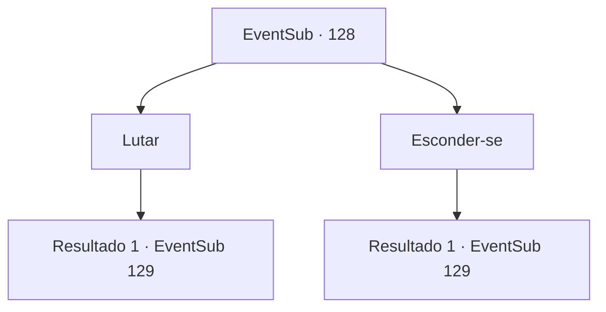

# Eventos secundários · 128

[Índice da tabela](index.md) · [Índice geral](../index.md)

ID: `pt:EventSub:128` · Fonte: `EventSub4` · Versão: 1.2.47.

Mapeamento estático dos arquivos; a disponibilidade e a execução dependem do estado da run.

## Texto do evento

O sol está se pondo e você sente um vento frio contra sua pele novamente. Você decide passar a noite no que parece ser uma cabana abandonada. De repente, você ouve o uivo dos lobos.

## Dados de entrada

```json
{
  "id": 128,
  "grade": 1,
  "subEvent": "",
  "required": "1_2_30|12_4_3"
}
```

## Mapa das escolhas



## Escolhas e resultados

### Escolha 1

Lutar

Requisitos e outros campos da escolha:

```json
{
  "required": ""
}
```

#### Resultado 1.1

Você sai da cabana para enfrentar os lobos. À medida que a porta range ao abrir, um lobo de inverno para de cheirar o chão para olhar para cima. Seus dentes brilham à luz da lua enquanto rosna.

Continuação registrada: [Evento 129](0129.md) na mesma tabela.

```json
{
  "required": "",
  "chance": "1",
  "nextEvent": 129,
  "type": 2,
  "reward": "6_0_88",
  "place": 14
}
```

### Escolha 2

Esconder-se

Requisitos e outros campos da escolha:

```json
{
  "required": ""
}
```

#### Resultado 2.1

Você prende a respiração e fica na cabana. Você espera que os lobos vão embora, mas eles não vão. Um dos lobos do inverno entra arrombando a porta da cabana. Seus dentes brilham à luz da lua enquanto ele rosna.

Continuação registrada: [Evento 129](0129.md) na mesma tabela.

```json
{
  "required": "",
  "chance": "1",
  "nextEvent": 129,
  "type": 2,
  "reward": "6_0_88",
  "place": 14
}
```

## Referências que chegam a este evento

Nenhum `nextEvent` positivo da mesma tabela aponta para este nó. Isso não prova que seja inacessível: sorteio e estado de história podem selecioná-lo.

