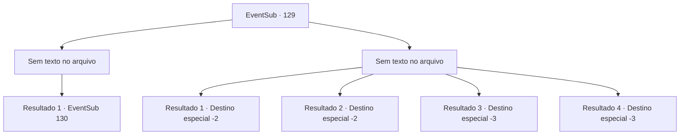

# Eventos secundários · 129

[Índice da tabela](index.md) · [Índice geral](../index.md)

ID: `pt:EventSub:129` · Fonte: `EventSub4` · Versão: 1.2.47.

Mapeamento estático dos arquivos; a disponibilidade e a execução dependem do estado da run.

## Texto do evento

*Sem texto no arquivo.*

## Dados de entrada

```json
{
  "id": 129,
  "grade": 1,
  "subEvent": "",
  "required": ""
}
```

## Mapa das escolhas



## Escolhas e resultados

### Escolha 1

*Sem texto no arquivo; o papel dessa opção depende da interface do jogo.*

Requisitos e outros campos da escolha:

```json
{
  "required": ""
}
```

#### Resultado 1.1

Ao terminar com o último lobo, uma figura esquelética e ofegante se aproxima de você. É um Lich com pele seca, cabelos brancos e olhos afundados que ardem em chamas azuis. 

 "Eu sou Tatia, a Rainha do Gelo. Você parece ser mais forte do que a maioria dos tolos que encontrei, e não gosto de lutas sem sentido. Então aqui está o acordo, mortal. Entregue-me a Flor do Gelo. Não tem muita utilidade para você de qualquer maneira. Eu lhe darei algo muito mais valioso em troca."


Continuação registrada: [Evento 130](0130.md) na mesma tabela.

```json
{
  "required": "",
  "chance": "1",
  "nextEvent": 130,
  "type": 2,
  "reward": ""
}
```

### Escolha 2

*Sem texto no arquivo; o papel dessa opção depende da interface do jogo.*

Requisitos e outros campos da escolha:

```json
{
  "required": ""
}
```

#### Resultado 2.1

Os lobos congelam você com sua respiração e você não consegue mais se mover. Uma figura esquelética e ofegante se aproxima de você. É um Lich com pele seca, cabelos brancos e olhos afundados que brilham azul com chamas. Ela coloca a mão na sua mochila e tira a Flor de Gelo. 

 "Ha...hahaha! Finalmente!"

 Ela explode em risadas enquanto desaparece na escuridão com seus lobos. Você espera até o amanhecer e se liberta do gelo quando ele começa a derreter.

Continuação registrada: [Destino especial `-2`](../destinos-especiais.md).

```json
{
  "required": "1_1_2|1_0_2|8_184_1",
  "chance": "1",
  "nextEvent": -2,
  "type": 2,
  "reward": "4_184_1|0_0_-1|0_1_-1|14_4_5|12_4_-1|0_2_1"
}
```

#### Resultado 2.2

Os lobos te congelam com sua respiração e você não consegue mais se mover. Uma figura esquelética e ofegante se aproxima de você. É um Lich com pele seca, cabelos brancos e olhos afundados que brilham azul com chamas. Ela procura em sua mochila, mas não consegue encontrar a Flor de Gelo. 

 "Maldição!"

 Furiosa, a Lich joga a bolsa no chão. Então ela vai embora com seus lobos.

Continuação registrada: [Destino especial `-2`](../destinos-especiais.md).

```json
{
  "required": "1_1_2|1_0_2|10_184_1",
  "chance": "1",
  "nextEvent": -2,
  "type": 2,
  "reward": "0_0_-1|0_1_-1|14_4_5|12_4_-1|0_2_1"
}
```

#### Resultado 2.3

Os lobos congelam você com sua respiração gelada.

Continuação registrada: [Destino especial `-3`](../destinos-especiais.md).

```json
{
  "required": "2_0_2",
  "chance": "1",
  "nextEvent": -3,
  "type": 2,
  "reward": "0_0_-1|0_1_-1"
}
```

#### Resultado 2.4

Os lobos congelam você com sua respiração gelada.

Continuação registrada: [Destino especial `-3`](../destinos-especiais.md).

```json
{
  "required": "2_1_2",
  "chance": "1",
  "nextEvent": -3,
  "type": 2,
  "reward": "0_0_-1|0_1_-1"
}
```

## Referências que chegam a este evento

- [Evento 128 · escolha 1 · resultado 1](0128.md#escolha-1)
- [Evento 128 · escolha 2 · resultado 1](0128.md#escolha-2)
