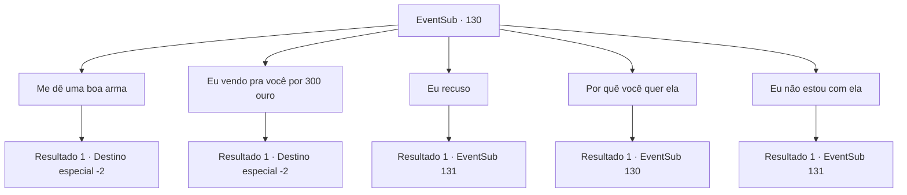

# Eventos secundários · 130

[Índice da tabela](index.md) · [Índice geral](../index.md)

ID: `pt:EventSub:130` · Fonte: `EventSub4` · Versão: 1.2.47.

Mapeamento estático dos arquivos; a disponibilidade e a execução dependem do estado da run.

## Texto do evento

*Sem texto no arquivo.*

## Dados de entrada

```json
{
  "id": 130,
  "grade": 1,
  "subEvent": "",
  "required": ""
}
```

## Mapa das escolhas



## Escolhas e resultados

### Escolha 1

Me dê uma boa arma

Requisitos e outros campos da escolha:

```json
{
  "required": "5_124_1|8_184_1"
}
```

#### Resultado 1.1

Você concorda em entregar a Frost Bloom em troca de uma boa arma. Tatia acena com a cabeça e estende a mão. Nela, uma lâmina brilha como um cristal sob a luz do sol. 

 "Aqui, pegue. Você deve se sentir honrado em ter isso, use com cuidado."

 Você pega a espada e entrega a Frost Bloom para ela. Ela a pega cuidadosamente em suas mãos. 

 "Até logo, mortal sensato."

 E com isso, a rainha desaparece na escuridão.

Continuação registrada: [Destino especial `-2`](../destinos-especiais.md).

```json
{
  "required": "",
  "chance": "1",
  "nextEvent": -2,
  "type": 2,
  "reward": "14_4_0|14_4_5|4_184_1|3_187_1|12_4_-1|0_2_3"
}
```

### Escolha 2

Eu vendo pra você por 300 ouro

Requisitos e outros campos da escolha:

```json
{
  "required": "5_124_1|8_184_1"
}
```

#### Resultado 2.1

Você vende a Frost Bloom por 300 ouro. Ela pega a flor cuidadosamente em suas mãos. 

 "Tchau, mortal sensato."

 E com isso, a rainha desaparece na escuridão.

Continuação registrada: [Destino especial `-2`](../destinos-especiais.md).

```json
{
  "required": "",
  "chance": "1",
  "nextEvent": -2,
  "type": 2,
  "reward": "14_4_0|14_4_5|4_184_1|0_4_300|12_4_-1|0_2_3"
}
```

### Escolha 3

Eu recuso

Requisitos e outros campos da escolha:

```json
{
  "required": "5_124_1|8_184_1"
}
```

#### Resultado 3.1

Você se recusa a entregar a Flor de Gelo. Tatia abaixa a mão. 

 "Então você escolheu a morte."


Continuação registrada: [Evento 131](0131.md) na mesma tabela.

```json
{
  "required": "",
  "chance": "1",
  "nextEvent": 131,
  "type": 2,
  "reward": "6_0_55",
  "place": 14
}
```

### Escolha 4

Por quê você quer ela

Requisitos e outros campos da escolha:

```json
{
  "required": "5_124_0"
}
```

#### Resultado 4.1

Você pergunta a Tatia por que ela quer tanto a Flor de Gelo. Ela te encara por um momento antes de explicar. 

 "Aos olhos não treinados, não passa de um simples enfeite bonito, mas a Flor de Gelo guarda a essência da força do inverno. Eu me tornei uma Lich para ter acesso a mais poder e conhecimento. A Flor de Gelo pode me transformar instantaneamente em uma Demilich."


Continuação registrada: [Evento 130](0130.md) na mesma tabela.

```json
{
  "required": "",
  "chance": "1",
  "nextEvent": 130,
  "type": 2,
  "reward": "5_124_1"
}
```

### Escolha 5

Eu não estou com ela

Requisitos e outros campos da escolha:

```json
{
  "required": "10_184_1"
}
```

#### Resultado 5.1

Tatia brilha mais intensamente e de forma mais ameaçadora do que antes. 

 "Então é assim que você quer jogar. Eu vou arrancar aquela flor de seus dedos frios e mortos!"

 Ela parece ter entendido você de forma equivocada.

Continuação registrada: [Evento 131](0131.md) na mesma tabela.

```json
{
  "required": "",
  "chance": "1",
  "nextEvent": 131,
  "type": 2,
  "reward": "6_0_55",
  "place": 14
}
```

## Referências que chegam a este evento

- [Evento 129 · escolha 1 · resultado 1](0129.md#escolha-1)
- [Evento 130 · escolha 4 · resultado 1](0130.md#escolha-4)
