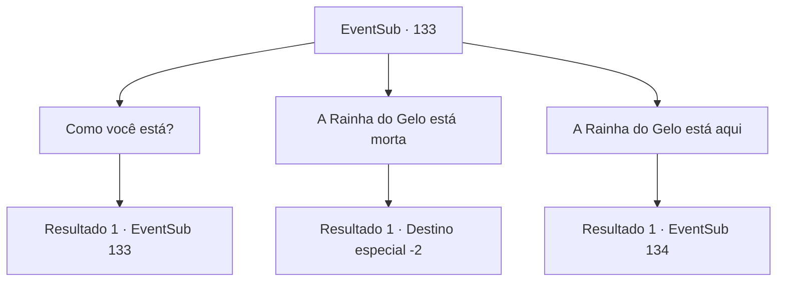

# Eventos secundários · 133

[Índice da tabela](index.md) · [Índice geral](../index.md)

ID: `pt:EventSub:133` · Fonte: `EventSub4` · Versão: 1.2.47.

Mapeamento estático dos arquivos; a disponibilidade e a execução dependem do estado da run.

## Texto do evento

Você passa por Nine Tails, a cidade de que Bruges estava falando. a cidade é cercada por um rio com nove riachos ramificados, o que o torna ideal para o cultivo de culturas comerciais. |drawing_farmingRefugees| Você percebe um grupo familiar de pessoas perto da periferia. É Bruges e seu povo. Eles reconhecem você e acenam. 

 "Bem-vindo, {1}! Ótimo ver você! Senhora Bruges!!"

 Um homem barbudo chama Bruges, e ela se aproxima. Ela parece ter comido bem, já que parece estar em muito melhor condição do que da última vez. 

 "{1}... Estamos esperando por você."

 Bruges te leva para a casa dela e te oferece chá.

## Dados de entrada

```json
{
  "id": 133,
  "grade": 1,
  "subEvent": "",
  "required": "12_4_6"
}
```

## Mapa das escolhas



## Escolhas e resultados

### Escolha 1

Como você está?

Requisitos e outros campos da escolha:

```json
{
  "required": "5_126_0"
}
```

#### Resultado 1.1

Bruges dá um gole de chá e responde. 

 "Nosso primo nos ajudou a alugar um pequeno pedaço de terra. Também estamos forjando armas e treinando duro. Todos nós estamos determinados a recuperar nossa terra. Até concordamos em contratar mercenários. Vamos ficar endividados, mas valerá a pena."


Continuação registrada: [Evento 133](0133.md) na mesma tabela.

```json
{
  "required": "",
  "chance": "1",
  "nextEvent": 133,
  "type": 2,
  "reward": "5_126_1|5_199_1"
}
```

### Escolha 2

A Rainha do Gelo está morta

Requisitos e outros campos da escolha:

```json
{
  "required": "5_126_1"
}
```

#### Resultado 2.1

Você conta a ela que matou a Rainha do Gelo. Bruges pisca, perplexa. 

 "Você... o quê? Você matou A Rainha do Gelo? Espere, isso significa..."

 Ela franze a testa e pensa por um momento antes de correr para fora. Momentos depois, ela retorna com as pessoas de Rixhelm. Eles estão em lágrimas enquanto te agradecem repetidamente. Juntos, eles te carregam para fora nos ombros e te jogam para o alto em comemoração. 

 "Nós vamos nos preparar para voltar para casa imediatamente. Mas antes disso, aqui está um pequeno presente pelo seu serviço. Por favor, aceite."

 Debaixo das embalagens, você encontra um machado com um emblema único esculpido em sua superfície, juntamente com um chifre de marfim. O mensageiro te agradece mais uma vez em nome de Bruges e parte. 

 "Que seu caminho seja tão agradável quanto a primavera!"

 Uma brisa quente acaricia seu rosto enquanto eles partem.

Continuação registrada: [Destino especial `-2`](../destinos-especiais.md).

```json
{
  "required": "",
  "chance": "1",
  "nextEvent": -2,
  "type": 2,
  "reward": "12_4_-1|14_4_7|3_186_1|3_182_1|0_2_3|5_199_1"
}
```

### Escolha 3

A Rainha do Gelo está aqui

Requisitos e outros campos da escolha:

```json
{
  "required": "8_188_1|5_126_1"
}
```

#### Resultado 3.1

Você tira o urso de pelúcia em que você selou a rainha. Ele se inclina na mesa enquanto você o coloca. Bruges pisca, perplexa. 

 "Então a Rainha do Gelo... está nessa boneca...?"

 O urso cruza os braços e responde. 

 "Hrmph! Riam o quanto quiserem, mortais. Um dia eu vou rasgar..."

 Seu discurso ameaçador é interrompido quando a filha de Bruges, Delin, começa a abraçar e balançar a boneca. 

 "Agora a Merry pode falar!"

 Ela pula para cima e para baixo antes de colocá-la silenciosamente de volta ao ver o olhar severo em seu rosto. Então ela pergunta cuidadosamente, 

 "Posso, por favor... ficar com ela?"


Continuação registrada: [Evento 134](0134.md) na mesma tabela.

```json
{
  "required": "",
  "chance": "1",
  "nextEvent": 134,
  "type": 2,
  "reward": "5_199_1"
}
```

## Referências que chegam a este evento

- [Evento 133 · escolha 1 · resultado 1](0133.md#escolha-1)
