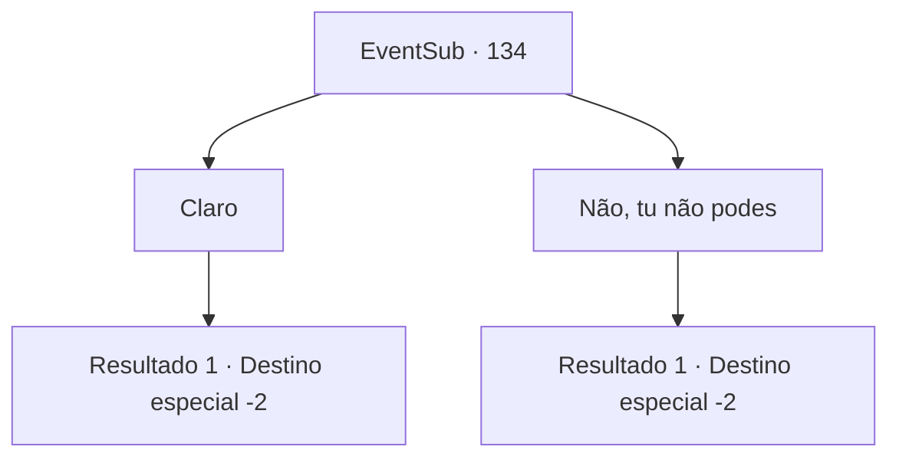

# Eventos secundários · 134

[Índice da tabela](index.md) · [Índice geral](../index.md)

ID: `pt:EventSub:134` · Fonte: `EventSub4` · Versão: 1.2.47.

Mapeamento estático dos arquivos; a disponibilidade e a execução dependem do estado da run.

## Texto do evento

*Sem texto no arquivo.*

## Dados de entrada

```json
{
  "id": 134,
  "grade": 1,
  "subEvent": "",
  "required": ""
}
```

## Mapa das escolhas



## Escolhas e resultados

### Escolha 1

Claro

Requisitos e outros campos da escolha:

```json
{
  "required": "8_188_1"
}
```

#### Resultado 1.1

Você entrega o urso de pelúcia falante de volta para Delin. Ela sorri enquanto o leva de volta para o quarto dela. Bruges sorri enquanto sua filha pula para longe. 

 "Esperem... Eu preciso compartilhar essa notícia com os outros."

 Ela se levanta e sai. Momentos depois, ela retorna para você com as pessoas de Rixhelm. Eles estão em lágrimas enquanto te agradecem repetidamente. Juntos, eles te carregam para fora nos ombros e te jogam para o alto em celebração. 

 "Nós iremos nos preparar para voltar para casa imediatamente. Mas antes disso, aqui está um pequeno presente pelo seu serviço. Por favor, aceite."

 Debaixo das embalagens, você encontra um machado com um emblema único esculpido em sua superfície, junto com um chifre de marfim. O mensageiro te agradece mais uma vez em nome de Bruges e sai. 

 "Que seu caminho seja tão agradável quanto a primavera!"

 Uma brisa quente acaricia seu rosto enquanto eles partem.

Continuação registrada: [Destino especial `-2`](../destinos-especiais.md).

```json
{
  "required": "",
  "chance": "1",
  "nextEvent": -2,
  "type": 2,
  "reward": "12_4_-1|14_4_4|4_188_1|14_4_7|3_186_1|3_182_1|0_2_3"
}
```

### Escolha 2

Não, tu não podes

Requisitos e outros campos da escolha:

```json
{
  "required": ""
}
```

#### Resultado 2.1

Você se recusa a dar o urso de pelúcia para Delin. Ela parece extremamente decepcionada, embora tente não mostrar. Bruges interrompe. 

 "Aguarde... Preciso compartilhar essa notícia com os outros."

 Ela se levanta e sai. Momentos depois, ela retorna com as pessoas de Rixhelm. Eles estão em lágrimas enquanto agradecem repetidamente. Juntos, eles te carregam para fora nos ombros e te jogam para o alto em comemoração. 

 "Nós iremos nos preparar para voltar para casa imediatamente. Mas antes disso, aqui está um pequeno presente pelo seu serviço. Por favor, aceite."

 Debaixo das embalagens, você encontra um machado com um emblema único esculpido em sua superfície, juntamente com um chifre de marfim. O mensageiro agradece novamente em nome de Bruges e sai. 

 "Que seu caminho seja tão agradável quanto a primavera!"

 Uma brisa quente acaricia seu rosto enquanto eles partem.

Continuação registrada: [Destino especial `-2`](../destinos-especiais.md).

```json
{
  "required": "",
  "chance": "1",
  "nextEvent": -2,
  "type": 2,
  "reward": "12_4_-1|14_4_6|14_4_7|3_186_1|3_182_1|0_2_3"
}
```

## Referências que chegam a este evento

- [Evento 133 · escolha 3 · resultado 1](0133.md#escolha-3)
