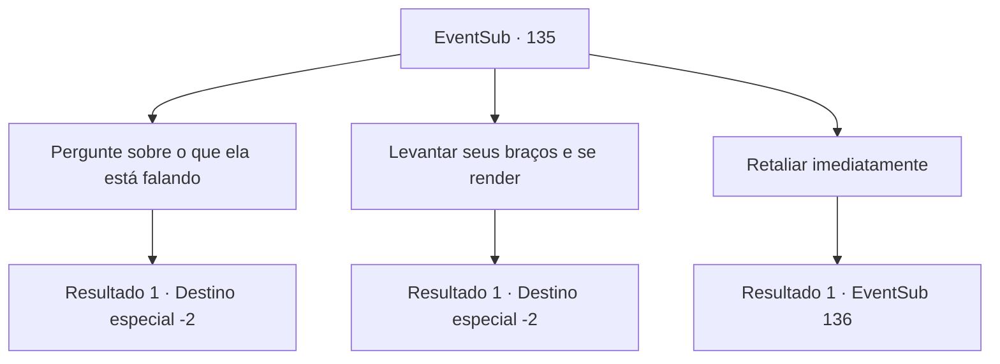

# Eventos secundários · 135

[Índice da tabela](index.md) · [Índice geral](../index.md)

ID: `pt:EventSub:135` · Fonte: `EventSub4` · Versão: 1.2.47.

Mapeamento estático dos arquivos; a disponibilidade e a execução dependem do estado da run.

## Texto do evento

Enquanto você está andando por uma selva densa, você descobre uma pequena cabana, envolta em grama e árvores cobertas de vegetação.
 Você se aproxima lentamente da cabana, esperando um momento de descanso do ar quente e úmido e do ataque dos insetos.
 *silvo* *CRACK!* 
 Nesse momento, uma adaga vem voando com um som penetrante, pousando bem ao lado de seus pés. Você dá um passo para trás e vira o olhar para onde a adaga veio, encontrando uma mulher encapuzada olhando de soslaio para você. 

 "Eu suponho que você esteja aqui pela recompensa, mas não tenho intenção de ser pego tão facilmente!"

 A cor dos olhos dela é diferente, embora não haja diferença no fato de que ambos estão olhando furiosamente para você.

## Dados de entrada

```json
{
  "id": 135,
  "grade": 1,
  "subEvent": "",
  "required": "12_5_0"
}
```

## Mapa das escolhas



## Escolhas e resultados

### Escolha 1

Pergunte sobre o que ela está falando

Requisitos e outros campos da escolha:

```json
{
  "required": ""
}
```

#### Resultado 1.1

Quando você pergunta a ela do que diabos ela está falando, ela faz uma expressão confusa. 

 "..Você não está aqui pela minha recompensa?"

 Você diz a ela que está apenas tentando passar pela floresta, procurando um lugar para descansar. Ela pensa por um segundo e se desculpa com você, balançando a cabeça. 

 "Desculpe. Eu tenho muitos inimigos. Não posso deixar você descansar aqui, mas posso te dizer o caminho para sair. Vá por ali e você conseguirá sair desta selva."

 Com a ajuda da mulher, você logo sai da selva. Do lado de fora, o vento fresco te recebe e seca seu suor.

Continuação registrada: [Destino especial `-2`](../destinos-especiais.md).

```json
{
  "required": "",
  "chance": "1",
  "nextEvent": -2,
  "type": 2,
  "reward": "12_5_1"
}
```

### Escolha 2

Levantar seus braços e se render

Requisitos e outros campos da escolha:

```json
{
  "required": ""
}
```

#### Resultado 2.1

Enquanto você levanta os braços no ar e faz um gesto de rendição, ela fala, sorrindo. 

 "Pelo menos você valoriza sua vida? Desapareça. E nunca mais volte."

 Ela anuncia, apontando a adaga para você. Você foge rapidamente, antes que ela mude de ideia.

Continuação registrada: [Destino especial `-2`](../destinos-especiais.md).

```json
{
  "required": "",
  "chance": "1",
  "nextEvent": -2,
  "type": 2,
  "reward": "12_5_1"
}
```

### Escolha 3

Retaliar imediatamente

Requisitos e outros campos da escolha:

```json
{
  "required": ""
}
```

#### Resultado 3.1

Você puxa sua arma e avança em direção a ela. Ela puxa sua adaga em resposta, como se estivesse esperando sua reação. 

 "Vamos ver do que você é feito, então!"


Continuação registrada: [Evento 136](0136.md) na mesma tabela.

```json
{
  "required": "",
  "chance": "1",
  "nextEvent": 136,
  "type": 2,
  "reward": "6_0_101",
  "place": 1
}
```

## Referências que chegam a este evento

Nenhum `nextEvent` positivo da mesma tabela aponta para este nó. Isso não prova que seja inacessível: sorteio e estado de história podem selecioná-lo.

