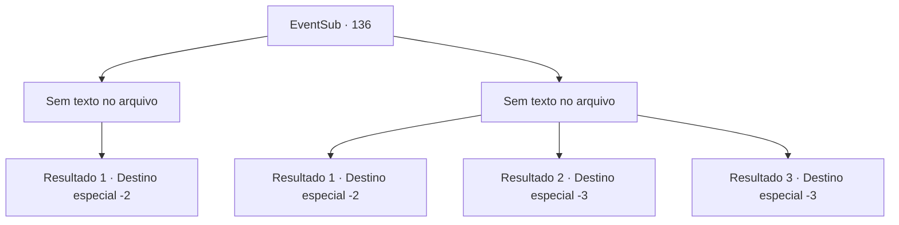

# Eventos secundários · 136

[Índice da tabela](index.md) · [Índice geral](../index.md)

ID: `pt:EventSub:136` · Fonte: `EventSub4` · Versão: 1.2.47.

Mapeamento estático dos arquivos; a disponibilidade e a execução dependem do estado da run.

## Texto do evento

*Sem texto no arquivo.*

## Dados de entrada

```json
{
  "id": 136,
  "grade": 1,
  "subEvent": "",
  "required": ""
}
```

## Mapa das escolhas



## Escolhas e resultados

### Escolha 1

*Sem texto no arquivo; o papel dessa opção depende da interface do jogo.*

Requisitos e outros campos da escolha:

```json
{
  "required": ""
}
```

#### Resultado 1.1

Incapaz de resistir ao seu ataque contínuo, ela foge, deixando a cabana para trás. Você tenta ir atrás dela, mas ela desaparece, com movimentos rápidos comparáveis aos de um esquilo. Eventualmente, você acaba esquecendo de persegui-la, deixando a selva após um breve descanso na cabana.

Continuação registrada: [Destino especial `-2`](../destinos-especiais.md).

```json
{
  "required": "",
  "chance": "1",
  "nextEvent": -2,
  "type": 2,
  "reward": "12_5_1"
}
```

### Escolha 2

*Sem texto no arquivo; o papel dessa opção depende da interface do jogo.*

Requisitos e outros campos da escolha:

```json
{
  "required": ""
}
```

#### Resultado 2.1

Sua habilidade em combate é impressionante. Sentindo que você não é páreo para ela, você se vira e foge. Ela joga algumas adagas em você, mas erra, e não te persegue mais enquanto você se afasta da cabana.

Continuação registrada: [Destino especial `-2`](../destinos-especiais.md).

```json
{
  "required": "1_0_2|1_1_2",
  "chance": "1",
  "nextEvent": -2,
  "type": 2,
  "reward": "12_5_1|0_0_-1|0_1_-1"
}
```

#### Resultado 2.2

As suas adagas perfuram a sua armadura. Você cai ao chão com uma picada aguda, sentindo a sua consciência desvanecer-se.

Continuação registrada: [Destino especial `-3`](../destinos-especiais.md).

```json
{
  "required": "2_0_2",
  "chance": "1",
  "nextEvent": -3,
  "type": 2,
  "reward": "0_0_-1|0_1_-1"
}
```

#### Resultado 2.3

As suas adagas perfuram a sua armadura. Você cai ao chão com uma picada aguda, sentindo a sua consciência desvanecer.

Continuação registrada: [Destino especial `-3`](../destinos-especiais.md).

```json
{
  "required": "2_1_2",
  "chance": "1",
  "nextEvent": -3,
  "type": 2,
  "reward": "0_0_-1|0_1_-1"
}
```

## Referências que chegam a este evento

- [Evento 135 · escolha 3 · resultado 1](0135.md#escolha-3)
