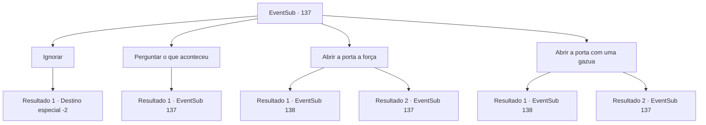

# Eventos secundários · 137

[Índice da tabela](index.md) · [Índice geral](../index.md)

ID: `pt:EventSub:137` · Fonte: `EventSub4` · Versão: 1.2.47.

Mapeamento estático dos arquivos; a disponibilidade e a execução dependem do estado da run.

## Texto do evento

Você encontra uma diligência. |drawing_jailWagon| A diligência está equipada com uma cela de prisão, na qual está a mulher que você viu da última vez na cabana. Suas mãos e pés estão firmemente algemados em correntes de aço, e os hematomas em seu rosto mostram claramente que ela foi espancada. Outra diferença distinta da última vez é que, sem o capuz, agora você pode ver um chifre na cabeça. Com o chifre crescendo de sua testa e os dois olhos com cores diferentes, sua aparência lembra um demônio. Ela reconhece você, enquanto seus olhos se arregalam.

## Dados de entrada

```json
{
  "id": 137,
  "grade": 1,
  "subEvent": "",
  "required": "12_5_1|1_2_15"
}
```

## Mapa das escolhas



## Escolhas e resultados

### Escolha 1

Ignorar

Requisitos e outros campos da escolha:

```json
{
  "required": ""
}
```

#### Resultado 1.1

Você deixa a mulher enjaulada para trás. Ela tenta falar com você algumas vezes, mas logo desiste.

Continuação registrada: [Destino especial `-2`](../destinos-especiais.md).

```json
{
  "required": "",
  "chance": "1",
  "nextEvent": -2,
  "type": 2,
  "reward": "12_5_5"
}
```

### Escolha 2

Perguntar o que aconteceu

Requisitos e outros campos da escolha:

```json
{
  "required": "5_181_0"
}
```

#### Resultado 2.1

Você pergunta a ela o que aconteceu. Ela sorri brincando, balançando as correntes em seus pulsos. 

 "Por que perguntar? Finalmente fui pega pelos caçadores de recompensas daquela maldita cabana. Ugh... Eu deveria ter fugido mais cedo."

 Ela solta um suspiro profundo, murmurando para si mesma, mostrando sinais de arrependimento. Ela continua, apalpando seu pequeno chifre na testa. 

 "Como você pode ver, eu meio que pareço um demônio? Então eu arrumo brigas aqui e ali, o que colocou uma recompensa em minha cabeça... *suspiro*, não faço ideia por que estou te contando isso agora."

 Ela se encolhe em uma posição fetal, cobrindo os joelhos com os braços. Ao contrário da última vez, quando ela lutou com todas as suas forças, desta vez ela parece ter perdido a esperança.

Continuação registrada: [Evento 137](0137.md) na mesma tabela.

```json
{
  "required": "",
  "chance": "1",
  "nextEvent": 137,
  "type": 2,
  "reward": "5_181_1"
}
```

### Escolha 3

Abrir a porta a força

Requisitos e outros campos da escolha:

```json
{
  "required": "5_181_1"
}
```

#### Resultado 3.1

Você decide arrombar a porta com sua força. Enquanto o som metálico estridente ecoa, ela olha para você com olhos surpresos e fala. 

 "O quê...? Se essa porta pudesse ser aberta com força, eu teria escapado mais cedo! Os caçadores vão voltar a qualquer momento! Pare de perder seu tempo e..."

 Você a ignora e aplica força à porta. Embora tenha sido um processo difícil, a porta finalmente cede à sua força. Ela pisca, perplexa, e pergunta. 

 "Você... é um urso ou algo assim? Obrigada por se livrar da porta, mas enquanto eu estiver acorrentada, não irei longe antes de ser pega novamente."

 Ela balança as correntes em suas mãos e pés, e suspira.

Continuação registrada: [Evento 138](0138.md) na mesma tabela.

```json
{
  "required": "",
  "chance": "1|0_5_1",
  "nextEvent": 138,
  "type": 0,
  "reward": ""
}
```

#### Resultado 3.2

Tentas abrir a porta da jaula com a tua força, mas apenas faz um som metálico. Ela olha para ti com um olhar patético nos olhos e diz. 

 "Eu teria escapado mais cedo se abrisse assim."


Continuação registrada: [Evento 137](0137.md) na mesma tabela.

```json
{
  "required": "",
  "chance": "18",
  "nextEvent": 137,
  "type": 1,
  "reward": "5_181_2"
}
```

### Escolha 4

Abrir a porta com uma gazua

Requisitos e outros campos da escolha:

```json
{
  "required": "5_181_1|8_41_1"
}
```

#### Resultado 4.1

Você usa uma chave de fenda para abrir a porta da gaiola. 

 "Veja o que você pode fazer. Você pode me desacorrentar também?"

 Ela fala, sacudindo as correntes em suas mãos e pés.

Continuação registrada: [Evento 138](0138.md) na mesma tabela.

```json
{
  "required": "",
  "chance": "1|0_6_1",
  "nextEvent": 138,
  "type": 0,
  "reward": ""
}
```

#### Resultado 4.2

Você coloca o pé de cabra na fechadura e o sacode, mas a porta da gaiola não se move. Ela te encara com um olhar patético nos olhos e diz: 

 "Boa tentativa."


Continuação registrada: [Evento 137](0137.md) na mesma tabela.

```json
{
  "required": "",
  "chance": "10",
  "nextEvent": 137,
  "type": 1,
  "reward": "5_181_2"
}
```

## Referências que chegam a este evento

- [Evento 137 · escolha 2 · resultado 1](0137.md#escolha-2)
- [Evento 137 · escolha 3 · resultado 2](0137.md#escolha-3)
- [Evento 137 · escolha 4 · resultado 2](0137.md#escolha-4)
