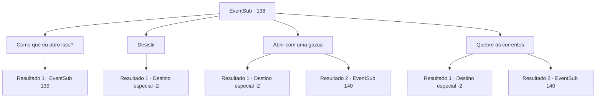

# Eventos secundários · 138

[Índice da tabela](index.md) · [Índice geral](../index.md)

ID: `pt:EventSub:138` · Fonte: `EventSub4` · Versão: 1.2.47.

Mapeamento estático dos arquivos; a disponibilidade e a execução dependem do estado da run.

## Texto do evento

*Sem texto no arquivo.*

## Dados de entrada

```json
{
  "id": 138,
  "grade": 1,
  "subEvent": "",
  "required": ""
}
```

## Mapa das escolhas



## Escolhas e resultados

### Escolha 1

Como que eu abro isso?

Requisitos e outros campos da escolha:

```json
{
  "required": ""
}
```

#### Resultado 1.1

Em resposta à sua pergunta, ela morde os lábios e diz cuidadosamente. 

 "Os caçadores de recompensas que me prenderam nesta jaula voltarão em breve. Se eu conseguir colocar as mãos na bolsa de chaves deles..."

 Logo em seguida, você ouve as vozes tagarelas dos caçadores de recompensas se aproximando. Ela olha para você com um olhar preocupado e fala. 

 "Está tudo bem. Você fez o suficiente, agora fuja."


Continuação registrada: [Evento 139](0139.md) na mesma tabela.

```json
{
  "required": "",
  "chance": "1",
  "nextEvent": 139,
  "type": 2,
  "reward": ""
}
```

### Escolha 2

Desistir

Requisitos e outros campos da escolha:

```json
{
  "required": ""
}
```

#### Resultado 2.1

Você desiste de libertá-la, deixando-a. Ela senta na gaiola e encara suas costas, como se já esperasse por isso.

Continuação registrada: [Destino especial `-2`](../destinos-especiais.md).

```json
{
  "required": "",
  "chance": "1",
  "nextEvent": -2,
  "type": 2,
  "reward": "12_5_5"
}
```

### Escolha 3

Abrir com uma gazua

Requisitos e outros campos da escolha:

```json
{
  "required": "8_41_1"
}
```

#### Resultado 3.1

Você a liberta de suas correntes com o pé de cabra. Tendo cumprido seu propósito, o pé de cabra quebra. A mulher, agora livre novamente, olha vazia para você por um tempo. Ela então fala com você, sentindo seus pulsos, agora leves. 

 "Devemos correr por enquanto. Não sabemos quando os caçadores voltarão."

 Depois de correr por um tempo, você e a mulher se escondem em um arbusto próximo. Ela recupera o fôlego e fala novamente. 

 "Uau... a propósito, ainda não sabemos o nome um do outro. Eu sou Cira. Uma mulher procurada e bonita com um chifre diabólico na cabeça, como você pode ver."

 Cira se apresenta com um sorriso travesso, e você diz a ela seu nome. Depois de trocar nomes, ela vai embora, com a promessa de que retribuirá o favor em breve.

Continuação registrada: [Destino especial `-2`](../destinos-especiais.md).

```json
{
  "required": "",
  "chance": "1|0_6_1",
  "nextEvent": -2,
  "type": 0,
  "reward": "12_5_2|4_41_1"
}
```

#### Resultado 3.2

Você tenta abrir as correntes com um pé de cabra. Mas as correntes são ainda mais difíceis de destrancar do que você esperava, e você ouve alguém gritando atrás de você. 

 "Você aí! O que você pensa que está fazendo!!"

 Quando você olha para trás, caçadores de recompensas estão correndo em sua direção com armas em punho.

Continuação registrada: [Evento 140](0140.md) na mesma tabela.

```json
{
  "required": "",
  "chance": "13",
  "nextEvent": 140,
  "type": 1,
  "reward": "6_3_25",
  "place": 1
}
```

### Escolha 4

Quebre as correntes

Requisitos e outros campos da escolha:

```json
{
  "required": ""
}
```

#### Resultado 4.1

Você agarra as correntes nela e despeja todo o seu poder. As veias em seus braços e mãos se destacam como se fossem explodir, e logo as correntes se quebram em pedaços. 

 "Huh... impossível.."

 A mulher, agora livre novamente, olha vazia para você por um tempo. Ela então fala com você, sentindo seus pulsos, agora leves. 

 "Devemos correr por enquanto. Não sabemos quando os caçadores voltarão."

 Depois de correr por um tempo, você e a mulher se escondem em um arbusto próximo. Ela recupera o fôlego e fala novamente. 

 "Ufa.. a propósito, ainda não sabemos o nome um do outro. Eu sou Cira. Uma mulher procurada e bonita com um chifre diabólico na cabeça, como você pode ver."

 Cira se apresenta com um sorriso travesso, e você diz a ela seu nome. Depois de trocar nomes, ela vai embora, com a promessa de que retribuirá o favor em breve.

Continuação registrada: [Destino especial `-2`](../destinos-especiais.md).

```json
{
  "required": "",
  "chance": "1|0_5_1",
  "nextEvent": -2,
  "type": 0,
  "reward": "12_5_2"
}
```

#### Resultado 4.2

Você agarra as correntes nela e despeja todo o seu poder. As veias em seus braços e mãos se destacam como se fossem explodir, mas não é o suficiente para quebrar as correntes. Então, você ouve alguém gritando atrás de você. 

 "Você aí! O que você pensa que está fazendo!!"

 Quando você olha para trás, caçadores de recompensas estão correndo em sua direção com armas em punho.

Continuação registrada: [Evento 140](0140.md) na mesma tabela.

```json
{
  "required": "",
  "chance": "18",
  "nextEvent": 140,
  "type": 1,
  "reward": "6_3_25",
  "place": 1
}
```

## Referências que chegam a este evento

- [Evento 137 · escolha 3 · resultado 1](0137.md#escolha-3)
- [Evento 137 · escolha 4 · resultado 1](0137.md#escolha-4)
