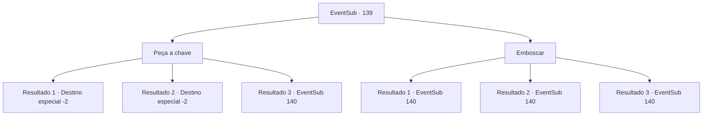

# Eventos secundários · 139

[Índice da tabela](index.md) · [Índice geral](../index.md)

ID: `pt:EventSub:139` · Fonte: `EventSub4` · Versão: 1.2.47.

Mapeamento estático dos arquivos; a disponibilidade e a execução dependem do estado da run.

## Texto do evento

*Sem texto no arquivo.*

## Dados de entrada

```json
{
  "id": 139,
  "grade": 1,
  "subEvent": "",
  "required": ""
}
```

## Mapa das escolhas



## Escolhas e resultados

### Escolha 1

Peça a chave

Requisitos e outros campos da escolha:

```json
{
  "required": ""
}
```

#### Resultado 1.1

Você fica parado em frente à jaula, esperando os caçadores de recompensas voltarem. E quando eles te descobrem e se aproximam, você casualmente pede a eles a bolsa de chaves, como um agiota aqui para cobrar sua dívida. Eles te olham com uma expressão confusa e falam. 

 "Hum... e você é...?"

 Quando você faz um som intimidador com os lábios, um dos caçadores se curva, te entregando a chave. 

 "Ahaha... você deve ser aquele do culto, certo? Você poderia ter nos contatado com sua chegada mais cedo.."

 Você pega a chave e desacorrenta a mulher. Ela te encara perplexa, tocando seus pulsos. Você se despede dos caçadores e sai confiantemente, junto com a mulher. Depois de caminhar o suficiente para que os caçadores não possam ser vistos, a mulher fala. 

 "Obrigada por me libertar novamente. Aliás, nem sabemos o nome um do outro. Eu sou Cira. Uma mulher procurada e bonita com um chifre diabólico na cabeça, como você pode ver."

 Cira se apresenta com um sorriso travesso, e você conta seu nome para ela. Após trocarem nomes, ela vai embora, prometendo que retribuirá o favor em breve.

Continuação registrada: [Destino especial `-2`](../destinos-especiais.md).

```json
{
  "required": "21_4_2",
  "chance": "1|0_12_1",
  "nextEvent": -2,
  "type": 0,
  "reward": "12_5_2"
}
```

#### Resultado 1.2

Você fica parado em frente à jaula, esperando os caçadores de recompensas voltarem. E quando eles te descobrem e se aproximam, você casualmente pede a eles a bolsa de chaves, como um agiota aqui para cobrar sua dívida. Eles te olham com uma expressão confusa e falam. 

 "Hum... e você é...?"

 Quando você faz um som intimidador com os lábios, um dos caçadores se curva, te entregando a chave. 

 "Ahaha... você deve ser aquele do culto, certo? Você poderia ter nos contatado com sua chegada mais cedo.."

 Você pega a chave e desacorrenta a mulher. Ela te encara perplexa, tocando seus pulsos. Você se despede dos caçadores e sai confiantemente, junto com a mulher. Depois de caminhar o suficiente para que os caçadores não possam ser vistos, a mulher fala. 

 "Obrigada por me libertar novamente. Aliás, nem sabemos o nome um do outro. Eu sou Cira. Uma mulher procurada e bonita com um chifre diabólico na cabeça, como você pode ver."

 Cira se apresenta com um sorriso travesso, e você conta seu nome para ela. Após trocarem nomes, ela vai embora, prometendo que retribuirá o favor em breve.

Continuação registrada: [Destino especial `-2`](../destinos-especiais.md).

```json
{
  "required": "20_4_2",
  "chance": "1|0_12_2",
  "nextEvent": -2,
  "type": 0,
  "reward": "12_5_2"
}
```

#### Resultado 1.3

Você fica parado em frente à jaula, esperando os caçadores de recompensas voltarem. E quando eles te descobrem e se aproximam, você casualmente pede a eles a bolsa de chaves, como um agiota aqui para cobrar sua dívida. Eles te olham com uma expressão confusa e falam. 

 "Quem é esse louco desgraçado?!"

 Então eles avançam em sua direção com suas espadas.

Continuação registrada: [Evento 140](0140.md) na mesma tabela.

```json
{
  "required": "",
  "chance": "20",
  "nextEvent": 140,
  "type": 1,
  "reward": "6_3_25",
  "place": 1
}
```

### Escolha 2

Emboscar

Requisitos e outros campos da escolha:

```json
{
  "required": ""
}
```

#### Resultado 2.1

Você se esconde dentro da diligência. Alguns momentos depois, os caçadores de recompensas voltam, descobrindo que a porta da jaula está aberta. 

 "O quê! Sua vadia maldita..! Não ouse nem pensar em fugir!"

 Um dos caçadores agarra o cabelo da mulher. Você se aproxima rapidamente dele e acerta seu pescoço. O caçador desmaia como uma marionete com a corda cortada. 

 "Quem está aí!!"

 O outro caçador saca sua arma, gritando.

Continuação registrada: [Evento 140](0140.md) na mesma tabela.

```json
{
  "required": "21_5_2",
  "chance": "1|0_6_1",
  "nextEvent": 140,
  "type": 0,
  "reward": "6_2_25",
  "place": 1
}
```

#### Resultado 2.2

Você se esconde dentro da diligência. Alguns momentos depois, os caçadores de recompensas voltam, descobrindo que a porta da jaula está aberta. 

 "O quê! Sua vadia maldita..! Não ouse nem pensar em fugir!"

 Um dos caçadores agarra o cabelo da mulher. Você se aproxima rapidamente dele e acerta seu pescoço. O caçador desmaia como uma marionete com a corda cortada. 

 "Quem está aí!!"

 O outro caçador saca sua arma, gritando.

Continuação registrada: [Evento 140](0140.md) na mesma tabela.

```json
{
  "required": "20_5_2",
  "chance": "1|0_6_2",
  "nextEvent": 140,
  "type": 0,
  "reward": "6_2_25",
  "place": 1
}
```

#### Resultado 2.3

Você se esconde dentro da diligência. Alguns momentos depois, os caçadores de recompensas voltam, descobrindo que a porta da jaula está aberta. 

 "O quê! Sua vadia maldita...! Nem mesmo... quem diabos é você!"

 Um dos caçadores te encontra, e seu plano de emboscada vai por água abaixo. Os caçadores avançam em sua direção, com claras intenções de te matar.

Continuação registrada: [Evento 140](0140.md) na mesma tabela.

```json
{
  "required": "",
  "chance": "18",
  "nextEvent": 140,
  "type": 1,
  "reward": "6_3_25",
  "place": 1
}
```

## Referências que chegam a este evento

- [Evento 138 · escolha 1 · resultado 1](0138.md#escolha-1)
