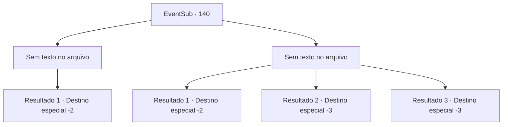

# Eventos secundários · 140

[Índice da tabela](index.md) · [Índice geral](../index.md)

ID: `pt:EventSub:140` · Fonte: `EventSub4` · Versão: 1.2.47.

Mapeamento estático dos arquivos; a disponibilidade e a execução dependem do estado da run.

## Texto do evento

*Sem texto no arquivo.*

## Dados de entrada

```json
{
  "id": 140,
  "grade": 1,
  "subEvent": "",
  "required": ""
}
```

## Mapa das escolhas



## Escolhas e resultados

### Escolha 1

*Sem texto no arquivo; o papel dessa opção depende da interface do jogo.*

Requisitos e outros campos da escolha:

```json
{
  "required": ""
}
```

#### Resultado 1.1

Você derrota todos os caçadores de recompensas e liberta a mulher com a chave deles. A mulher, agora livre novamente, olha vazia para você por um tempo. Ela então fala com você, sentindo seus pulsos, agora leves. 

 "... A propósito, nem mesmo me apresentei. Eu sou Cira. Uma mulher bonita procurada com um chifre diabólico na cabeça, como você pode ver."

 Você faz o mesmo, contando a ela sobre os motivos de sua aventura. Ela acena com a cabeça e olha silenciosamente para você por um longo tempo, tentando lembrar do seu rosto. Depois disso, ela chuta o rosto de um dos caçadores de recompensas e sai da área, rindo infantilmente. 

 "Eu farei questão de retribuir um dia. Estou quebrada pra caramba agora. Até logo."

 Você também logo deixa a área, depois de vê-la ir embora.

Continuação registrada: [Destino especial `-2`](../destinos-especiais.md).

```json
{
  "required": "",
  "chance": "1",
  "nextEvent": -2,
  "type": 2,
  "reward": "12_5_2"
}
```

### Escolha 2

*Sem texto no arquivo; o papel dessa opção depende da interface do jogo.*

Requisitos e outros campos da escolha:

```json
{
  "required": ""
}
```

#### Resultado 2.1

Você luta valentemente contra os caçadores de recompensas, mas você perde. O melhor que você pode fazer é poupar sua vida e fugir. Você tenta ignorar a sensação do olhar triste da mulher em suas costas.

Continuação registrada: [Destino especial `-2`](../destinos-especiais.md).

```json
{
  "required": "1_0_2|1_1_2",
  "chance": "1",
  "nextEvent": -2,
  "type": 2,
  "reward": "12_5_5|0_0_-1|0_1_-1"
}
```

#### Resultado 2.2

Você luta valentemente contra os caçadores de recompensas, mas perde. Você encontra o seu fim, ouvindo o grito de uma mulher que nem mesmo conhece o nome.

Continuação registrada: [Destino especial `-3`](../destinos-especiais.md).

```json
{
  "required": "2_0_2",
  "chance": "1",
  "nextEvent": -3,
  "type": 2,
  "reward": "0_0_-1|0_1_-1"
}
```

#### Resultado 2.3

Você luta valentemente contra os caçadores de recompensas, mas perde. Você encontra o seu fim, ouvindo o grito de uma mulher cujo nome nem sequer conhece.

Continuação registrada: [Destino especial `-3`](../destinos-especiais.md).

```json
{
  "required": "2_1_2",
  "chance": "1",
  "nextEvent": -3,
  "type": 2,
  "reward": "0_0_-1|0_1_-1"
}
```

## Referências que chegam a este evento

- [Evento 138 · escolha 3 · resultado 2](0138.md#escolha-3)
- [Evento 138 · escolha 4 · resultado 2](0138.md#escolha-4)
- [Evento 139 · escolha 1 · resultado 3](0139.md#escolha-1)
- [Evento 139 · escolha 2 · resultado 1](0139.md#escolha-2)
- [Evento 139 · escolha 2 · resultado 2](0139.md#escolha-2)
- [Evento 139 · escolha 2 · resultado 3](0139.md#escolha-2)
