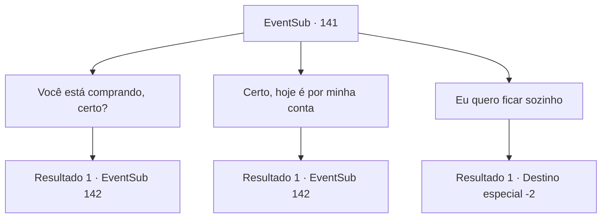

# Eventos secundários · 141

[Índice da tabela](index.md) · [Índice geral](../index.md)

ID: `pt:EventSub:141` · Fonte: `EventSub4` · Versão: 1.2.47.

Mapeamento estático dos arquivos; a disponibilidade e a execução dependem do estado da run.

## Texto do evento

Você visita a cidade chamada 'Chrysalide'. Crisálida significa basicamente um casulo, e diz-se que a cidade é chamada assim por causa das estruturas semelhantes a casulos ao longo das paredes do castelo. Alguém toca em seu ombro. Quando você olha para trás, vê uma pequena figura encapuzada e ouve uma pequena risada. 

 "Sou eu, Cira. Quer tomar uma bebida?"

 Cira está cobrindo o chifre na testa com um grande capuz e, como se isso não bastasse, uma bandana.

## Dados de entrada

```json
{
  "id": 141,
  "grade": 1,
  "subEvent": "",
  "required": "12_5_2|1_2_30"
}
```

## Mapa das escolhas



## Escolhas e resultados

### Escolha 1

Você está comprando, certo?

Requisitos e outros campos da escolha:

```json
{
  "required": ""
}
```

#### Resultado 1.1


 "Tudo bem. Eu pago."

 Você e Cira entram em um pequeno pub nos arredores da cidade. Ela pede cerveja e petiscos secos. Cira pergunta como tem sido sua vida e você responde suas perguntas apaixonadamente. Ouvindo as histórias de sua aventura, ela demonstra espanto, ri e até mesmo chora. Depois de contar a ela sobre os menores detalhes, você sente que é sua vez de fazer perguntas. 

 "Ah, bem... Como qualquer outro dia. Sendo perseguido por caçadores de recompensas, cruzados e desta vez, por alguns cultistas lunáticos."

 Ela sorri amargamente e bebe sua cerveja de um gole. 

 "Ahh... já acabou... Você está a fim de mais lá em cima em uma sala privada, certo? Não me sinto tão confortável perto de estranhos."


Continuação registrada: [Evento 142](0142.md) na mesma tabela.

```json
{
  "required": "",
  "chance": "1",
  "nextEvent": 142,
  "type": 2,
  "reward": ""
}
```

### Escolha 2

Certo, hoje é por minha conta

Requisitos e outros campos da escolha:

```json
{
  "required": "1_4_10"
}
```

#### Resultado 2.1


 "Adoro a tua atitude!"

 Ela ri, batendo-te nos ombros. Tu e Cira entram num pequeno pub nos arredores da cidade. Ela pede cerveja e petiscos secos. Cira pergunta-te como tem sido a tua vida e tu respondes às suas perguntas com paixão. Ouvindo as histórias da tua aventura, ela mostra espanto, ri e até mesmo chora. Depois de contar-lhe os menores detalhes, sentes que é a tua vez de fazer perguntas. 

 "Oh, bem... Como qualquer outro dia. Sendo perseguido por caçadores de recompensas, cruzados e desta vez, por alguns cultistas lunáticos."

 Ela sorri amargamente e bebe a sua cerveja. 

 "Ahh... já acabou... Estás pronto para mais no meu quarto, certo? Não me sinto muito à vontade com estranhos."


Continuação registrada: [Evento 142](0142.md) na mesma tabela.

```json
{
  "required": "",
  "chance": "1",
  "nextEvent": 142,
  "type": 2,
  "reward": "0_4_-10"
}
```

### Escolha 3

Eu quero ficar sozinho

Requisitos e outros campos da escolha:

```json
{
  "required": ""
}
```

#### Resultado 3.1

A expressão de Cira escurece com suas palavras frias. 

 "...Entendi. Nem você quer sair com alguém como eu."

 Cira fala com voz chorosa e joga uma bolsa de couro aos seus pés. Ela então desaparece pelas ruas escuras.

Continuação registrada: [Destino especial `-2`](../destinos-especiais.md).

```json
{
  "required": "",
  "chance": "1",
  "nextEvent": -2,
  "type": 2,
  "reward": "12_5_7|0_4_50"
}
```

## Referências que chegam a este evento

Nenhum `nextEvent` positivo da mesma tabela aponta para este nó. Isso não prova que seja inacessível: sorteio e estado de história podem selecioná-lo.

