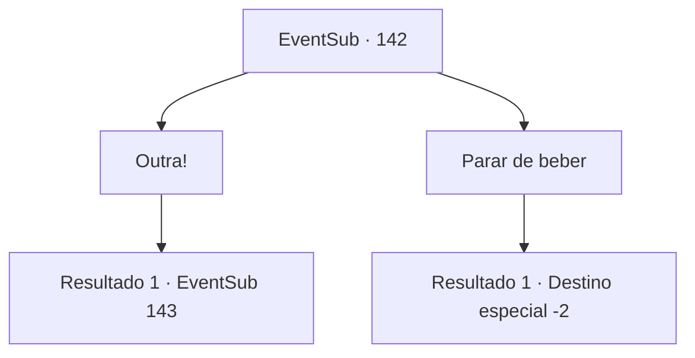

# Eventos secundários · 142

[Índice da tabela](index.md) · [Índice geral](../index.md)

ID: `pt:EventSub:142` · Fonte: `EventSub4` · Versão: 1.2.47.

Mapeamento estático dos arquivos; a disponibilidade e a execução dependem do estado da run.

## Texto do evento

*Sem texto no arquivo.*

## Dados de entrada

```json
{
  "id": 142,
  "grade": 1,
  "subEvent": "",
  "required": ""
}
```

## Mapa das escolhas



## Escolhas e resultados

### Escolha 1

Outra!

Requisitos e outros campos da escolha:

```json
{
  "required": ""
}
```

#### Resultado 1.1

Lá em cima, na sala privada, você e Cira continuam a conversar, cada um segurando uma garrafa de álcool. 

 "Essa maldita corneta me obriga a usar roupas mesmo no meio do verão. Está me matando, entende?"

 Cira tira sua roupa e bandana, tocando seu chifre, rindo como uma criança. De repente, você sente uma vontade de saciar sua sede de conhecimento. Você tem muitas perguntas para ela, desde o chifre em sua testa, sobre seu olho estranho, por que ela está sendo perseguida, etc.

Continuação registrada: [Evento 143](0143.md) na mesma tabela.

```json
{
  "required": "",
  "chance": "1",
  "nextEvent": 143,
  "type": 2,
  "reward": ""
}
```

### Escolha 2

Parar de beber

Requisitos e outros campos da escolha:

```json
{
  "required": ""
}
```

#### Resultado 2.1

Você diz a ela que isso será tudo por hoje, e ela responde em um tom mais calmo. 

 "Eu acho que temos muito mais a fazer... mas tudo bem. Até logo. Embora eu não tenha certeza de quando será."

 Ela então lhe entrega uma bolsa cheia de ouro e desaparece nas ruas escuras.

Continuação registrada: [Destino especial `-2`](../destinos-especiais.md).

```json
{
  "required": "",
  "chance": "1",
  "nextEvent": -2,
  "type": 2,
  "reward": "12_5_7|0_4_70"
}
```

## Referências que chegam a este evento

- [Evento 141 · escolha 1 · resultado 1](0141.md#escolha-1)
- [Evento 141 · escolha 2 · resultado 1](0141.md#escolha-2)
