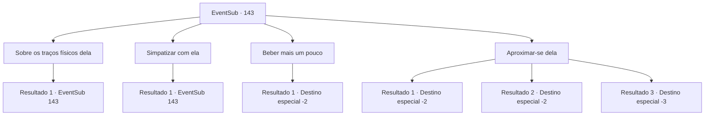

# Eventos secundários · 143

[Índice da tabela](index.md) · [Índice geral](../index.md)

ID: `pt:EventSub:143` · Fonte: `EventSub4` · Versão: 1.2.47.

Mapeamento estático dos arquivos; a disponibilidade e a execução dependem do estado da run.

## Texto do evento

*Sem texto no arquivo.*

## Dados de entrada

```json
{
  "id": 143,
  "grade": 1,
  "subEvent": "",
  "required": ""
}
```

## Mapa das escolhas



## Escolhas e resultados

### Escolha 1

Sobre os traços físicos dela

Requisitos e outros campos da escolha:

```json
{
  "required": "5_182_0"
}
```

#### Resultado 1.1

Ela franze um pouco a testa em resposta à sua pergunta, mas logo responde, como se estivesse acostumada com isso. 

 "Eu não sei todos os detalhes, mas aparentemente um dos meus antepassados era um demônio. Então, às vezes, um dos descendentes mostra essas características."


Continuação registrada: [Evento 143](0143.md) na mesma tabela.

```json
{
  "required": "",
  "chance": "1",
  "nextEvent": 143,
  "type": 2,
  "reward": "5_182_1"
}
```

### Escolha 2

Simpatizar com ela

Requisitos e outros campos da escolha:

```json
{
  "required": "5_182_1"
}
```

#### Resultado 2.1

|drawing_drinkingCira| Cira engole sua bebida violentamente e continua. 

 "...Obrigado. Tem sido difícil há muito tempo para mim, mas acho que é a primeira vez que alguém realmente tenta me animar. Esse chifre e os olhos ... Acho que parecer diferente de outras pessoas causa muitas dificuldades. O que me deixa com raiva, então eu luto, recebo uma recompensa, luto de novo, mais recompensa, é isso, haha ​​..."

 Não há nada peculiar na atitude em que Cira está contando sua história, mas você pode sentir a dor em sua voz. Ela então se contorce com a forma de olhos de gato. 

 "Prefiro não falar sobre um tópico deprimente como este ..?"


Continuação registrada: [Evento 143](0143.md) na mesma tabela.

```json
{
  "required": "",
  "chance": "1",
  "nextEvent": 143,
  "type": 2,
  "reward": "5_182_2"
}
```

### Escolha 3

Beber mais um pouco

Requisitos e outros campos da escolha:

```json
{
  "required": ""
}
```

#### Resultado 3.1

Você e Cira bebem a noite toda. Quando você abre os olhos, a luz do sol ilumina calorosamente o seu rosto. Enquanto você tenta se recuperar da ressaca, você encontra um bilhete rabiscado em uma pequena mesa. Pelo que está escrito na carta, parece que Cira já pagou pela acomodação e foi embora. Você também encontra alguns itens na sua mochila que claramente não pertencem a você. Parece ser uma adaga que ela costumava empunhar. Você descansa brevemente na cama para a dor de cabeça passar, e então retorna à sua aventura.

Continuação registrada: [Destino especial `-2`](../destinos-especiais.md).

```json
{
  "required": "",
  "chance": "1",
  "nextEvent": -2,
  "type": 2,
  "reward": "12_5_3|3_205_1|3_27_1"
}
```

### Escolha 4

Aproximar-se dela

Requisitos e outros campos da escolha:

```json
{
  "required": "11_0_0|18_91_3|18_92_3|18_8_2|5_182_2"
}
```

#### Resultado 4.1

Quando você se aproxima dela de perto, ela coloca o braço em volta do pescoço. 

 "Hngh ... eu adoraria ... você vai ficar bem?"

 Ela não pediu nada. Você passa uma noite incrivelmente eufórica com ela, tão grande que um ser humano comum teria desmaiado. Você sente como se sua energia estivesse sendo drenada por ela e, por um momento, você acha que o chifre dela está brilhando em vermelho. 

 Quando você abre os olhos, a luz do sol ilumina calorosamente seu rosto. Enquanto você tenta se recuperar da dor de cabeça, você encontra uma nota rabiscada em uma pequena mesa. Pelo que está escrito na carta, parece que Cira já pagou pela acomodação e saiu.

Continuação registrada: [Destino especial `-2`](../destinos-especiais.md).

```json
{
  "required": "",
  "chance": "1|0_13_1",
  "nextEvent": -2,
  "type": 2,
  "reward": "12_5_3|3_205_1|5_182_3"
}
```

#### Resultado 4.2

Quando você se aproxima dela de perto, ela coloca o braço em volta do pescoço. 

 "Hngh ... eu adoraria ... você vai ficar bem?"

 Ela não pediu nada. Você passa uma noite eufórica com ela. Você sente como se sua energia estivesse sendo drenada por ela. Por fim, você perde a consciência e desmaia, e a última coisa que você se lembra é o chifre de Cira, brilhando vermelho. 

 Quando você abre os olhos, a luz do sol ilumina calorosamente seu rosto. Enquanto você tenta se recuperar da dor de cabeça, você encontra uma nota rabiscada em uma pequena mesa. Pelo que está escrito na carta, parece que Cira já pagou pela acomodação e saiu.

Continuação registrada: [Destino especial `-2`](../destinos-especiais.md).

```json
{
  "required": "1_0_2",
  "chance": "11",
  "nextEvent": -2,
  "type": 2,
  "reward": "0_0_-1|12_5_3|3_205_1|5_182_3"
}
```

#### Resultado 4.3

À medida que te aproximas dela, ela coloca o braço em volta do teu pescoço. 

 "Hngh... Eu adoraria... Vais ficar bem?"

 Ela não perguntou isso à toa. Passas uma noite eufórica com ela. Sentes como se a tua energia estivesse a ser drenada por ela. Finalmente, perdes a consciência e desmaias, e a última coisa que te lembras é do chifre de Cira a brilhar vermelho.

Continuação registrada: [Destino especial `-3`](../destinos-especiais.md).

```json
{
  "required": "2_0_2",
  "chance": "11",
  "nextEvent": -3,
  "type": 2,
  "reward": "0_0_-1"
}
```

## Referências que chegam a este evento

- [Evento 142 · escolha 1 · resultado 1](0142.md#escolha-1)
- [Evento 143 · escolha 1 · resultado 1](0143.md#escolha-1)
- [Evento 143 · escolha 2 · resultado 1](0143.md#escolha-2)
