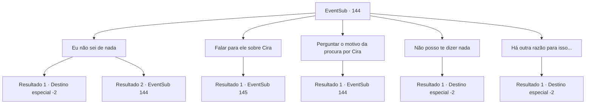

# Eventos secundários · 144

[Índice da tabela](index.md) · [Índice geral](../index.md)

ID: `pt:EventSub:144` · Fonte: `EventSub4` · Versão: 1.2.47.

Mapeamento estático dos arquivos; a disponibilidade e a execução dependem do estado da run.

## Texto do evento

Um homem de armadura branca bloqueia seu caminho. Ele se apresenta como 'Rohan', um cruzado leal à vontade de Deus. Quando você pergunta por que ele está bloqueando seu caminho, ele responde com uma voz muito séria. 

 "Estou procurando por Cira. Ouvi dizer que você é um 'conhecido' dela, e eu agradeceria se você me contasse tudo o que sabe."


## Dados de entrada

```json
{
  "id": 144,
  "grade": 1,
  "subEvent": "",
  "required": "12_5_3|1_2_40"
}
```

## Mapa das escolhas



## Escolhas e resultados

### Escolha 1

Eu não sei de nada

Requisitos e outros campos da escolha:

```json
{
  "required": "5_183_0"
}
```

#### Resultado 1.1

Quando você diz a ele que não sabe de nada, os olhos azuis de Rohan brilham levemente, como se tentassem olhar através de você. Mas, enquanto sua boca permanece fechada, Rohan sai com um suspiro curto.

Continuação registrada: [Destino especial `-2`](../destinos-especiais.md).

```json
{
  "required": "18_182_3",
  "chance": "1",
  "nextEvent": -2,
  "type": 2,
  "reward": "12_5_6"
}
```

#### Resultado 1.2

Quando você diz a ele que não sabe de nada, as pupilas azuis de Rohan brilham levemente, como se tentassem olhar através de você. Ele então continua com um suspiro. 

 "...Não minta. Sua alma está marcada com um sinal demoníaco."


Continuação registrada: [Evento 144](0144.md) na mesma tabela.

```json
{
  "required": "5_182_3",
  "chance": "1",
  "nextEvent": 144,
  "type": 2,
  "reward": "5_183_1"
}
```

### Escolha 2

Falar para ele sobre Cira

Requisitos e outros campos da escolha:

```json
{
  "required": ""
}
```

#### Resultado 2.1

Você conta a ele tudo o que sabe sobre Cira. Rohan, enquanto ouve silenciosamente, concentra-se no fato de que ela estava sendo perseguida por cultistas. 

 "Se Cira realmente está sendo perseguida por eles, estamos em uma situação terrível."

 Quando você pergunta a ele o motivo, ele hesita por um tempo antes de continuar, dizendo que você tem um motivo para saber os detalhes. Sua voz é tão séria quanto pode ser. 

 "Eles provavelmente tentarão transformar Cira em um demônio completo. Cira deve ser colocada sob a vigilância da Ordem Sagrada, para evitar que uma catástrofe como essa aconteça. Deve ser feito."

 Após terminar, Rohan se prepara imediatamente para sair.

Continuação registrada: [Evento 145](0145.md) na mesma tabela.

```json
{
  "required": "",
  "chance": "1",
  "nextEvent": 145,
  "type": 2,
  "reward": ""
}
```

### Escolha 3

Perguntar o motivo da procura por Cira

Requisitos e outros campos da escolha:

```json
{
  "required": "5_184_0"
}
```

#### Resultado 3.1

Quando você pergunta a ele por que ele está procurando Cira, Rohan explica cuidadosamente tudo. 

 "Uma pessoa com sangue demoníaco correndo em suas veias, como Cira, é muito corruptível. Não apenas isso, mas também são um sacrifício valioso para invocar um demônio real. Entende o que quero dizer?"

 Rohan toca sua barba, acrescentando que por essas razões, sua Ordem Sagrada tem perseguido e observado ela por muito tempo. Você percebe um leve sinal de preocupação, mesmo em sua expressão confiante. 

 "Especialmente se o sangue demoníaco for forte o suficiente para fazer traços diabólicos aparecerem fisicamente... cultistas matarão para colocar as mãos nela."


Continuação registrada: [Evento 144](0144.md) na mesma tabela.

```json
{
  "required": "",
  "chance": "1",
  "nextEvent": 144,
  "type": 2,
  "reward": "5_184_1"
}
```

### Escolha 4

Não posso te dizer nada

Requisitos e outros campos da escolha:

```json
{
  "required": "5_183_1"
}
```

#### Resultado 4.1

Você não responde a ele. Enquanto você fecha a boca, Rohan sai com um suspiro curto.

Continuação registrada: [Destino especial `-2`](../destinos-especiais.md).

```json
{
  "required": "",
  "chance": "1",
  "nextEvent": -2,
  "type": 2,
  "reward": "12_5_6"
}
```

### Escolha 5

Há outra razão para isso...

Requisitos e outros campos da escolha:

```json
{
  "required": "5_183_1|5_432_1|18_431_1"
}
```

#### Resultado 5.1

Você tentou dar uma desculpa de que não era por causa da Cira.  Mas Kior te interrompe e sussurra.  

 "Não faça do seu trabalho um incômodo...  Seria melhor você não se envolver de forma alguma. Ou mate-o."

  Enquanto isso, Rohan compreende seu silêncio de uma maneira diferente.  Ele vai embora com um suspiro curto.

Continuação registrada: [Destino especial `-2`](../destinos-especiais.md).

```json
{
  "required": "",
  "chance": "1",
  "nextEvent": -2,
  "type": 2,
  "reward": "12_5_6"
}
```

## Referências que chegam a este evento

- [Evento 144 · escolha 1 · resultado 2](0144.md#escolha-1)
- [Evento 144 · escolha 3 · resultado 1](0144.md#escolha-3)
