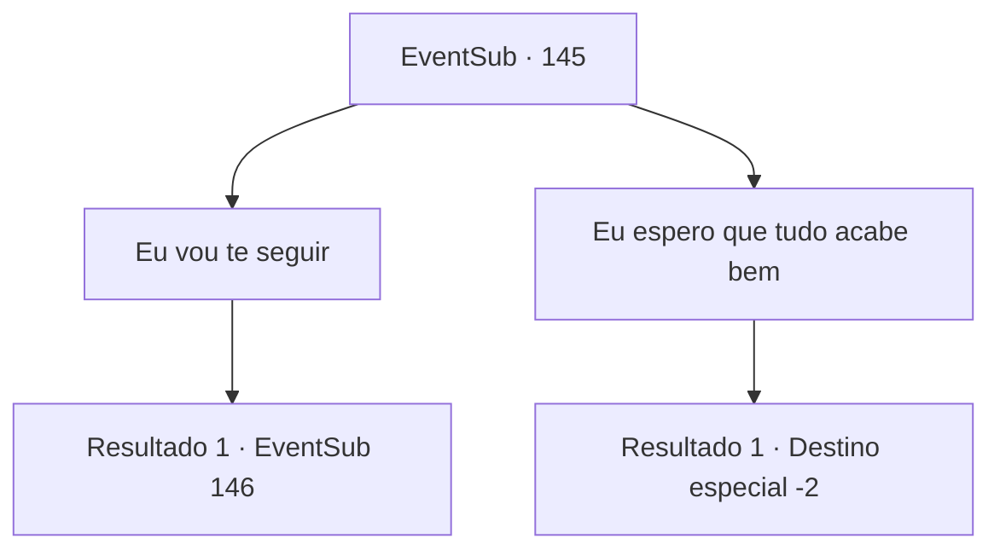

# Eventos secundários · 145

[Índice da tabela](index.md) · [Índice geral](../index.md)

ID: `pt:EventSub:145` · Fonte: `EventSub4` · Versão: 1.2.47.

Mapeamento estático dos arquivos; a disponibilidade e a execução dependem do estado da run.

## Texto do evento

*Sem texto no arquivo.*

## Dados de entrada

```json
{
  "id": 145,
  "grade": 1,
  "subEvent": "",
  "required": ""
}
```

## Mapa das escolhas



## Escolhas e resultados

### Escolha 1

Eu vou te seguir

Requisitos e outros campos da escolha:

```json
{
  "required": ""
}
```

#### Resultado 1.1

Você sugere segui-lo em sua jornada. Rohan balança a cabeça com uma expressão teimosa. 

 "Se Cira realmente está sendo mantida cativa pelo culto, esta será uma missão extremamente perigosa."

 Mas como você ainda mostra sua intenção de ajudá-lo, ele finalmente concorda relutantemente. 

 "Então, mostre-me do que você é capaz. Eu decidirei então."

 Rohan te olha com firmeza, sinalizando para você mostrar tudo o que tem.

Continuação registrada: [Evento 146](0146.md) na mesma tabela.

```json
{
  "required": "",
  "chance": "1",
  "nextEvent": 146,
  "type": 2,
  "reward": ""
}
```

### Escolha 2

Eu espero que tudo acabe bem

Requisitos e outros campos da escolha:

```json
{
  "required": ""
}
```

#### Resultado 2.1

Você diz a Rohan que espera que tudo termine bem entre ele e Cira. Ele agradece brevemente e se apressa para encontrar Cira. Você olha fixamente para as costas dele por um momento antes de se afastar.

Continuação registrada: [Destino especial `-2`](../destinos-especiais.md).

```json
{
  "required": "",
  "chance": "1",
  "nextEvent": -2,
  "type": 2,
  "reward": "12_5_6"
}
```

## Referências que chegam a este evento

- [Evento 144 · escolha 2 · resultado 1](0144.md#escolha-2)
