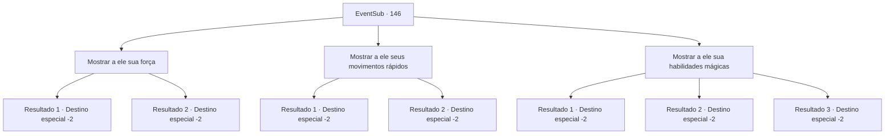

# Eventos secundários · 146

[Índice da tabela](index.md) · [Índice geral](../index.md)

ID: `pt:EventSub:146` · Fonte: `EventSub4` · Versão: 1.2.47.

Mapeamento estático dos arquivos; a disponibilidade e a execução dependem do estado da run.

## Texto do evento

*Sem texto no arquivo.*

## Dados de entrada

```json
{
  "id": 146,
  "grade": 1,
  "subEvent": "",
  "required": ""
}
```

## Mapa das escolhas



## Escolhas e resultados

### Escolha 1

Mostrar a ele sua força

Requisitos e outros campos da escolha:

```json
{
  "required": ""
}
```

#### Resultado 1.1

Você chuta uma árvore próxima com toda a sua força. A casca da árvore se quebra e sua pegada fica impressa nela. Rohan fala, surpreso. 

 "Eu seria um idiota em recusar uma pessoa com tanto talento. Na verdade, eu gostaria de pedir sua ajuda em vez disso."

 Você aperta a mão dele e concorda em ajudá-lo em sua busca por Cira. Ele se afasta, prometendo notificá-lo imediatamente se encontrar alguma evidência relacionada ao culto.

Continuação registrada: [Destino especial `-2`](../destinos-especiais.md).

```json
{
  "required": "",
  "chance": "1|0_5_1",
  "nextEvent": -2,
  "type": 0,
  "reward": "12_5_4"
}
```

#### Resultado 1.2

Você chuta uma árvore próxima com toda a sua força. Mas a árvore não se move. Apenas o seu pé dói. Vendo isso, Rohan balança a cabeça e vira as costas para você. 

 "Desculpe, mas esse nível de habilidade não será de muita ajuda."

 Rohan se afasta, sem olhar para trás nem uma vez.

Continuação registrada: [Destino especial `-2`](../destinos-especiais.md).

```json
{
  "required": "",
  "chance": "13",
  "nextEvent": -2,
  "type": 1,
  "reward": "12_5_6"
}
```

### Escolha 2

Mostrar a ele seus movimentos rápidos

Requisitos e outros campos da escolha:

```json
{
  "required": ""
}
```

#### Resultado 2.1

Você mostra sua agilidade treinada por muito tempo para Rohan. Rohan fica impressionado com suas manobras rápidas e admite. 

 "Seria um idiota se recusasse uma pessoa com tanto talento. Na verdade, gostaria de pedir sua ajuda em vez disso."

 Você aperta sua mão e concorda em ajudá-lo em sua busca por Cira. Ele se afasta, prometendo notificá-lo imediatamente se encontrar alguma evidência relacionada ao culto.

Continuação registrada: [Destino especial `-2`](../destinos-especiais.md).

```json
{
  "required": "",
  "chance": "1|0_6_1",
  "nextEvent": -2,
  "type": 0,
  "reward": "12_5_4"
}
```

#### Resultado 2.2

Você mostra sua agilidade treinada por muito tempo para Rohan. Mas ao ver isso, Rohan balança a cabeça e vira as costas para você. 

 "Desculpe, mas esse nível de habilidade não será de muita ajuda."

 Rohan se afasta, sem olhar para trás nem uma vez sequer.

Continuação registrada: [Destino especial `-2`](../destinos-especiais.md).

```json
{
  "required": "",
  "chance": "13",
  "nextEvent": -2,
  "type": 1,
  "reward": "12_5_6"
}
```

### Escolha 3

Mostrar a ele sua habilidades mágicas

Requisitos e outros campos da escolha:

```json
{
  "required": "20_0_1"
}
```

#### Resultado 3.1

Você lança feitiços impressionantes para capturar a mente de Rohan. Impressionado com sua habilidade na magia, Rohan admite ter sido persuadido. 

 "Seria um idiota se recusasse uma pessoa com tanto talento. Na verdade, gostaria de pedir sua ajuda em vez disso."

 Você aperta sua mão e concorda em ajudá-lo em sua busca por Cira. Ele se afasta, prometendo notificá-lo imediatamente se encontrar alguma evidência relacionada ao culto.

Continuação registrada: [Destino especial `-2`](../destinos-especiais.md).

```json
{
  "required": "21_0_3",
  "chance": "1|0_7_1",
  "nextEvent": -2,
  "type": 0,
  "reward": "12_5_4"
}
```

#### Resultado 3.2

Tentas lançar feitiços impressionantes, mas eles não são lançados corretamente. Ao ver isso, Rohan abana a cabeça e vira as costas para ti. 

 "Desculpa, mas esse nível de habilidade não será de grande ajuda."

 Rohan afasta-se, sem olhar para trás nem uma vez sequer.

Continuação registrada: [Destino especial `-2`](../destinos-especiais.md).

```json
{
  "required": "21_0_3",
  "chance": "13",
  "nextEvent": -2,
  "type": 1,
  "reward": "12_5_6"
}
```

#### Resultado 3.3

Com gestos simples, você lança feitiços impressionantes e captura a mente de Rohan. Impressionado com sua habilidade na magia, Rohan admite ter sido persuadido. 

 "Eu seria um idiota em recusar uma pessoa com tanto talento. Na verdade, gostaria de pedir sua ajuda em vez disso."

 Você aperta sua mão e concorda em ajudá-lo em sua busca por Cira. Ele se afasta, prometendo notificá-lo imediatamente se encontrar alguma evidência relacionada ao culto.

Continuação registrada: [Destino especial `-2`](../destinos-especiais.md).

```json
{
  "required": "20_0_3",
  "chance": "1",
  "nextEvent": -2,
  "type": 0,
  "reward": "12_5_4"
}
```

## Referências que chegam a este evento

- [Evento 145 · escolha 1 · resultado 1](0145.md#escolha-1)
