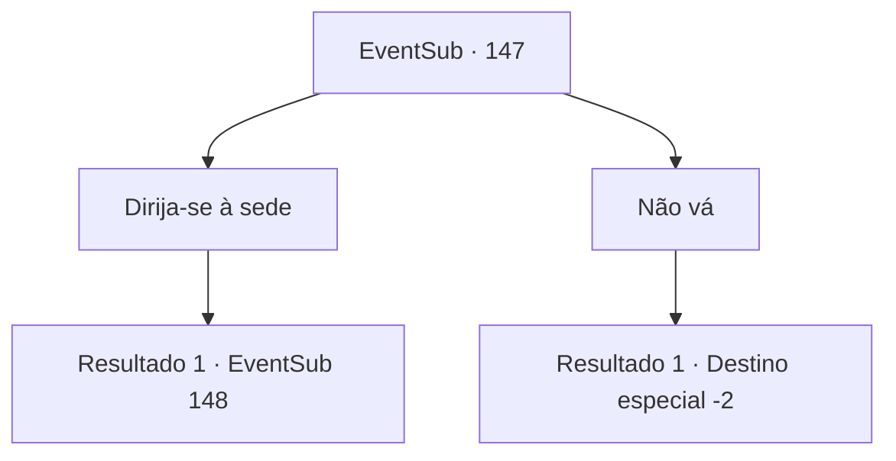

# Eventos secundários · 147

[Índice da tabela](index.md) · [Índice geral](../index.md)

ID: `pt:EventSub:147` · Fonte: `EventSub4` · Versão: 1.2.47.

Mapeamento estático dos arquivos; a disponibilidade e a execução dependem do estado da run.

## Texto do evento

Um pombo branco voa até você. Em suas patas descansa uma carta, escrita para você. Ao abrí-la e lê-la, vê que foi Rohan quem a enviou.
 'Parece que estamos atrasados. Acho que o culto já capturou Cira. Felizmente, consegui localizar a sede deles, então, por favor, ajude-me a pegá-los todos de uma vez.'
 Sob a caligrafia de Rohan está um mapa desenhado da localização da sede do culto. 

## Dados de entrada

```json
{
  "id": 147,
  "grade": 1,
  "subEvent": "",
  "required": "12_5_4"
}
```

## Mapa das escolhas



## Escolhas e resultados

### Escolha 1

Dirija-se à sede

Requisitos e outros campos da escolha:

```json
{
  "required": ""
}
```

#### Resultado 1.1

Você segue para a sede do culto que Rohan lhe disse. Depois de caminhar por um tempo na floresta, você encontra Rohan. 

 "Você está aqui. Obrigado. Siga-me."

 Você caminha com Rohan. A sede está localizada em uma caverna nas colinas próximas, um lugar visível apenas após descer por um corredor estreito construído no subsolo. O lugar parece ser algum tipo de templo construído para divindades e emana uma vibe muito sinistra, provavelmente por ter sido construído no escuro subterrâneo. Passo a passo, quanto mais perto você chega ao centro do templo, mais forte o cheiro de sangue fica. Enquanto você avança cuidadosamente, é impedido pela mão de Rohan, fazendo um gesto para você parar. 

 "Quem são vocês dois? Esta área é estritamente proibida por ordens do sacerdote-chefe. Há um ritual acontecendo lá dentro."

 Em frente a você, guardando a enorme porta, estão cultistas com olhos enlouquecidos.

Continuação registrada: [Evento 148](0148.md) na mesma tabela.

```json
{
  "required": "",
  "chance": "1",
  "nextEvent": 148,
  "type": 2,
  "reward": ""
}
```

### Escolha 2

Não vá

Requisitos e outros campos da escolha:

```json
{
  "required": ""
}
```

#### Resultado 2.1

Você joga fora a carta dele e vai para outro lugar, longe da sede da seita.

Continuação registrada: [Destino especial `-2`](../destinos-especiais.md).

```json
{
  "required": "",
  "chance": "1",
  "nextEvent": -2,
  "type": 2,
  "reward": "12_5_6"
}
```

## Referências que chegam a este evento

Nenhum `nextEvent` positivo da mesma tabela aponta para este nó. Isso não prova que seja inacessível: sorteio e estado de história podem selecioná-lo.

