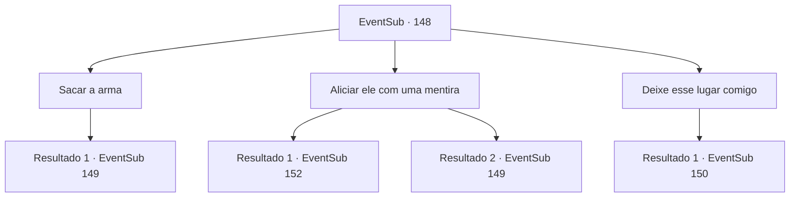

# Eventos secundários · 148

[Índice da tabela](index.md) · [Índice geral](../index.md)

ID: `pt:EventSub:148` · Fonte: `EventSub4` · Versão: 1.2.47.

Mapeamento estático dos arquivos; a disponibilidade e a execução dependem do estado da run.

## Texto do evento

*Sem texto no arquivo.*

## Dados de entrada

```json
{
  "id": 148,
  "grade": 1,
  "subEvent": "",
  "required": ""
}
```

## Mapa das escolhas



## Escolhas e resultados

### Escolha 1

Sacar a arma

Requisitos e outros campos da escolha:

```json
{
  "required": ""
}
```

#### Resultado 1.1

Você não tem tempo a perder, então você saca sua arma rapidamente. Rohan também se prepara para lutar, e os cultistas avançam em vocês dois com suas armas.

Continuação registrada: [Evento 149](0149.md) na mesma tabela.

```json
{
  "required": "",
  "chance": "1",
  "nextEvent": 149,
  "type": 2,
  "reward": "6_3_71",
  "place": 7
}
```

### Escolha 2

Aliciar ele com uma mentira

Requisitos e outros campos da escolha:

```json
{
  "required": ""
}
```

#### Resultado 2.1

Você se apresenta como amigo do padre -chefe e diz que há uma mensagem muito importante a ser enviada. Sua atitude ousada engana completamente os cultistas. Eles educadamente se inclinam e abrem a porta. Ao seu lado, Rohan sussurra em silêncio. 

 "Para criar uma mentira tão ousada nesse tipo de situação. incrível."

 Com uma observação de que você não tem certeza se é um elogio ou uma crítica, você entra na porta. Quando você e Rohan entram, uma escada em espiral que leva a um subterrâneo mais profundo aparece. A escada é tão escura que está escura em todos os lugares, mesmo com uma tocha. Por fim, quando você chega ao final, encontra CIRA. |drawing_devilCira| Mas ela não está igual do jeito que você se lembra dela. Nas costas, há um par de asas escuras e carmesim, enquanto o chifre ficou maior. Seus olhos são inteiramente negros e ela cheira a sangue. Ao lado dela, há um cadáver seco, semelhante a uma múmia. Cira olha para você com um olhar ressentido. 

 "Junto com um cruzado ... Vejo que você me traiu. Você está aqui para me matar também, hein? <link=shake> Eu sempre considerei você um amigo! </link>"


Continuação registrada: [Evento 152](0152.md) na mesma tabela.

```json
{
  "required": "",
  "chance": "1|0_12_1",
  "nextEvent": 152,
  "type": 0,
  "reward": ""
}
```

#### Resultado 2.2

Você se apresenta como amigo do chefe sacerdote e diz que há uma mensagem muito importante para enviar. Os cultistas, é claro, ficam desconfiados e pedem que você prove sua afirmação. Rohan, depois de olhar para você em silêncio, saca sua arma. 

 "Eu acho que não temos mais opções."


Continuação registrada: [Evento 149](0149.md) na mesma tabela.

```json
{
  "required": "",
  "chance": "15",
  "nextEvent": 149,
  "type": 1,
  "reward": "6_3_71",
  "place": 7
}
```

### Escolha 3

Deixe esse lugar comigo

Requisitos e outros campos da escolha:

```json
{
  "required": ""
}
```

#### Resultado 3.1

Você diz a Rohan para ir primeiro, sacando sua arma. 

 "Então, estou indo embora!"

 Rohan não recusa sua proposta e rapidamente entra pela porta, passando pelos cultistas.

Continuação registrada: [Evento 150](0150.md) na mesma tabela.

```json
{
  "required": "",
  "chance": "1",
  "nextEvent": 150,
  "type": 2,
  "reward": "6_3_71",
  "place": 7
}
```

## Referências que chegam a este evento

- [Evento 147 · escolha 1 · resultado 1](0147.md#escolha-1)
