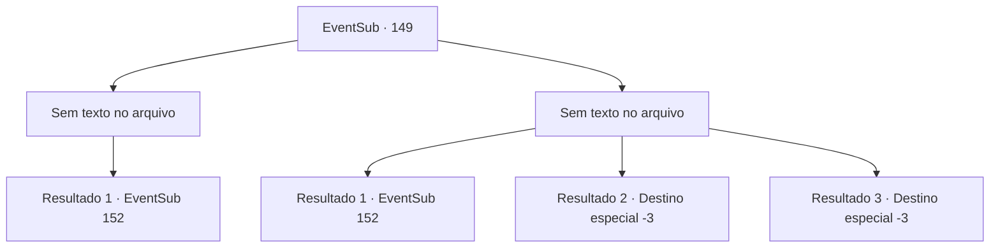

# Eventos secundários · 149

[Índice da tabela](index.md) · [Índice geral](../index.md)

ID: `pt:EventSub:149` · Fonte: `EventSub4` · Versão: 1.2.47.

Mapeamento estático dos arquivos; a disponibilidade e a execução dependem do estado da run.

## Texto do evento

*Sem texto no arquivo.*

## Dados de entrada

```json
{
  "id": 149,
  "grade": 1,
  "subEvent": "",
  "required": ""
}
```

## Mapa das escolhas



## Escolhas e resultados

### Escolha 1

*Sem texto no arquivo; o papel dessa opção depende da interface do jogo.*

Requisitos e outros campos da escolha:

```json
{
  "required": ""
}
```

#### Resultado 1.1

Você derrota com sucesso os cultistas que guardam a porta. Quando você e Rohan entram, uma escada em espiral que leva a um subterrâneo mais profundo aparece. A escada é tão escura que está escura em todos os lugares, mesmo com uma tocha. Por fim, quando você chega ao fim, encontra o CIRA. |drawing_devilCira| Mas ela não é como você se lembra dela. Nas costas, há um par de asas escuras e carmesim, enquanto o chifre ficou maior. Seus olhos estão inteiramente negros e ela cheira a sangue. Ao lado dela, há um cadáver seco, semelhante a uma múmia. Cira olha para você com um olhar ressentido. 

 "Junto com um cruzado ... Vejo que você me traiu. Você está aqui para me matar também, não é? <link=shake> Eu sempre te considerei como um amigo! </link>"


Continuação registrada: [Evento 152](0152.md) na mesma tabela.

```json
{
  "required": "",
  "chance": "1",
  "nextEvent": 152,
  "type": 2,
  "reward": ""
}
```

### Escolha 2

*Sem texto no arquivo; o papel dessa opção depende da interface do jogo.*

Requisitos e outros campos da escolha:

```json
{
  "required": ""
}
```

#### Resultado 2.1

Você luta contra os cultistas, mas a imprudência deles tem o melhor de você. Como um dos cultistas está prestes a esmagar sua cabeça com a arma dele, Ele cai sem vida. Rohan derrotou todos eles. 

 "Você está bem? Não decepcione sua guarda."

 Ele o ajuda a se levantar e abre a enorme porta. Quando você e Rohan entram, uma escada em espiral que leva a um subterrâneo mais profundo aparece. A escada é tão escura que está escura em todos os lugares, mesmo com uma tocha. Por fim, quando você chega ao fim, encontra o CIRA. |drawing_devilCira| Mas ela mudou desde a última vez que você a viu. Nas costas, há um par de asas escuras e carmesim, enquanto o chifre ficou maior. Seus olhos estão inteiramente negros e ela cheira a sangue. Ao lado dela, há um cadáver seco, semelhante a uma múmia. Cira olha para você com um olhar ressentido. 

 "Junto com um cruzado ... Vejo que você me traiu. Você está aqui para me matar também, não é? <link=shake> Eu sempre te considerei como um amigo! </link>"


Continuação registrada: [Evento 152](0152.md) na mesma tabela.

```json
{
  "required": "1_0_2|1_1_2",
  "chance": "1",
  "nextEvent": 152,
  "type": 2,
  "reward": "0_0_-1|0_1_-1"
}
```

#### Resultado 2.2

Você luta contra os cultistas, mas a audácia destemida deles acaba sendo melhor que a sua. Infelizmente, você encontra o seu fim, esfaqueado pela lâmina do cultista, sem conseguir ver Cira.

Continuação registrada: [Destino especial `-3`](../destinos-especiais.md).

```json
{
  "required": "2_0_2",
  "chance": "1",
  "nextEvent": -3,
  "type": 2,
  "reward": "0_0_-1|0_1_-1"
}
```

#### Resultado 2.3

Você luta contra os cultistas, mas a audácia destemida deles acaba sendo melhor que a sua. Infelizmente, você encontra o seu fim, esfaqueado pela lâmina do cultista, sem conseguir ver Cira.

Continuação registrada: [Destino especial `-3`](../destinos-especiais.md).

```json
{
  "required": "2_1_2",
  "chance": "1",
  "nextEvent": -3,
  "type": 2,
  "reward": "0_0_-1|0_1_-1"
}
```

## Referências que chegam a este evento

- [Evento 148 · escolha 1 · resultado 1](0148.md#escolha-1)
- [Evento 148 · escolha 2 · resultado 2](0148.md#escolha-2)
