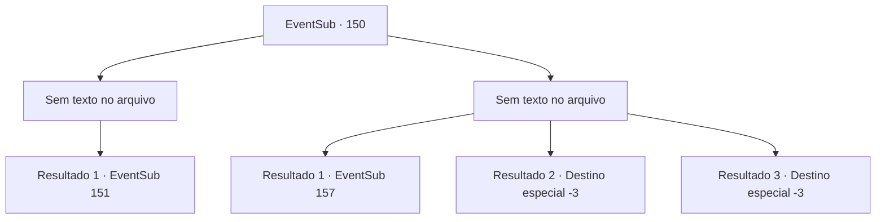

# Eventos secundários · 150

[Índice da tabela](index.md) · [Índice geral](../index.md)

ID: `pt:EventSub:150` · Fonte: `EventSub4` · Versão: 1.2.47.

Mapeamento estático dos arquivos; a disponibilidade e a execução dependem do estado da run.

## Texto do evento

*Sem texto no arquivo.*

## Dados de entrada

```json
{
  "id": 150,
  "grade": 1,
  "subEvent": "",
  "required": ""
}
```

## Mapa das escolhas



## Escolhas e resultados

### Escolha 1

*Sem texto no arquivo; o papel dessa opção depende da interface do jogo.*

Requisitos e outros campos da escolha:

```json
{
  "required": ""
}
```

#### Resultado 1.1

Ao derrotar os cultistas e entrar pela porta, uma escada em espiral que leva a um subterrâneo mais profundo aparece. A escada é tão escura que está escura em todos os lugares, mesmo com uma tocha. Por fim, quando você chega ao fim, encontra CIRA. Mas ela não é como você se lembra dela. |drawing_devilCira| Nas costas, há um par de asas escuras e carmesim, enquanto o chifre ficou maior. Seus olhos estão inteiramente negros e ela cheira a sangue. Ao lado dela, há um cadáver seco, semelhante a uma múmia. Rohan, que entrou primeiro, está deitado no canto, sangrando. Quando ela se aproxima de Rohan, Cira vê seu rosto e para. 

 "Você... c-como você..?"


Continuação registrada: [Evento 151](0151.md) na mesma tabela.

```json
{
  "required": "",
  "chance": "1",
  "nextEvent": 151,
  "type": 2,
  "reward": "5_185_1"
}
```

### Escolha 2

*Sem texto no arquivo; o papel dessa opção depende da interface do jogo.*

Requisitos e outros campos da escolha:

```json
{
  "required": ""
}
```

#### Resultado 2.1

Você luta contra os cultistas, mas a imprudência deles tem o melhor de você. Você é pego, gravemente ferido e perde a consciência depois de ser atingido por um clube. 

 Você abre os olhos, acorrentado a um poste de madeira. Um espaço subterrâneo escuro com uma vibração sinistra, engolida na escuridão. Lá está Cira, mas ela está diferente de como você se lembra dela. |drawing_devilCira| Nas costas, há um par de asas escuras e carmesim, enquanto o chifre ficou maior. Seus olhos estão inteiramente negros e ela cheira a sangue. Ao lado dela, há um cadáver seco, semelhante a uma múmia. Rohan, que entrou primeiro, está deitado no canto, sangrando. Os cultistas se curvam para Cira e falam. 

 "Oh, grande Cira, este ser tentou prejudicar você e o culto. Devore sua alma e fique mais forte."

 Mas ela se aproxima de você e quebra as correntes. Ela então olha para seus olhos e diz: 

 "Você salvou a minha vida, então desta vez eu irei salvar a sua. CORRA!"


Continuação registrada: [Evento 157](0157.md) na mesma tabela.

```json
{
  "required": "1_0_2|1_1_2",
  "chance": "1",
  "nextEvent": 157,
  "type": 2,
  "reward": "0_0_-1|0_1_-1|5_185_1"
}
```

#### Resultado 2.2

Você luta contra os cultistas, mas a audácia destemida deles acaba sendo melhor que a sua. Infelizmente, você encontra o seu fim, esfaqueado pela lâmina do cultista, sem conseguir ver Cira.

Continuação registrada: [Destino especial `-3`](../destinos-especiais.md).

```json
{
  "required": "2_0_2",
  "chance": "1",
  "nextEvent": -3,
  "type": 2,
  "reward": "0_0_-1|0_1_-1"
}
```

#### Resultado 2.3

Você luta contra os cultistas, mas a audácia destemida deles acaba sendo melhor que a sua. Infelizmente, você encontra o seu fim, esfaqueado pela lâmina do cultista, sem conseguir ver Cira.

Continuação registrada: [Destino especial `-3`](../destinos-especiais.md).

```json
{
  "required": "2_1_2",
  "chance": "1",
  "nextEvent": -3,
  "type": 2,
  "reward": "0_0_-1|0_1_-1"
}
```

## Referências que chegam a este evento

- [Evento 148 · escolha 3 · resultado 1](0148.md#escolha-3)
