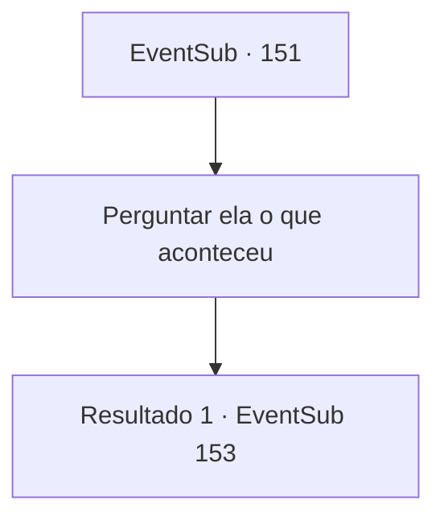

# Eventos secundários · 151

[Índice da tabela](index.md) · [Índice geral](../index.md)

ID: `pt:EventSub:151` · Fonte: `EventSub4` · Versão: 1.2.47.

Mapeamento estático dos arquivos; a disponibilidade e a execução dependem do estado da run.

## Texto do evento

*Sem texto no arquivo.*

## Dados de entrada

```json
{
  "id": 151,
  "grade": 1,
  "subEvent": "",
  "required": ""
}
```

## Mapa das escolhas



## Escolhas e resultados

### Escolha 1

Perguntar ela o que aconteceu

Requisitos e outros campos da escolha:

```json
{
  "required": ""
}
```

#### Resultado 1.1

Você pergunta a ela o que aconteceu, por que ela se transformou dessa maneira. Ela balança a cabeça e olha para o seu corpo. Ela pega o cadáver seco de um cultista e fala. Ele está vestido com uma túnica mais elegante do que os outros cultistas, e aparentemente ele é o sacerdote da classe mais alta. 

 "Esse cara me fez assim. Não sei por que ou como ele fez isso. Eu estava aqui quando acordei, e drenava a alma dele sem nem perceber. Essa é a forma que eu desprezava a minha vida toda... mas acho que é para o melhor. Não preciso mais viver com humanos. Não preciso mais tentar ser humano."

 Talvez ela esteja falando consigo mesma, não com você.

Continuação registrada: [Evento 153](0153.md) na mesma tabela.

```json
{
  "required": "",
  "chance": "1",
  "nextEvent": 153,
  "type": 2,
  "reward": ""
}
```

## Referências que chegam a este evento

- [Evento 150 · escolha 1 · resultado 1](0150.md#escolha-1)
