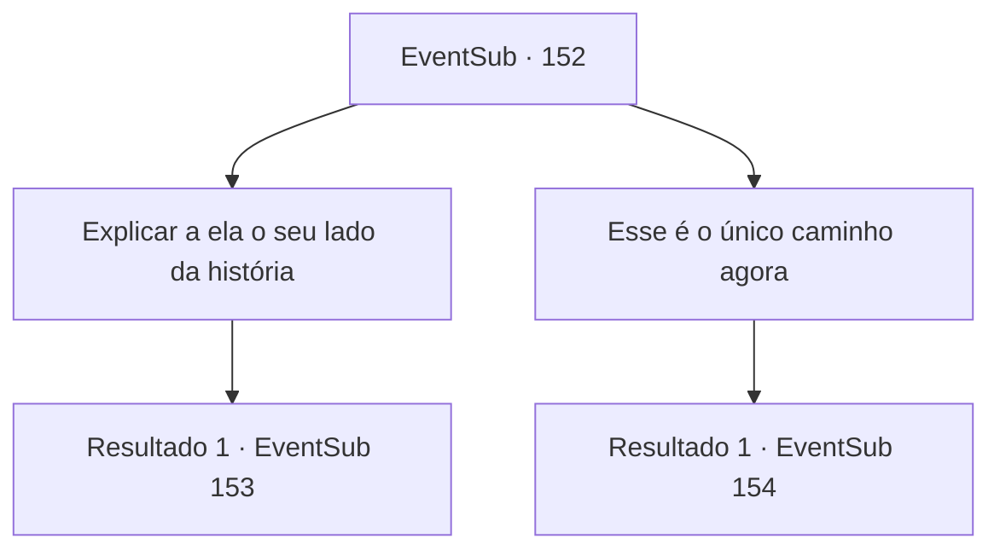

# Eventos secundários · 152

[Índice da tabela](index.md) · [Índice geral](../index.md)

ID: `pt:EventSub:152` · Fonte: `EventSub4` · Versão: 1.2.47.

Mapeamento estático dos arquivos; a disponibilidade e a execução dependem do estado da run.

## Texto do evento

*Sem texto no arquivo.*

## Dados de entrada

```json
{
  "id": 152,
  "grade": 1,
  "subEvent": "",
  "required": ""
}
```

## Mapa das escolhas



## Escolhas e resultados

### Escolha 1

Explicar a ela o seu lado da história

Requisitos e outros campos da escolha:

```json
{
  "required": ""
}
```

#### Resultado 1.1

Você se explica para Cira. Felizmente, ela não se transformou completamente, pois ela ouve sua história em silêncio. Quando você termina sua explicação, Cira ri com uma voz grave e fala. 

 "E agora? Eu sou um demônio completo agora. Esta é a forma que eu desprezei a vida toda... mas acho que é para o melhor. Eu não preciso mais viver com humanos. Eu não preciso mais tentar ser humana."

 Talvez ela esteja falando consigo mesma, não com você.

Continuação registrada: [Evento 153](0153.md) na mesma tabela.

```json
{
  "required": "",
  "chance": "1",
  "nextEvent": 153,
  "type": 2,
  "reward": ""
}
```

### Escolha 2

Esse é o único caminho agora

Requisitos e outros campos da escolha:

```json
{
  "required": ""
}
```

#### Resultado 2.1

Vendo que não há outra opção, você saca sua arma novamente. Se ela realmente é um demônio completamente transformado, você acha melhor encerrar sua vida com suas próprias mãos em seu último momento. Cira coloca um sorriso triste em sua atitude. 

 "Entendo. Você está pensando a mesma coisa que aquele cruzado. ...Eu vou te matar o mais rápido possível. Esse é meu último favor."


Continuação registrada: [Evento 154](0154.md) na mesma tabela.

```json
{
  "required": "",
  "chance": "1",
  "nextEvent": 154,
  "type": 2,
  "reward": "6_0_102",
  "place": 7
}
```

## Referências que chegam a este evento

- [Evento 148 · escolha 2 · resultado 1](0148.md#escolha-2)
- [Evento 149 · escolha 1 · resultado 1](0149.md#escolha-1)
- [Evento 149 · escolha 2 · resultado 1](0149.md#escolha-2)
