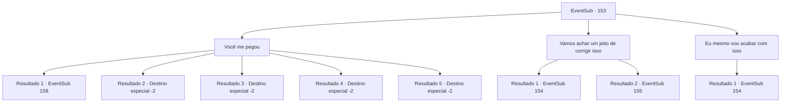

# Eventos secundários · 153

[Índice da tabela](index.md) · [Índice geral](../index.md)

ID: `pt:EventSub:153` · Fonte: `EventSub4` · Versão: 1.2.47.

Mapeamento estático dos arquivos; a disponibilidade e a execução dependem do estado da run.

## Texto do evento

*Sem texto no arquivo.*

## Dados de entrada

```json
{
  "id": 153,
  "grade": 1,
  "subEvent": "",
  "required": ""
}
```

## Mapa das escolhas



## Escolhas e resultados

### Escolha 1

Você me pegou

Requisitos e outros campos da escolha:

```json
{
  "required": ""
}
```

#### Resultado 1.1

Você diz a ela que não se importa com a aparência dela, que ficará ao lado dela como amigo. Cira questiona você com um olhar surpreso. 

 "..Você vai me tratar da mesma forma mesmo quando eu estiver assim?"

 Você acena silenciosamente com a cabeça e estende as mãos. Ela fala com voz trêmula. 

 "Você... Se você não me matar aqui, a Igreja pode te exilar."

 Rohan olha para você e grita. 

 "Você está louco?! Afaste-se dessa coisa maligna...!"

 Enquanto ele puxa sua espada, Cira olha para você e fala. 

 "Prove sua determinação. Prove para mim que você tem mais do que palavras."


Continuação registrada: [Evento 158](0158.md) na mesma tabela.

```json
{
  "required": "18_185_1",
  "chance": "1|0_14_1",
  "nextEvent": 158,
  "type": 0,
  "reward": ""
}
```

#### Resultado 1.2

Você diz a ela que não se importa com a aparência dela, que ficará ao lado dela como amigo. Mas você não consegue deixar de ser dominado pelo medo. Cira reconhece seu tremor. 

 "Tremendo assim... não acho que você quer dizer o que disse. Mas... ainda assim, suas palavras me consolam. Vá. Vou deixar você viver desta vez."

 Cira vira as costas, como se tivesse terminado de falar com você. Rohan olha para você e grita. 

 "Acorde! Não viemos aqui para matar o diabo!?"

 Ele puxa sua espada e avança em direção a Cira. Mas você se afasta dele, para fora da caverna.

Continuação registrada: [Destino especial `-2`](../destinos-especiais.md).

```json
{
  "required": "18_185_1",
  "chance": "14",
  "nextEvent": -2,
  "type": 1,
  "reward": "12_5_6"
}
```

#### Resultado 1.3

Você diz a ela que não se importa com a aparência dela, que ficará ao lado dela como amiga. Cira questiona você com um olhar surpreso. 

 "..Você vai me tratar da mesma forma mesmo quando eu estiver assim?"

 Você acena silenciosamente com a cabeça e estende as mãos. Ela fala com voz trêmula. 

 "Mesmo que você possa ser perseguido por cruzados pelo resto da sua vida?"

 Você segura as mãos dela em vez de responder. Ela olha para o chão por um momento e fala novamente, levantando a cabeça. 

 "Obrigada... Isso significa muito para mim. Vamos tomar uma bebida algum dia. Estarei esperando."

 Depois de terminar, ela abre suas asas e voa para longe. Embora ela não tenha dito para onde está indo, você sente que há um vínculo especial que conecta você a ela.

Continuação registrada: [Destino especial `-2`](../destinos-especiais.md).

```json
{
  "required": "5_185_1",
  "chance": "1|0_14_1",
  "nextEvent": -2,
  "type": 0,
  "reward": "12_5_10|5_187_1"
}
```

#### Resultado 1.4

Você diz a ela que não se importa com a aparência dela, que ficará ao lado dela como amiga. Mas você não consegue deixar de ser dominado pelo medo. Cira reconhece seu tremor. 

 "Tremendo assim... Não acho que você quer dizer o que disse. Mas... ainda assim, suas palavras me consolam. Vá. Vou deixar você viver desta vez."

 Cira vira as costas, como se tivesse terminado de falar com você. Você olha para as costas dela por um momento, antes de acalmar seus ombros trêmulos e sair. Não há mais nada que você possa fazer por um demônio completamente transformado.

Continuação registrada: [Destino especial `-2`](../destinos-especiais.md).

```json
{
  "required": "5_185_1",
  "chance": "20",
  "nextEvent": -2,
  "type": 1,
  "reward": "12_5_-1|14_5_2"
}
```

#### Resultado 1.5

Você diz a ela que não se importa com a aparência dela, que ficará ao lado dela como um amigo.  Cira olha para você e assente.  

 "Obrigada... você realmente faria isso. Vamos tomar algo juntos um dia. Estarei esperando."

  Ao terminar, ela abre suas asas e voa embora.  Embora ela não tenha lhe dito para onde está indo, você sente que há um laço especial conectando você a ela.

Continuação registrada: [Destino especial `-2`](../destinos-especiais.md).

```json
{
  "required": "5_432_1|18_431_1",
  "chance": "1",
  "nextEvent": -2,
  "type": 2,
  "reward": "12_5_10|5_187_1"
}
```

### Escolha 2

Vamos achar um jeito de corrigir isso

Requisitos e outros campos da escolha:

```json
{
  "required": ""
}
```

#### Resultado 2.1

Você sugere a ela que encontre uma maneira de desfazer sua transformação com você. Mas Cira explode de raiva. 

 "Procurar uma maneira de desfazer isso? Não! NÃO! Esta sou eu de verdade! É assim que realmente pareço!"

 Sangue escorre de seus olhos. 

 "Esta forma miserável sou eu! Melhor do que antes. Porque agora eu tenho poder!"

 Cira grita agudamente e prepara suas garras. Você também saca sua arma silenciosamente.

Continuação registrada: [Evento 154](0154.md) na mesma tabela.

```json
{
  "required": "5_185_1",
  "chance": "1",
  "nextEvent": 154,
  "type": 2,
  "reward": "6_0_102",
  "place": 7
}
```

#### Resultado 2.2

Você sugere a ela que encontre uma maneira de desfazer sua transformação com você. Mas Cira explode de raiva. 

 "Procurar uma maneira de desfazer isso? Não! NÃO! Esta sou eu de verdade! É assim que realmente pareço!"

 Sangue escorre de seus olhos. 

 "Esta forma miserável sou eu! Melhor do que antes. Porque agora eu tenho poder!"

 Cira grita com raiva e prepara suas garras. Você também pega sua arma silenciosamente. Rohan se prepara também, com sua espada e escudo.

Continuação registrada: [Evento 155](0155.md) na mesma tabela.

```json
{
  "required": "18_185_1",
  "chance": "1",
  "nextEvent": 155,
  "type": 2,
  "reward": "6_2_102",
  "place": 7
}
```

### Escolha 3

Eu mesmo vou acabar com isso

Requisitos e outros campos da escolha:

```json
{
  "required": ""
}
```

#### Resultado 3.1

Vendo que não há outra opção, você saca sua arma novamente. Se ela realmente é um demônio completamente transformado, você acha melhor encerrar sua vida com suas próprias mãos em seu último momento. Cira coloca um sorriso triste em sua atitude. 

 "Entendo. Você está pensando a mesma coisa que aquele cruzado. ...Eu vou te matar o mais rápido possível. Esse é meu último favor."


Continuação registrada: [Evento 154](0154.md) na mesma tabela.

```json
{
  "required": "",
  "chance": "1",
  "nextEvent": 154,
  "type": 2,
  "reward": "6_0_102|5_293_1",
  "place": 7
}
```

## Referências que chegam a este evento

- [Evento 151 · escolha 1 · resultado 1](0151.md#escolha-1)
- [Evento 152 · escolha 1 · resultado 1](0152.md#escolha-1)
