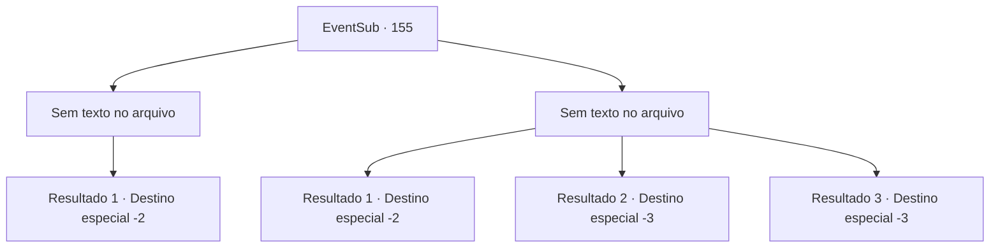

# Eventos secundários · 155

[Índice da tabela](index.md) · [Índice geral](../index.md)

ID: `pt:EventSub:155` · Fonte: `EventSub4` · Versão: 1.2.47.

Mapeamento estático dos arquivos; a disponibilidade e a execução dependem do estado da run.

## Texto do evento

*Sem texto no arquivo.*

## Dados de entrada

```json
{
  "id": 155,
  "grade": 1,
  "subEvent": "",
  "required": ""
}
```

## Mapa das escolhas



## Escolhas e resultados

### Escolha 1

*Sem texto no arquivo; o papel dessa opção depende da interface do jogo.*

Requisitos e outros campos da escolha:

```json
{
  "required": ""
}
```

#### Resultado 1.1

Você e Rohan finalmente derrotam Cira completamente transformada. A lâmina de Rohan atinge o coração de Cira, e ela cospe sangue negro. 

 "Tudo o que eu queria era uma vida comum..."

 Ela termina suas últimas palavras e desmorona no chão. Rohan retira sua espada e fala, lavando o sangue. 

 "Eu não teria sido capaz de derrotar o demônio sem a sua ajuda. Agradeço a você. O fato de você ter vindo até mim também deve ser a vontade do grande deus."

 Ele junta as mãos em oração e diz que a Ordem Sagrada cuidará deste lugar. 

 "Como sinal de gratidão, em breve haverá uma recompensa destinada a você."

 Com um último aperto de mão com Rohan, você sai da caverna.

Continuação registrada: [Destino especial `-2`](../destinos-especiais.md).

```json
{
  "required": "",
  "chance": "1",
  "nextEvent": -2,
  "type": 2,
  "reward": "12_5_9"
}
```

### Escolha 2

*Sem texto no arquivo; o papel dessa opção depende da interface do jogo.*

Requisitos e outros campos da escolha:

```json
{
  "required": ""
}
```

#### Resultado 2.1

Você e Rohan lutam ferozmente com o Cira totalmente virado, Mas vocês dois não são páreo para ela. Você fica atingido pelo chão pelas asas de Cira e perde a consciência quando bate no chão. 

 Quando você acorda com dor de cabeça, encontra Rohan e Cira no chão. A lâmina de Rohan perfurou o coração de Cira, e as garras de Cira são cavadas no abdômen de Rohan. Você se aproxima e os inspeciona. Você descobre que nenhum deles está respirando. Você fecha os olhos de Rohan e Cira e sai da caverna.

Continuação registrada: [Destino especial `-2`](../destinos-especiais.md).

```json
{
  "required": "1_0_2|1_1_2",
  "chance": "1",
  "nextEvent": -2,
  "type": 2,
  "reward": "12_5_8|0_0_-1|0_1_-1"
}
```

#### Resultado 2.2

Você luta ferozmente com a Cira completamente transformada. Você é derrotado e morto.

Continuação registrada: [Destino especial `-3`](../destinos-especiais.md).

```json
{
  "required": "2_0_2",
  "chance": "1",
  "nextEvent": -3,
  "type": 2,
  "reward": "0_0_-1|0_1_-1"
}
```

#### Resultado 2.3

Você luta ferozmente com a Cira completamente transformada. Você é derrotado e morto.

Continuação registrada: [Destino especial `-3`](../destinos-especiais.md).

```json
{
  "required": "2_1_2",
  "chance": "1",
  "nextEvent": -3,
  "type": 2,
  "reward": "0_0_-1|0_1_-1"
}
```

## Referências que chegam a este evento

- [Evento 153 · escolha 2 · resultado 2](0153.md#escolha-2)
