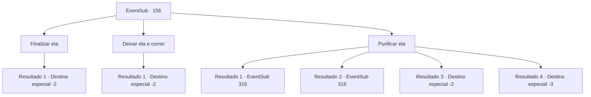

# Eventos secundários · 156

[Índice da tabela](index.md) · [Índice geral](../index.md)

ID: `pt:EventSub:156` · Fonte: `EventSub4` · Versão: 1.2.47.

Mapeamento estático dos arquivos; a disponibilidade e a execução dependem do estado da run.

## Texto do evento

*Sem texto no arquivo.*

## Dados de entrada

```json
{
  "id": 156,
  "grade": 1,
  "subEvent": "",
  "required": ""
}
```

## Mapa das escolhas



## Escolhas e resultados

### Escolha 1

Finalizar ela

Requisitos e outros campos da escolha:

```json
{
  "required": ""
}
```

#### Resultado 1.1

Você se aproxima silenciosamente de Cira, deitada no chão. Ela está imóvel, sangrando, mas não há dúvida de que ela se recuperará se lhe derem algum tempo. Depois de um feroz conflito interno, você decide terminar com Cira. Com um último grito doloroso, Cira olha para o seu rosto com um sorriso fraco e morre. Logo em seguida, seu corpo se torna transparente e desaparece, deixando para trás uma armadura carmesim.

Continuação registrada: [Destino especial `-2`](../destinos-especiais.md).

```json
{
  "required": "",
  "chance": "1",
  "nextEvent": -2,
  "type": 2,
  "reward": "3_206_1|14_5_3|12_5_-1"
}
```

### Escolha 2

Deixar ela e correr

Requisitos e outros campos da escolha:

```json
{
  "required": ""
}
```

#### Resultado 2.1

Você simplesmente não pode matar Cira. Embora agora seja um demônio completamente transformado, você a deixa para trás e foge.

Continuação registrada: [Destino especial `-2`](../destinos-especiais.md).

```json
{
  "required": "",
  "chance": "1",
  "nextEvent": -2,
  "type": 2,
  "reward": "14_5_1|0_3_5|12_5_-1"
}
```

### Escolha 3

Purificar ela

Requisitos e outros campos da escolha:

```json
{
  "required": "20_3_2|20_0_1|18_432_1"
}
```

#### Resultado 3.1

Você rapidamente desenha um círculo de vedação. Você então canaliza o poder sagrado no corpo de Cira. Ela joga a cabeça para trás e grita de dor, enquanto uma substância espessa e vermelha enevoada sai de seus olhos, nariz e boca. <link=shake><color=red>

 "AAAAAAAARRRRGHHHHH!!!!!"

<color></link> Sua armadura se quebra em pedaços quando seu grito chega ao fim. Depois de um tempo, a substância vermelha se dissipa e você pode ver Cira novamente. A armadura vermelha, as garras e chifres afiados, todos eles se foram. Cira agora é uma mulher perfeitamente normal. Você carrega o corpo inconsciente de Cira para fora da caverna.

Continuação registrada: [Evento 316](0316.md) na mesma tabela.

```json
{
  "required": "5_293_1",
  "chance": "1|0_7_1",
  "nextEvent": 316,
  "type": 0,
  "reward": "22_3_-2"
}
```

#### Resultado 3.2

Você rapidamente desenha um círculo de vedação. Você então canaliza o poder sagrado no corpo de Cira. Ela joga a cabeça para trás e grita de dor, enquanto uma substância espessa e vermelha enevoada sai de seus olhos, nariz e boca. <link=shake><color=red>

 "AAAAAAAARRRRGHHHHH!!!!!"

<color></link> Sua armadura se quebra em pedaços quando seu grito chega ao fim. Depois de um tempo, a substância vermelha se dissipa e você pode ver Cira novamente. A armadura vermelha, as garras e chifres afiados, todos eles se foram. Cira agora é uma mulher perfeitamente normal. Você carrega o corpo inconsciente de Cira para fora da caverna.

Continuação registrada: [Evento 316](0316.md) na mesma tabela.

```json
{
  "required": "18_293_1",
  "chance": "1|0_7_2",
  "nextEvent": 316,
  "type": 0,
  "reward": "22_3_-2"
}
```

#### Resultado 3.3

Você rapidamente desenha um círculo de vedação. Você então canaliza o poder sagrado no corpo de Cira. Ela joga a cabeça para trás e grita de dor, enquanto uma substância espessa e vermelha enevoada sai de seus olhos, nariz e boca. <link=shake><color=red>

 "AAAAAAAARRRRGHHHHH!!!!!"

<color></link> Ela bate com os braços e pernas, fazendo o possível para resistir. Finalmente, ela consegue quebrar seu feitiço de limpeza. Você sente sua visão tremendo, enquanto uma dor de cabeça dolorosa engole sua consciência. Infelizmente, você entra em colapso no chão inconsciente. 

 Você nem sabe quanto tempo passou. Quando você abre os olhos, ainda pode sentir sua cabeça doer. Você volta e olha em volta, mas o CIRA não está em lugar algum.

Continuação registrada: [Destino especial `-2`](../destinos-especiais.md).

```json
{
  "required": "1_1_2",
  "chance": "22",
  "nextEvent": -2,
  "type": 1,
  "reward": "14_5_2|12_5_-1|0_1_-1|22_3_-2"
}
```

#### Resultado 3.4

Você rapidamente desenha um círculo de vedação. Você então canaliza o poder sagrado no corpo de Cira. Ela joga a cabeça para trás e grita de dor, enquanto uma substância espessa e vermelha enevoada sai de seus olhos, nariz e boca. <link=shake><color=red>

 "AAAAAAAARRRRGHHHHH!!!!!"

<color></link> Ela bate com os braços e pernas, fazendo o possível para resistir. Finalmente, ela consegue quebrar seu feitiço de limpeza. Você sente sua visão tremendo, enquanto uma dor de cabeça dolorosa engole sua consciência. Infelizmente, você entra em colapso no chão inconsciente.

Continuação registrada: [Destino especial `-3`](../destinos-especiais.md).

```json
{
  "required": "2_1_2",
  "chance": "22",
  "nextEvent": -3,
  "type": 1,
  "reward": "0_1_-1"
}
```

## Referências que chegam a este evento

- [Evento 154 · escolha 1 · resultado 1](0154.md#escolha-1)
