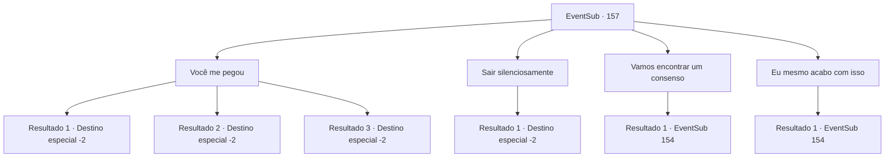

# Eventos secundários · 157

[Índice da tabela](index.md) · [Índice geral](../index.md)

ID: `pt:EventSub:157` · Fonte: `EventSub4` · Versão: 1.2.47.

Mapeamento estático dos arquivos; a disponibilidade e a execução dependem do estado da run.

## Texto do evento

*Sem texto no arquivo.*

## Dados de entrada

```json
{
  "id": 157,
  "grade": 1,
  "subEvent": "",
  "required": ""
}
```

## Mapa das escolhas



## Escolhas e resultados

### Escolha 1

Você me pegou

Requisitos e outros campos da escolha:

```json
{
  "required": ""
}
```

#### Resultado 1.1

Você diz a ela que não se importa com a aparência dela, que ficará ao lado dela como amiga. Cira questiona você com um olhar surpreso. 

 "..Você vai me tratar da mesma forma mesmo quando eu estiver assim?"

 Você acena silenciosamente com a cabeça e estende as mãos. Ela fala com voz trêmula. 

 "Mesmo que você viva como fugitivo pelo resto da vida por minha causa?"

 Em vez de responder, você segura firmemente as mãos dela. Mas os fanáticos do culto parecem não ter intenção de deixar você ir. 

 "Você ousa tentar tirar nosso Deus... você sabe o quão difícil foi o processo?!"

 Eles avançam em sua direção com suas armas em punho, mas não conseguem alcançá-lo. Cira o abraça apertado e abre suas asas. Logo, os dois estão fora da caverna. Após um longo voo, à medida que a caverna fica muito distante para ser vista, ela o solta no chão. 

 "Obrigada... Suas palavras significam muito para mim. Vamos tomar uma bebida algum dia. Estarei esperando."

 Terminando suas palavras, ela voa para longe. Embora ela não tenha lhe dito para onde está indo, você sente que há um vínculo especial que os conecta.

Continuação registrada: [Destino especial `-2`](../destinos-especiais.md).

```json
{
  "required": "",
  "chance": "1|0_14_1",
  "nextEvent": -2,
  "type": 0,
  "reward": "12_5_10"
}
```

#### Resultado 1.2

Você diz a ela que não se importa com a aparência dela, que ficará ao lado dela como amiga. Mas você não consegue deixar de ser dominado pelo medo. Cira reconhece seu tremor. 

 "Tremendo assim... Não acho que você quer dizer o que disse. Mas... ainda assim, suas palavras me consolam. Vá. Vou deixar você viver desta vez."

 Cira vira as costas, como se tivesse terminado de falar com você. Você olha para as costas dela por um momento, antes de acalmar seus ombros trêmulos e sair. Não há mais nada que você possa fazer por um demônio completamente transformado.

Continuação registrada: [Destino especial `-2`](../destinos-especiais.md).

```json
{
  "required": "",
  "chance": "18",
  "nextEvent": -2,
  "type": 1,
  "reward": "14_5_1|12_5_-1"
}
```

#### Resultado 1.3

Você diz a ela que não se importa com a aparência dela, que ficará ao lado dela como um amigo.  Cira olha para você e assente.  

 "Obrigada... você realmente faria isso. Vamos tomar algo juntos um dia. Estarei esperando."

  Ao terminar, ela abre suas asas e voa embora.  Embora ela não tenha lhe dito para onde está indo, você sente que há um laço especial conectando você a ela.

Continuação registrada: [Destino especial `-2`](../destinos-especiais.md).

```json
{
  "required": "5_432_1|18_431_1",
  "chance": "1",
  "nextEvent": -2,
  "type": 2,
  "reward": "12_5_10"
}
```

### Escolha 2

Sair silenciosamente

Requisitos e outros campos da escolha:

```json
{
  "required": ""
}
```

#### Resultado 2.1

Você foge rapidamente, antes que Cira ou os cultistas mudem de ideia. Não há mais nada que você possa fazer por um demônio completamente transformado.

Continuação registrada: [Destino especial `-2`](../destinos-especiais.md).

```json
{
  "required": "",
  "chance": "1",
  "nextEvent": -2,
  "type": 2,
  "reward": "14_5_1|12_5_-1"
}
```

### Escolha 3

Vamos encontrar um consenso

Requisitos e outros campos da escolha:

```json
{
  "required": ""
}
```

#### Resultado 3.1

Você sugere a ela que encontre uma maneira de desfazer sua transformação com você. Mas Cira explode de raiva. 

 "Procurar uma maneira de desfazer isso? Não! NÃO! Esta sou eu de verdade! É assim que realmente pareço!"

 Sangue escorre de seus olhos. 

 "Esta forma miserável sou eu! Melhor do que antes. Porque agora eu tenho poder!"

 Cira grita com raiva e prepara suas garras. Você também pega sua arma silenciosamente. Rohan se prepara também, com sua espada e escudo.

Continuação registrada: [Evento 154](0154.md) na mesma tabela.

```json
{
  "required": "",
  "chance": "1",
  "nextEvent": 154,
  "type": 2,
  "reward": "6_0_102",
  "place": 7
}
```

### Escolha 4

Eu mesmo acabo com isso

Requisitos e outros campos da escolha:

```json
{
  "required": ""
}
```

#### Resultado 4.1

Vendo que não há outra opção, você saca sua arma novamente. Se ela realmente é um demônio completamente transformado, você acha melhor encerrar sua vida com suas próprias mãos em seu último momento. Cira coloca um sorriso triste em sua atitude. 

 "Entendo. Você está pensando a mesma coisa que aquele cruzado. ...Eu vou te matar o mais rápido possível. Esse é meu último favor."


Continuação registrada: [Evento 154](0154.md) na mesma tabela.

```json
{
  "required": "",
  "chance": "1",
  "nextEvent": 154,
  "type": 2,
  "reward": "6_0_102",
  "place": 7
}
```

## Referências que chegam a este evento

- [Evento 150 · escolha 2 · resultado 1](0150.md#escolha-2)
