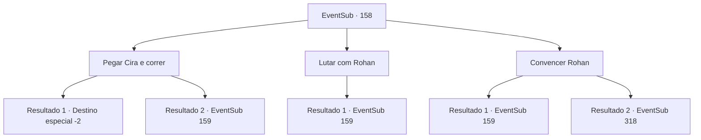

# Eventos secundários · 158

[Índice da tabela](index.md) · [Índice geral](../index.md)

ID: `pt:EventSub:158` · Fonte: `EventSub4` · Versão: 1.2.47.

Mapeamento estático dos arquivos; a disponibilidade e a execução dependem do estado da run.

## Texto do evento

*Sem texto no arquivo.*

## Dados de entrada

```json
{
  "id": 158,
  "grade": 1,
  "subEvent": "",
  "required": ""
}
```

## Mapa das escolhas



## Escolhas e resultados

### Escolha 1

Pegar Cira e correr

Requisitos e outros campos da escolha:

```json
{
  "required": ""
}
```

#### Resultado 1.1

Você segura as mãos de Cira e corre rapidamente. Rohan tenta correr atrás de você, mas não consegue alcançá-lo. Depois de correr por muito tempo, você recupera o fôlego e olha para Cira. Ela está rindo o mais silenciosamente possível. 

 "Ah... hilário. Aquele cruzado, você viu ele tentando correr com aquela armadura pesada?"

 Ela enxuga a lágrima do riso e fala. 

 "Obrigada. Suas palavras significam muito para mim. Agora me sinto melhor... Vamos tomar uma bebida qualquer hora."

 Terminando suas palavras, ela voa para longe. Embora ela não tenha dito para onde está indo, você sente que há um vínculo especial que os conecta.

Continuação registrada: [Destino especial `-2`](../destinos-especiais.md).

```json
{
  "required": "",
  "chance": "1|0_6_1",
  "nextEvent": -2,
  "type": 0,
  "reward": "12_5_10"
}
```

#### Resultado 1.2

Você segura as mãos de Cira e corre, mas Rohan agarra você pela garganta. Com olhos de falcão, ele encara você e balança sua espada.

Continuação registrada: [Evento 159](0159.md) na mesma tabela.

```json
{
  "required": "",
  "chance": "16",
  "nextEvent": 159,
  "type": 1,
  "reward": "6_3_103",
  "place": 7
}
```

### Escolha 2

Lutar com Rohan

Requisitos e outros campos da escolha:

```json
{
  "required": ""
}
```

#### Resultado 2.1

Você saca sua arma, protegendo Cira de Rohan. Ele olha para você com um olhar piedoso e fala. 

 "Você já está hipnotizado... Eu vou te libertar desse feitiço do diabo."


Continuação registrada: [Evento 159](0159.md) na mesma tabela.

```json
{
  "required": "",
  "chance": "1",
  "nextEvent": 159,
  "type": 2,
  "reward": "6_3_103",
  "place": 7
}
```

### Escolha 3

Convencer Rohan

Requisitos e outros campos da escolha:

```json
{
  "required": ""
}
```

#### Resultado 3.1

Você diz a Rohan para não machucar Cira. Mas ele responde com uma expressão séria. 

 "Bobagem... Eu vou te libertar desse feitiço do diabo."


Continuação registrada: [Evento 159](0159.md) na mesma tabela.

```json
{
  "required": "-1|21_3_2|21_0_1|5_432_1",
  "chance": "1",
  "nextEvent": 159,
  "type": 2,
  "reward": "6_3_103",
  "place": 7
}
```

#### Resultado 3.2

Você diz a Rohan para não machucar Cira. Rohan então olha para você em silêncio e continua. 

 "Hmm.... tudo bem. Eu consigo sentir uma certa quantidade de energia sagrada vindo de você. Talvez você possa expulsar o mal do corpo dela. Mas se você falhar, não hesitarei em cortar a cabeça dela."

 Rohan dá um passo para trás ao terminar.

Continuação registrada: [Evento 318](0318.md) na mesma tabela.

```json
{
  "required": "20_3_2|20_0_1|18_432_1",
  "chance": "1",
  "nextEvent": 318,
  "type": 2,
  "reward": ""
}
```

## Referências que chegam a este evento

- [Evento 153 · escolha 1 · resultado 1](0153.md#escolha-1)
