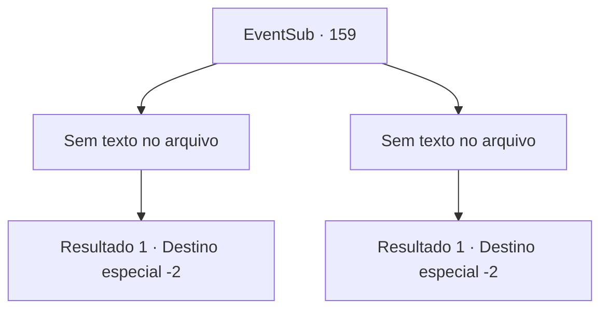

# Eventos secundários · 159

[Índice da tabela](index.md) · [Índice geral](../index.md)

ID: `pt:EventSub:159` · Fonte: `EventSub4` · Versão: 1.2.47.

Mapeamento estático dos arquivos; a disponibilidade e a execução dependem do estado da run.

## Texto do evento

*Sem texto no arquivo.*

## Dados de entrada

```json
{
  "id": 159,
  "grade": 1,
  "subEvent": "",
  "required": ""
}
```

## Mapa das escolhas



## Escolhas e resultados

### Escolha 1

*Sem texto no arquivo; o papel dessa opção depende da interface do jogo.*

Requisitos e outros campos da escolha:

```json
{
  "required": ""
}
```

#### Resultado 1.1

Você derrota Rohan. Ele tenta se equilibrar usando sua espada como uma parede, mas logo cai. Cira te abraça por trás, enquanto você está respirando pesadamente. 

 "Obrigado. Agora eu sei o que você quer dizer... Vamos tomar uma bebida algum dia. Eu estarei esperando."

 Terminando suas palavras, ela voa para longe, espalhando suas asas. Embora ela não tenha te dito para onde está indo, você sente que há um vínculo especial conectando vocês dois.

Continuação registrada: [Destino especial `-2`](../destinos-especiais.md).

```json
{
  "required": "",
  "chance": "1",
  "nextEvent": -2,
  "type": 2,
  "reward": "12_5_10"
}
```

### Escolha 2

*Sem texto no arquivo; o papel dessa opção depende da interface do jogo.*

Requisitos e outros campos da escolha:

```json
{
  "required": ""
}
```

#### Resultado 2.1

Rohan te atinge com seu escudo e você é jogado ao chão. Seu corpo chega aos pés de Cira. Rohan exclama em uma voz desesperada. 

 "Acorde! Aquilo não passa de um demônio impuro! Ela não é mais sua amiga!!"

 Ele então pega sua espada novamente e se aproxima de Cira. Ignorando-o, Cira te abraça apertado e fala. 

 "Demônio, deusa... Isso é tudo o que você espera de mim. Eu sou... apenas eu."

 Rohan para por um segundo, perplexo. Aproveitando a oportunidade, Cira abre suas asas e sai da caverna em um instante. Após um longo voo, conforme a caverna fica muito distante para ser vista, ela te solta ao chão. 

 "Obrigado... Suas palavras significam muito para mim. Vamos tomar uma bebida algum dia. Estarei esperando."

 Terminando suas palavras, ela voa para longe. Embora ela não tenha te dito para onde está indo, você sente que há um vínculo especial que te conecta a ela.

Continuação registrada: [Destino especial `-2`](../destinos-especiais.md).

```json
{
  "required": "",
  "chance": "1",
  "nextEvent": -2,
  "type": 2,
  "reward": "12_5_10"
}
```

## Referências que chegam a este evento

- [Evento 158 · escolha 1 · resultado 2](0158.md#escolha-1)
- [Evento 158 · escolha 2 · resultado 1](0158.md#escolha-2)
- [Evento 158 · escolha 3 · resultado 1](0158.md#escolha-3)
