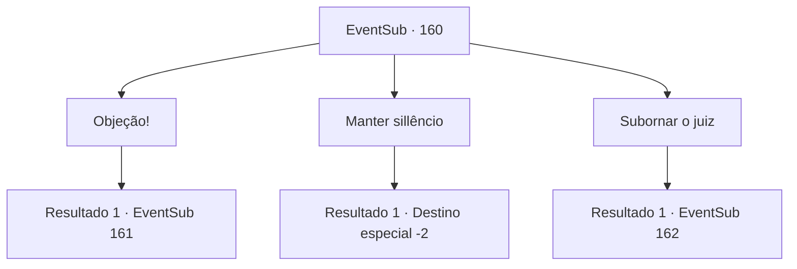

# Eventos secundários · 160

[Índice da tabela](index.md) · [Índice geral](../index.md)

ID: `pt:EventSub:160` · Fonte: `EventSub4` · Versão: 1.2.47.

Mapeamento estático dos arquivos; a disponibilidade e a execução dependem do estado da run.

## Texto do evento

Ao se aproximar de uma cidade, você encontra uma praça cheia de gente. Parece haver algum tipo de julgamento acontecendo. Um padre levanta a mão e fala. 

 "Meritíssimo, esta mulher é uma personificação do próprio diabo! Esse chifre feio é a evidência. Portanto, acredito que ela deve ser queimada imediatamente!"

 O discurso entusiasmado do padre é respondido com aplausos da multidão fervorosa. Sua curiosidade pela garota que parece um demônio leva você para a multidão.

## Dados de entrada

```json
{
  "id": 160,
  "grade": 2,
  "subEvent": "",
  "required": "12_5_5"
}
```

## Mapa das escolhas



## Escolhas e resultados

### Escolha 1

Objeção!

Requisitos e outros campos da escolha:

```json
{
  "required": ""
}
```

#### Resultado 1.1

Você grita confiantemente uma objeção. A multidão suspira enquanto olham para você, e a mulher te encara com uma expressão igualmente surpresa. O padre que sugeriu a queima dela grita em resposta, descontente. 

 "Quem se atreve a interromper o julgamento sagrado!"

 Sua voz como um sinalizador, os guardas que patrulham ao redor do julgamento apontam as pontas de suas lanças para você. Mas o juiz ordena que parem e pergunta a razão de interromper o julgamento.

Continuação registrada: [Evento 161](0161.md) na mesma tabela.

```json
{
  "required": "",
  "chance": "1",
  "nextEvent": 161,
  "type": 2,
  "reward": ""
}
```

### Escolha 2

Manter sillêncio

Requisitos e outros campos da escolha:

```json
{
  "required": ""
}
```

#### Resultado 2.1

Você observa silenciosamente o julgamento sem interrompê-lo. O juiz pede um intervalo e desaparece. Cerca de 10 minutos depois, o juiz, ao retornar ao seu assento, sentencia a mulher à morte. Ela é levada à estaca ardente e amarrada a um pilar de madeira. Mesmo enquanto é queimada viva, a mulher com um chifre diabólico não grita de dor, mas grita desesperadamente com todas as suas forças. 

 "Vocês são os verdadeiros demônios! Eu só queria viver como todo mundo!! SEUS FILHOS DA PUTA!"

 Enquanto o fogo ardente consome tudo, a multidão começa a deixar a praça um por um. Você encara a pilha negra de cinzas por um momento antes de se afastar silenciosamente.

Continuação registrada: [Destino especial `-2`](../destinos-especiais.md).

```json
{
  "required": "",
  "chance": "1",
  "nextEvent": -2,
  "type": 2,
  "reward": "12_5_-1"
}
```

### Escolha 3

Subornar o juiz

Requisitos e outros campos da escolha:

```json
{
  "required": "1_4_300"
}
```

#### Resultado 3.1

Você se aproxima do juiz durante o intervalo, logo antes de ele declarar a sentença final. Você entrega a ele uma bolsa pesada cheia de ouro e pede que o veredicto seja de inocência. Ele abre a bolsa e a pega. 

 "Na verdade, eu também não acho que ela seja um demônio. Sem asas, sem cauda e o chifre é mais como uma corcunda.."

 Logo, o juiz retorna ao seu assento e o julgamento recomeça. Com uma expressão séria, ele bate o martelo e fala. 

 "O veredicto final será anunciado. O réu é inocente! Portanto, a partir deste momento, ordeno que a desacorrentem e a deixem ir livre."

 O padre fica surpreso com o veredicto inesperado e objeta, mas o juiz não muda sua decisão. Logo, Cira, liberta das correntes, olha para você com um olhar incrédulo. 

 "O que você está fazendo aqui? Por que você me salvou? Talvez... você esteja deslumbrado com a minha beleza?"


Continuação registrada: [Evento 162](0162.md) na mesma tabela.

```json
{
  "required": "",
  "chance": "1",
  "nextEvent": 162,
  "type": 2,
  "reward": "0_4_-300"
}
```

## Referências que chegam a este evento

Nenhum `nextEvent` positivo da mesma tabela aponta para este nó. Isso não prova que seja inacessível: sorteio e estado de história podem selecioná-lo.

