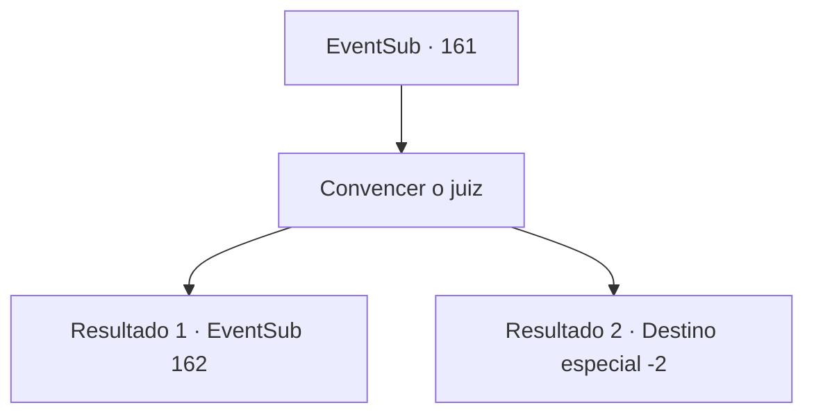

# Eventos secundários · 161

[Índice da tabela](index.md) · [Índice geral](../index.md)

ID: `pt:EventSub:161` · Fonte: `EventSub4` · Versão: 1.2.47.

Mapeamento estático dos arquivos; a disponibilidade e a execução dependem do estado da run.

## Texto do evento

*Sem texto no arquivo.*

## Dados de entrada

```json
{
  "id": 161,
  "grade": 1,
  "subEvent": "",
  "required": ""
}
```

## Mapa das escolhas



## Escolhas e resultados

### Escolha 1

Convencer o juiz

Requisitos e outros campos da escolha:

```json
{
  "required": ""
}
```

#### Resultado 1.1

Você começa a explicar logicamente sobre por que ela não é um demônio. A princípio, o juiz parece duvidoso, mas à medida que seu argumento impecável continua, ele começa a concordar. Quando você termina sua defesa, o juiz bate seu martelo.
 *slam**slam**slam*
 A voz do juiz ecoa por toda a praça. 

 "O veredicto final será anunciado. O réu é inocente! Portanto, a partir desse momento, ordenei que a desviie e a deixei se libertar."

 O padre fica surpreso com o veredicto e os objetos inesperados, mas o juiz não muda sua decisão. Logo, Cira, libertado das correntes, olha para você com um olhar incrédulo. 

 "O que você está fazendo aqui? Por que você me salvou? Talvez ... você está deslumbrado com minha beleza?"


Continuação registrada: [Evento 162](0162.md) na mesma tabela.

```json
{
  "required": "",
  "chance": "1|0_7_1",
  "nextEvent": 162,
  "type": 0,
  "reward": ""
}
```

#### Resultado 1.2

Você começa a explicar por que ela não é um demônio. Seu argumento é sobre como ela parece um pouco diferente dos humanos normais, Mas a expressão do juiz permanece duvidosa até o fim.
 *bam**bam**bam*
 A voz do juiz ecoa por toda a praça. 

 "O veredicto final será anunciado. Pena de morte! Leve-a para a estaca em chamas e realize a imolação imediatamente."

 Logo, seu corpo queima na estaca em chamas, queimada pelo fogo violento. Mesmo enquanto se queima vivo, a senhora com um chifre do estilo diabólico não grita de dor, mas grita desesperadamente com todo o seu poder. 

 "VOCÊS SÃO OS VERDADEIROS DEMÔNIOS! Eu só queria viver como todo mundo!! BABACAS!!"

 Enquanto o fogo ardente consome tudo, a multidão começa a deixar a praça um por um. Você olha para a pilha preta de cinzas por um breve momento antes de se afastar em silêncio.

Continuação registrada: [Destino especial `-2`](../destinos-especiais.md).

```json
{
  "required": "",
  "chance": "14",
  "nextEvent": -2,
  "type": 1,
  "reward": "12_5_-1"
}
```

## Referências que chegam a este evento

- [Evento 160 · escolha 1 · resultado 1](0160.md#escolha-1)
