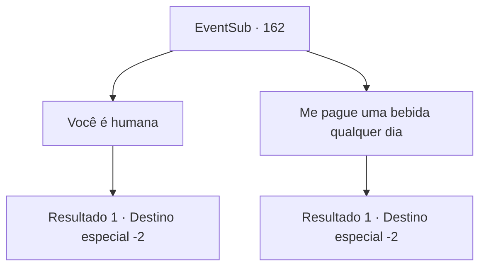

# Eventos secundários · 162

[Índice da tabela](index.md) · [Índice geral](../index.md)

ID: `pt:EventSub:162` · Fonte: `EventSub4` · Versão: 1.2.47.

Mapeamento estático dos arquivos; a disponibilidade e a execução dependem do estado da run.

## Texto do evento

*Sem texto no arquivo.*

## Dados de entrada

```json
{
  "id": 162,
  "grade": 1,
  "subEvent": "",
  "required": ""
}
```

## Mapa das escolhas



## Escolhas e resultados

### Escolha 1

Você é humana

Requisitos e outros campos da escolha:

```json
{
  "required": ""
}
```

#### Resultado 1.1

Você diz a ela que a ajudou simplesmente porque ela é humana, não um demônio. Ela olha para você com olhos vazios, como se não esperasse essa resposta, e começa a rir. Seu riso continua por um tempo. Depois de uma longa risada, ela enxuga a lágrima nos olhos, sorri feliz e fala. 

 "Você tem coragem de dizer isso mesmo depois de olhar para meu chifre. Nunca conheci alguém assim antes. Ah, e nem sabemos nossos nomes ainda."

 Você se apresenta orgulhosamente. Ela faz o mesmo. 

 "Me chamo Cira. Vou garantir que um dia eu te recompense. Estou quebrada como o inferno agora. Até mais. Hehe!"

 Cira abre os bolsos vazios em suas calças, como se mostrasse evidências de como está quebrada, então sai da praça da cidade com passos felizes.

Continuação registrada: [Destino especial `-2`](../destinos-especiais.md).

```json
{
  "required": "",
  "chance": "1",
  "nextEvent": -2,
  "type": 2,
  "reward": "12_5_2"
}
```

### Escolha 2

Me pague uma bebida qualquer dia

Requisitos e outros campos da escolha:

```json
{
  "required": ""
}
```

#### Resultado 2.1

Diga a ela para comprar uma bebida algum dia, se ela realmente estiver agradecida. Ela olha para você com olhos vazios, como se não esperasse tal resposta, e explode em risadas. Sua risada continua por um tempo. Depois de uma longa risada, ela enxuga a lágrima nos olhos, sorri feliz e fala. 

 "Ah, pode apostar. Vou te deixar bêbado o dia inteiro. Ah, e nem sabemos nossos nomes ainda."

 Você se apresenta orgulhosamente. Ela faz o mesmo. 

 "Me chamo Cira. Vou garantir que te recompense algum dia. Estou quebrada pra caramba agora. Até mais. Hehe!"

 Cira abre os bolsos vazios em suas calças, como se mostrasse evidências de como está quebrada, então sai da praça da cidade com passos felizes.

Continuação registrada: [Destino especial `-2`](../destinos-especiais.md).

```json
{
  "required": "",
  "chance": "1",
  "nextEvent": -2,
  "type": 2,
  "reward": "12_5_2"
}
```

## Referências que chegam a este evento

- [Evento 160 · escolha 3 · resultado 1](0160.md#escolha-3)
- [Evento 161 · escolha 1 · resultado 1](0161.md#escolha-1)
