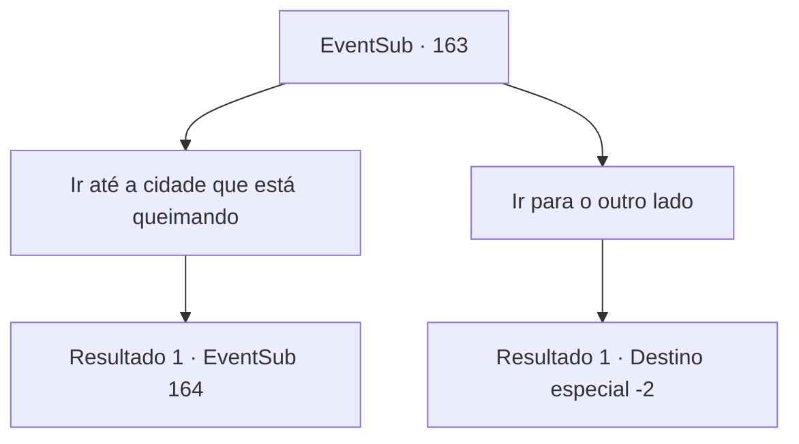

# Eventos secundários · 163

[Índice da tabela](index.md) · [Índice geral](../index.md)

ID: `pt:EventSub:163` · Fonte: `EventSub4` · Versão: 1.2.47.

Mapeamento estático dos arquivos; a disponibilidade e a execução dependem do estado da run.

## Texto do evento

Ao atravessar uma ponte localizada perto de uma cidade chamada 'Mariposa', você encontra um soldado sangrando. Ele está gravemente ferido, mas parece muito focado em fugir de algo, com uma expressão de medo. Quando você consegue acalmá-lo e perguntar o que aconteceu, ele treme e conta tudo. 

 "Demônio! Um demônio apareceu! Está queimando a cidade inteira e massacrando pessoas!"

 Ele fala alto e aponta para a direção de onde veio. |drawing_burnCastle| A cidade em si não é visível, mas você pode definitivamente ver a fumaça subindo do que deve ser a cidade. Depois de terminar sua frase, o soldado espuma e desmaia. Você deita o corpo dele com gentileza e se percebe hesitante.

## Dados de entrada

```json
{
  "id": 163,
  "grade": 1,
  "subEvent": "",
  "required": "12_5_7"
}
```

## Mapa das escolhas



## Escolhas e resultados

### Escolha 1

Ir até a cidade que está queimando

Requisitos e outros campos da escolha:

```json
{
  "required": ""
}
```

#### Resultado 1.1

Você acelera seus passos em direção à fumaça, para verificar as coisas que ele disse. Você encontra a cidade outrora famosa, famosa por suas flores e borboletas, virou-se para nada além de ruínas. Entre os edifícios quebrados estão inúmeros corpos de civis mortos, e o vento frio sopra apenas aumenta a atmosfera ameaçadora. De repente, você ouve alguém chamando seu nome de suas costas. 

 "... {1}?"

 Quando você se vira rapidamente, você vê Cira, aquela moça que você conheceu antes. Mas ela não é como você se lembra dela. |drawing_devilCira| Nas costas, há um par de asas escuras e carmesim, enquanto o chifre ficou maior. Seus olhos estão inteiramente negros e ela cheira a sangue. Ela questiona você em uma voz fria. Você ainda está surpreso. 

 "O que você está fazendo aqui?"


Continuação registrada: [Evento 164](0164.md) na mesma tabela.

```json
{
  "required": "",
  "chance": "1",
  "nextEvent": 164,
  "type": 2,
  "reward": ""
}
```

### Escolha 2

Ir para o outro lado

Requisitos e outros campos da escolha:

```json
{
  "required": ""
}
```

#### Resultado 2.1

Não querendo descobrir a verdade sobre o demônio mencionado em uma cidade, você deixa o homem e segue para outro lugar.

Continuação registrada: [Destino especial `-2`](../destinos-especiais.md).

```json
{
  "required": "",
  "chance": "1",
  "nextEvent": -2,
  "type": 2,
  "reward": "12_5_-1"
}
```

## Referências que chegam a este evento

Nenhum `nextEvent` positivo da mesma tabela aponta para este nó. Isso não prova que seja inacessível: sorteio e estado de história podem selecioná-lo.

