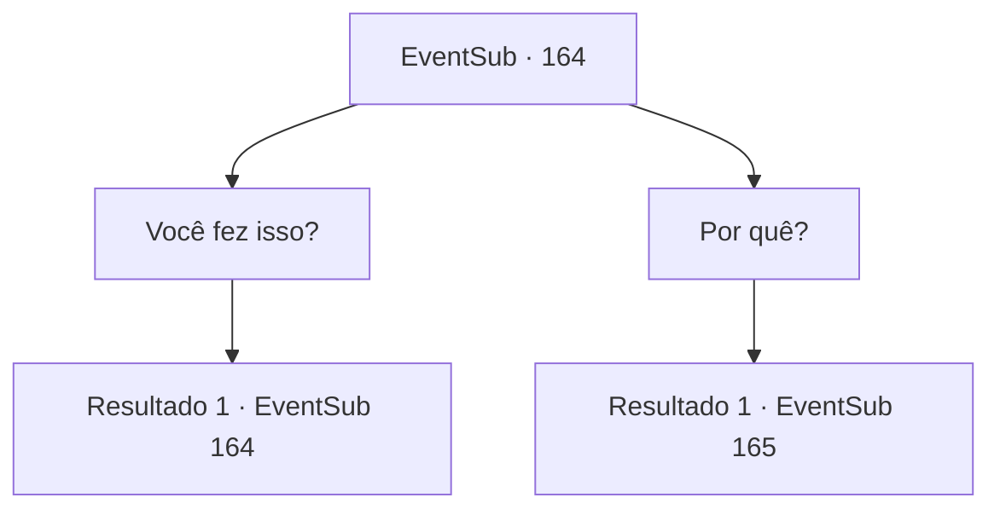

# Eventos secundários · 164

[Índice da tabela](index.md) · [Índice geral](../index.md)

ID: `pt:EventSub:164` · Fonte: `EventSub4` · Versão: 1.2.47.

Mapeamento estático dos arquivos; a disponibilidade e a execução dependem do estado da run.

## Texto do evento

*Sem texto no arquivo.*

## Dados de entrada

```json
{
  "id": 164,
  "grade": 1,
  "subEvent": "",
  "required": ""
}
```

## Mapa das escolhas



## Escolhas e resultados

### Escolha 1

Você fez isso?

Requisitos e outros campos da escolha:

```json
{
  "required": "5_186_0"
}
```

#### Resultado 1.1

Você pergunta a ela por que ela queimou a cidade. Então, Cira ri alegremente e responde. 

 "Sim. Fui eu. Você não consegue ver?"

 Ainda olhando para você, ela estende sua cauda para um monte de destroços. Um porco, presumivelmente trancado dentro de um celeiro destruído, fica preso em sua cauda, emitindo um grito alto. É apenas um animal de criação, mas o porco parece ter percebido sua morte. Cira usa seu poder para estourar o corpo do porco com sua cauda. É como se Cira estivesse te dizendo que ela pode transformá-lo no que costumava ser o porco a qualquer momento. Ela continua com um sorriso maligno. 

 "Eu... sou um verdadeiro demônio agora. Não mais um meio como antes..."


Continuação registrada: [Evento 164](0164.md) na mesma tabela.

```json
{
  "required": "",
  "chance": "1",
  "nextEvent": 164,
  "type": 2,
  "reward": "5_186_1"
}
```

### Escolha 2

Por quê?

Requisitos e outros campos da escolha:

```json
{
  "required": "5_186_1"
}
```

#### Resultado 2.1

Respondendo à sua pergunta, Cira abre os braços largos e olha ao redor. Sangue pinga de suas longas garras. 

 "Aqui. Minha cidade natal. Tudo que costumava me atormentar e intimidar estava bem aqui. Embora agora tudo tenha desaparecido. Heehee... heeheehee..."

 Ela explode em risadas, mas soa mais anticlimática do que feliz. Terminando sua risada, Cira lambe suas garras ensanguentadas e continua. 

 "Vou me livrar de tudo que me causou dor. Se você deseja me impedir... isso incluirá você também."


Continuação registrada: [Evento 165](0165.md) na mesma tabela.

```json
{
  "required": "",
  "chance": "1",
  "nextEvent": 165,
  "type": 2,
  "reward": ""
}
```

## Referências que chegam a este evento

- [Evento 163 · escolha 1 · resultado 1](0163.md#escolha-1)
- [Evento 164 · escolha 1 · resultado 1](0164.md#escolha-1)
