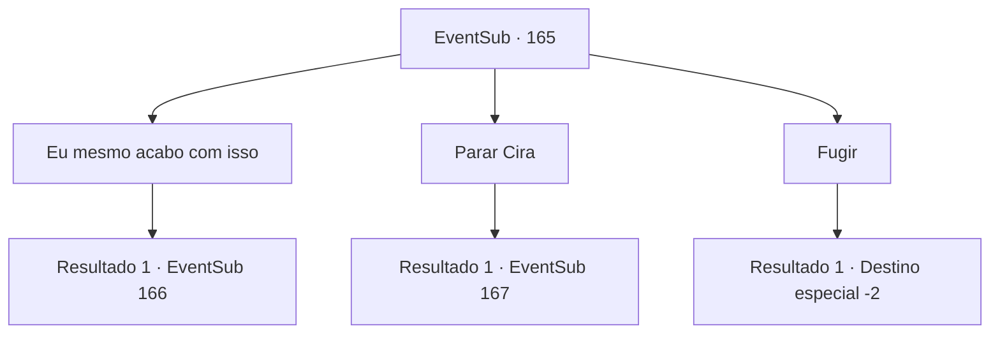

# Eventos secundários · 165

[Índice da tabela](index.md) · [Índice geral](../index.md)

ID: `pt:EventSub:165` · Fonte: `EventSub4` · Versão: 1.2.47.

Mapeamento estático dos arquivos; a disponibilidade e a execução dependem do estado da run.

## Texto do evento

*Sem texto no arquivo.*

## Dados de entrada

```json
{
  "id": 165,
  "grade": 1,
  "subEvent": "",
  "required": ""
}
```

## Mapa das escolhas



## Escolhas e resultados

### Escolha 1

Eu mesmo acabo com isso

Requisitos e outros campos da escolha:

```json
{
  "required": ""
}
```

#### Resultado 1.1

Não vendo outra opção, você saca sua arma. Se ela realmente é um demônio completo, você acha melhor apenas acabar com a vida dela com suas próprias mãos. Cira ri em resposta à sua atitude, alegremente. 

 "Ahahahaha! Que assim seja. Eu também vou te matar."


Continuação registrada: [Evento 166](0166.md) na mesma tabela.

```json
{
  "required": "",
  "chance": "1",
  "nextEvent": 166,
  "type": 2,
  "reward": "6_0_102",
  "place": 7
}
```

### Escolha 2

Parar Cira

Requisitos e outros campos da escolha:

```json
{
  "required": ""
}
```

#### Resultado 2.1

Você convence Cira a parar de cometer mais pecados. Cira ri de você e fala. 

 "Oh, apenas tente me impedir então. Devo ver sua determinação?"

 Ela então avança em sua direção com suas longas garras.

Continuação registrada: [Evento 167](0167.md) na mesma tabela.

```json
{
  "required": "",
  "chance": "1",
  "nextEvent": 167,
  "type": 2,
  "reward": ""
}
```

### Escolha 3

Fugir

Requisitos e outros campos da escolha:

```json
{
  "required": ""
}
```

#### Resultado 3.1

Você transpira profusamente e foge dela. Ao ver você fugindo, Cira ri. 

 "Ahahahah! Isso mesmo! Corra! Fuja! Eu vou deixar você ir desta vez, corra como um pequeno inseto!"

 Ela não te persegue, mantendo sua promessa, mas tudo o que você consegue pensar é em continuar correndo como o soldado sangrando que você viu na ponte. Finalmente, quando você não consegue mais ver a cidade, começa a vomitar e cai no chão. Depois de respirar pesadamente por um tempo, você segue na direção oposta da cidade.

Continuação registrada: [Destino especial `-2`](../destinos-especiais.md).

```json
{
  "required": "",
  "chance": "1",
  "nextEvent": -2,
  "type": 2,
  "reward": "14_5_2|12_5_-1"
}
```

## Referências que chegam a este evento

- [Evento 164 · escolha 2 · resultado 1](0164.md#escolha-2)
