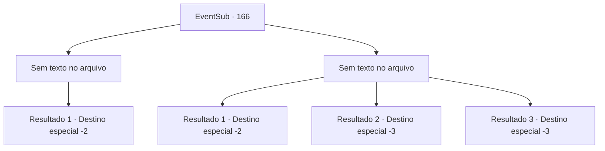

# Eventos secundários · 166

[Índice da tabela](index.md) · [Índice geral](../index.md)

ID: `pt:EventSub:166` · Fonte: `EventSub4` · Versão: 1.2.47.

Mapeamento estático dos arquivos; a disponibilidade e a execução dependem do estado da run.

## Texto do evento

*Sem texto no arquivo.*

## Dados de entrada

```json
{
  "id": 166,
  "grade": 1,
  "subEvent": "",
  "required": ""
}
```

## Mapa das escolhas



## Escolhas e resultados

### Escolha 1

*Sem texto no arquivo; o papel dessa opção depende da interface do jogo.*

Requisitos e outros campos da escolha:

```json
{
  "required": ""
}
```

#### Resultado 1.1

Você luta ferozmente contra o demônio completamente transformado, Cira. Ela te ataca impiedosamente com uma sequência de ataques, mas você identifica uma fraqueza e consegue derrotá-la. Ao perceber sua morte, Cira grita de agonia, chorando lágrimas negras. 

 "Eu... Se eu tivesse nascido comum...!"

 Após amaldiçoar o mundo com todas as suas forças, Cira finalmente cai pela última vez, encarando o seu rosto. Logo em seguida, seu corpo se torna transparente e desaparece, deixando para trás uma armadura carmesim. Você pega o que restou de Cira e vai embora.

Continuação registrada: [Destino especial `-2`](../destinos-especiais.md).

```json
{
  "required": "",
  "chance": "1",
  "nextEvent": -2,
  "type": 2,
  "reward": "14_5_3|3_206_1|12_5_-1"
}
```

### Escolha 2

*Sem texto no arquivo; o papel dessa opção depende da interface do jogo.*

Requisitos e outros campos da escolha:

```json
{
  "required": ""
}
```

#### Resultado 2.1

Você luta ferozmente contra o demônio completamente transformado, Cira, mas acaba perdendo. Cira fala com os olhos estreitos. 

 "Você salvou minha vida uma vez, então se você fugir agora, eu vou deixar você ir."

 Usando o último ato de misericórdia de Cira, você vira as costas para ela e foge, gritando. Cira ri de você pelas costas, mas tudo o que você consegue pensar é em continuar correndo como o soldado ferido que você viu na ponte. Finalmente, quando você não consegue mais ver a cidade, começa a vomitar e cai no chão. Quando você abre os olhos novamente, a intensa dor muscular lhe diz que o pesadelo ainda não acabou.

Continuação registrada: [Destino especial `-2`](../destinos-especiais.md).

```json
{
  "required": "1_0_2|1_1_2",
  "chance": "1",
  "nextEvent": -2,
  "type": 2,
  "reward": "14_5_2|0_0_-1|0_1_-1|12_5_-1"
}
```

#### Resultado 2.2

Você luta ferozmente contra o demônio completamente transformado, Cira, mas acaba perdendo. Cira fala com um sorriso sádico. 

 "Você vai me entender, certo?"

 Ela prossegue devorando sua alma.

Continuação registrada: [Destino especial `-3`](../destinos-especiais.md).

```json
{
  "required": "2_0_2",
  "chance": "1",
  "nextEvent": -3,
  "type": 2,
  "reward": "0_0_-1|0_1_-1"
}
```

#### Resultado 2.3

Você luta ferozmente contra o demônio completamente transformado, Cira, mas acaba perdendo. Cra fala com um sorriso sádico. 

 "Você vai me entender, certo?"

 Ela prossegue devorando sua alma.

Continuação registrada: [Destino especial `-3`](../destinos-especiais.md).

```json
{
  "required": "2_1_2",
  "chance": "1",
  "nextEvent": -3,
  "type": 2,
  "reward": "0_0_-1|0_1_-1"
}
```

## Referências que chegam a este evento

- [Evento 165 · escolha 1 · resultado 1](0165.md#escolha-1)
- [Evento 167 · escolha 2 · resultado 1](0167.md#escolha-2)
