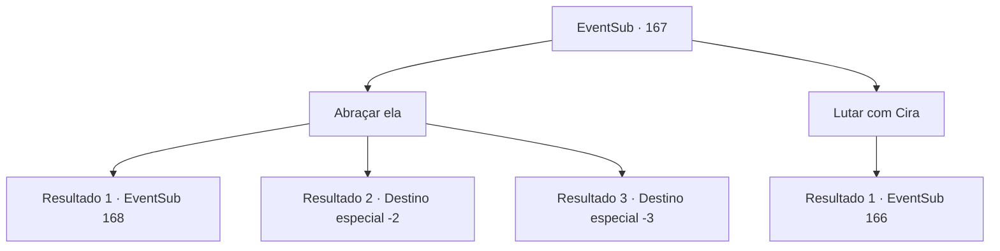

# Eventos secundários · 167

[Índice da tabela](index.md) · [Índice geral](../index.md)

ID: `pt:EventSub:167` · Fonte: `EventSub4` · Versão: 1.2.47.

Mapeamento estático dos arquivos; a disponibilidade e a execução dependem do estado da run.

## Texto do evento

*Sem texto no arquivo.*

## Dados de entrada

```json
{
  "id": 167,
  "grade": 1,
  "subEvent": "",
  "required": ""
}
```

## Mapa das escolhas



## Escolhas e resultados

### Escolha 1

Abraçar ela

Requisitos e outros campos da escolha:

```json
{
  "required": "18_91_3|18_92_3|18_8_2"
}
```

#### Resultado 1.1

Você se aproxima dela, dizendo que não quer lutar com ela. Ela balança suas garras e cauda em você. Uma dor excruciante atinge seus sentidos. Pedaços de carne são arrancados e sangue é espirrado por toda parte. Mas você continua a caminhar em direção a ela e a abraça. Ela derrama lágrimas carmesim e pergunta a você. 

 "O que eu devo fazer... parecendo assim... eu não posso voltar a ser como eu costumava ser."


Continuação registrada: [Evento 168](0168.md) na mesma tabela.

```json
{
  "required": "",
  "chance": "1|0_13_1",
  "nextEvent": 168,
  "type": 0,
  "reward": ""
}
```

#### Resultado 1.2

Você se aproxima dela, dizendo que não quer lutar com ela. Cira balança suas garras em você, e você foge, com as costas sangrando viradas para ela. Ao ver você fugindo, Cira ri. 

 "Ahahahah! Isso mesmo! Corra! Fuja! Eu vou deixar você ir desta vez, corra como um pequeno inseto!"

 Ela não te persegue, mantendo sua promessa, mas tudo o que você consegue pensar é em continuar correndo como o soldado sangrando que você viu na ponte. Finalmente, quando você não consegue mais ver a cidade, começa a vomitar e cai no chão. Depois de respirar pesadamente por um tempo, você segue na direção oposta da cidade.

Continuação registrada: [Destino especial `-2`](../destinos-especiais.md).

```json
{
  "required": "1_0_2",
  "chance": "12",
  "nextEvent": -2,
  "type": 1,
  "reward": "14_5_2|0_0_-1|12_5_-1"
}
```

#### Resultado 1.3

Você se aproxima dela, dizendo que não quer lutar com ela. Cira balança suas garras em você, e você cai, sangrando.

Continuação registrada: [Destino especial `-3`](../destinos-especiais.md).

```json
{
  "required": "2_0_2",
  "chance": "12",
  "nextEvent": -3,
  "type": 1,
  "reward": "0_0_-1"
}
```

### Escolha 2

Lutar com Cira

Requisitos e outros campos da escolha:

```json
{
  "required": ""
}
```

#### Resultado 2.1

Sem ver outra opção, você saca sua arma. Se ela realmente é um demônio completo, você acha melhor apenas acabar com a vida dela com suas próprias mãos. Cira ri em resposta à sua atitude, alegremente. 

 "Ahahahaha! Que assim seja. Eu também vou te matar."


Continuação registrada: [Evento 166](0166.md) na mesma tabela.

```json
{
  "required": "",
  "chance": "1",
  "nextEvent": 166,
  "type": 2,
  "reward": "6_0_102",
  "place": 7
}
```

## Referências que chegam a este evento

- [Evento 165 · escolha 2 · resultado 1](0165.md#escolha-2)
