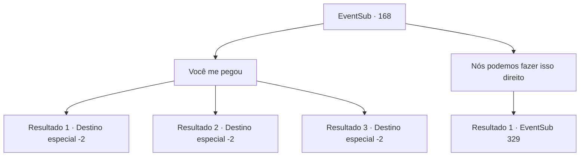

# Eventos secundários · 168

[Índice da tabela](index.md) · [Índice geral](../index.md)

ID: `pt:EventSub:168` · Fonte: `EventSub4` · Versão: 1.2.47.

Mapeamento estático dos arquivos; a disponibilidade e a execução dependem do estado da run.

## Texto do evento

*Sem texto no arquivo.*

## Dados de entrada

```json
{
  "id": 168,
  "grade": 1,
  "subEvent": "",
  "required": ""
}
```

## Mapa das escolhas



## Escolhas e resultados

### Escolha 1

Você me pegou

Requisitos e outros campos da escolha:

```json
{
  "required": ""
}
```

#### Resultado 1.1

Você diz a ela que não se importa com a aparência dela, que ficará ao lado dela como amiga. Cira questiona você com um olhar surpreso. 

 "..Você vai me tratar da mesma forma mesmo quando eu estiver assim?"

 Você acena silenciosamente com a cabeça e estende as mãos. Ela fala com voz trêmula. 

 "Mesmo que você possa ser perseguido pelos cruzados pelo resto da sua vida?"

 Você segura as mãos dela em vez de responder. Ela olha para o chão por um momento e fala novamente, levantando a cabeça. 

 "Obrigada... Isso significa muito para mim. Vamos tomar uma bebida algum dia. Estarei esperando."

 Depois de terminar, ela abre suas asas e voa para longe. Embora ela não tenha dito para onde está indo, você sente que há um vínculo especial que conecta você a ela.

Continuação registrada: [Destino especial `-2`](../destinos-especiais.md).

```json
{
  "required": "",
  "chance": "1|0_14_1",
  "nextEvent": -2,
  "type": 0,
  "reward": "12_5_10"
}
```

#### Resultado 1.2

Você diz a ela que não se importa com a aparência dela, que ficará ao lado dela como amiga. Mas você não consegue deixar de ser dominado pelo medo. Cira reconhece seu tremor. 

 "Tremendo assim... Não acho que você quer dizer o que disse. Mas... ainda assim, suas palavras me consolam. Vá. Vou deixar você viver desta vez."

 Cira vira as costas, como se tivesse terminado de falar com você. Você olha para as costas dela por um momento, antes de acalmar seus ombros trêmulos e sair. Não há mais nada que você possa fazer por um demônio completamente transformado.

Continuação registrada: [Destino especial `-2`](../destinos-especiais.md).

```json
{
  "required": "",
  "chance": "18",
  "nextEvent": -2,
  "type": 1,
  "reward": "12_5_-1|14_5_2"
}
```

#### Resultado 1.3

Você diz a ela que não se importa com a aparência dela, que ficará ao lado dela como um amigo.  Cira olha para você e assente.  

 "Obrigada... você realmente faria isso. Vamos tomar algo juntos um dia. Estarei esperando."

  Ao terminar, ela abre suas asas e voa embora.  Embora ela não tenha lhe dito para onde está indo, você sente que há um laço especial conectando você a ela.

Continuação registrada: [Destino especial `-2`](../destinos-especiais.md).

```json
{
  "required": "5_432_1|18_431_1",
  "chance": "1",
  "nextEvent": -2,
  "type": 2,
  "reward": "12_5_10"
}
```

### Escolha 2

Nós podemos fazer isso direito

Requisitos e outros campos da escolha:

```json
{
  "required": "20_3_2|20_0_1"
}
```

#### Resultado 2.1

Você pede a confiança dela, dizendo que sabe transformar Cira de volta em um humano. Ela olha em seus olhos e assente lentamente. Você rapidamente desenha um círculo de vedação. Você então canaliza o poder sagrado no corpo de Cira. Ela joga a cabeça para trás e grita de dor, enquanto uma substância espessa e vermelha enevoada sai de seus olhos, nariz e boca. <link=shake><color=red> 

 "AAAAAAAARRRRGHHHHH!!!!!"

<color></link> Sua armadura se quebra em pedaços quando seu grito chega ao fim. Depois de um tempo, a substância vermelha se dissipa e você pode ver Cira novamente. A armadura vermelha, as garras e chifres afiados, todos eles se foram. Cira agora é uma mulher perfeitamente normal, deitada no chão como se exausta.

Continuação registrada: [Evento 329](0329.md) na mesma tabela.

```json
{
  "required": "",
  "chance": "1",
  "nextEvent": 329,
  "type": 2,
  "reward": "22_3_-2"
}
```

## Referências que chegam a este evento

- [Evento 167 · escolha 1 · resultado 1](0167.md#escolha-1)
