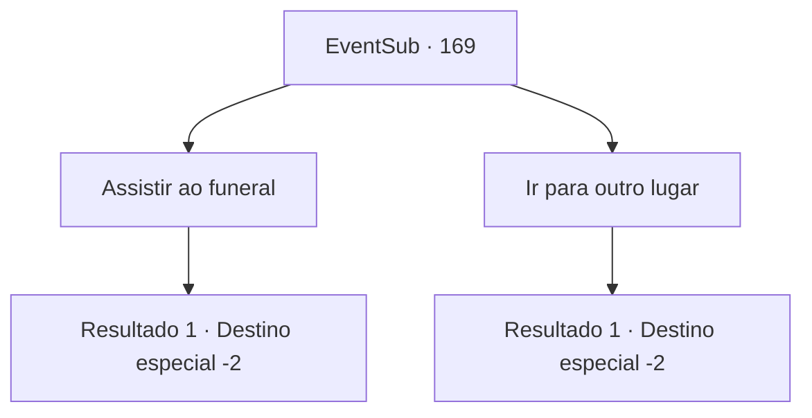

# Eventos secundários · 169

[Índice da tabela](index.md) · [Índice geral](../index.md)

ID: `pt:EventSub:169` · Fonte: `EventSub4` · Versão: 1.2.47.

Mapeamento estático dos arquivos; a disponibilidade e a execução dependem do estado da run.

## Texto do evento

Um dia, ao passar por uma igreja em uma cidade, um nome familiar atinge seus ouvidos. Quando você se aproxima da fonte desse nome, você vê o funeral do cruzado, Rohan.

## Dados de entrada

```json
{
  "id": 169,
  "grade": 1,
  "subEvent": "",
  "required": "12_5_6"
}
```

## Mapa das escolhas



## Escolhas e resultados

### Escolha 1

Assistir ao funeral

Requisitos e outros campos da escolha:

```json
{
  "required": ""
}
```

#### Resultado 1.1

Muitos crentes lançam flores brancas no caixão de Rohan e enviam-lhe orações, mantendo as mãos juntas. Um jovem padre com uma bengala se curva a eles, mostrando gratidão. Segundo ele, Rohan conseguiu derrotar a demônio após uma longa batalha, mas sofreu um ferimento fatal que lhe tirou a vida. Você observou por um tempo e virou as costas.

Continuação registrada: [Destino especial `-2`](../destinos-especiais.md).

```json
{
  "required": "",
  "chance": "1",
  "nextEvent": -2,
  "type": 2,
  "reward": "12_5_-1|14_5_3|14_5_4"
}
```

### Escolha 2

Ir para outro lugar

Requisitos e outros campos da escolha:

```json
{
  "required": ""
}
```

#### Resultado 2.1

Muitos crentes estão lançando flores brancas no caixão de Rohan. Mas a visão disso não consegue capturar sua atenção, e você se afasta.

Continuação registrada: [Destino especial `-2`](../destinos-especiais.md).

```json
{
  "required": "",
  "chance": "1",
  "nextEvent": -2,
  "type": 2,
  "reward": "12_5_-1|14_5_3|14_5_4"
}
```

## Referências que chegam a este evento

Nenhum `nextEvent` positivo da mesma tabela aponta para este nó. Isso não prova que seja inacessível: sorteio e estado de história podem selecioná-lo.

