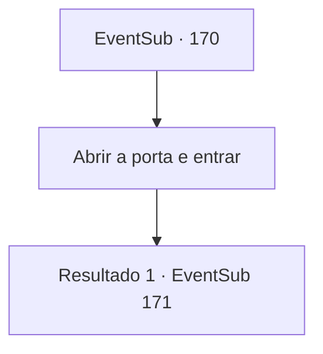

# Eventos secundários · 170

[Índice da tabela](index.md) · [Índice geral](../index.md)

ID: `pt:EventSub:170` · Fonte: `EventSub4` · Versão: 1.2.47.

Mapeamento estático dos arquivos; a disponibilidade e a execução dependem do estado da run.

## Texto do evento

Um dia, ao passar por uma igreja em uma cidade, um nome familiar atinge seus ouvidos. Quando você se aproxima da fonte desse nome, você vê o funeral do cruzado, Rohan. De repente, um jovem com um manto de padre se aproxima de você e pergunta. 

 "Você poderia ser... {1}?"

 Quando você acena com a cabeça, o jovem se apresenta como Albert, guiando você para dentro da igreja. Albert fala com você enquanto caminha. 

 "O irmão Rohan nos notificou de sua presença em seus dias de vida, por meio de cartas. Ouvimos que você foi de grande ajuda para derrotar o diabo."

 Terminando sua frase, Albert para em frente a uma certa sala. A placa diz 'Câmara de Selamento'.

## Dados de entrada

```json
{
  "id": 170,
  "grade": 1,
  "subEvent": "",
  "required": "12_5_8|18_432_1"
}
```

## Mapa das escolhas



## Escolhas e resultados

### Escolha 1

Abrir a porta e entrar

Requisitos e outros campos da escolha:

```json
{
  "required": ""
}
```

#### Resultado 1.1

Quando você abre a porta e entra, você vê uma armadura de prata embrulhada em correntes prateadas. Albert aponta para a armadura e a descreve. 

 "Essa é a armadura deixada por Cira."

 Ele para de falar e espreita para você. Logo ele retorna o olhar para a armadura de Cira e continua. 

 "Queremos que você pegue isso, {1}. Já passamos pelo processo de limpeza, então qualquer sinal de mal se foi há muito tempo. Quer você aceite ou não, faremos o que desejar. Qual será a sua decisão?"


Continuação registrada: [Evento 171](0171.md) na mesma tabela.

```json
{
  "required": "",
  "chance": "1",
  "nextEvent": 171,
  "type": 2,
  "reward": "14_5_3"
}
```

## Referências que chegam a este evento

Nenhum `nextEvent` positivo da mesma tabela aponta para este nó. Isso não prova que seja inacessível: sorteio e estado de história podem selecioná-lo.

