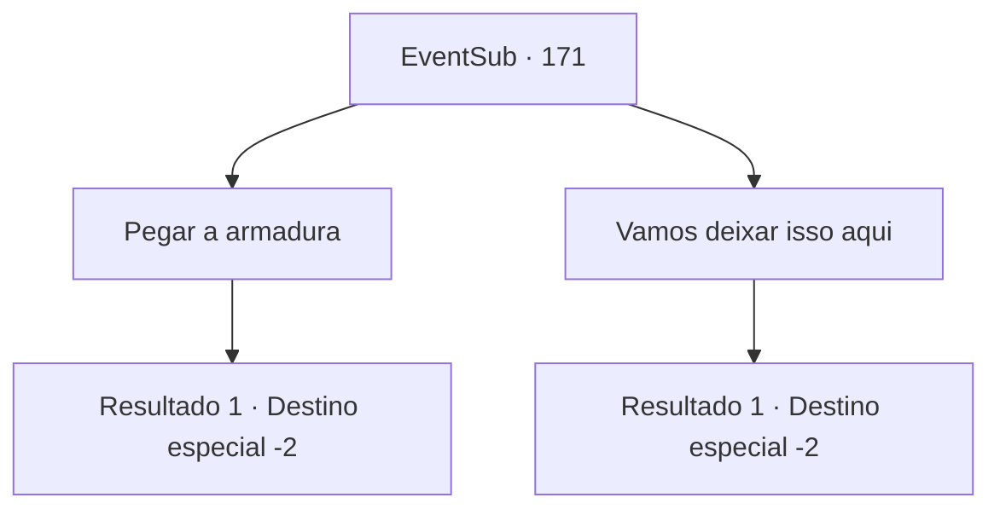

# Eventos secundários · 171

[Índice da tabela](index.md) · [Índice geral](../index.md)

ID: `pt:EventSub:171` · Fonte: `EventSub4` · Versão: 1.2.47.

Mapeamento estático dos arquivos; a disponibilidade e a execução dependem do estado da run.

## Texto do evento

*Sem texto no arquivo.*

## Dados de entrada

```json
{
  "id": 171,
  "grade": 1,
  "subEvent": "",
  "required": ""
}
```

## Mapa das escolhas



## Escolhas e resultados

### Escolha 1

Pegar a armadura

Requisitos e outros campos da escolha:

```json
{
  "required": ""
}
```

#### Resultado 1.1

Você diz que vai pegar a armadura de Cira. 

 "Obrigado. O irmão Rohan também ficaria satisfeito, sem dúvida."

 Albert então te entrega a armadura. Ela parece ser muito comum para algo que pertencia a um demônio. Você abaixa a cabeça em gratidão e envia orações para Rohan também.

Continuação registrada: [Destino especial `-2`](../destinos-especiais.md).

```json
{
  "required": "",
  "chance": "1",
  "nextEvent": -2,
  "type": 2,
  "reward": "14_5_4|3_207_1|12_5_-1"
}
```

### Escolha 2

Vamos deixar isso aqui

Requisitos e outros campos da escolha:

```json
{
  "required": ""
}
```

#### Resultado 2.1

Você sugere que a armadura de Cira fique na igreja. Albert acena com a cabeça e fala. 

 "Hmm... então vamos garantir que cuidaremos muito bem dela."

 Você concorda, sai da Câmara de Selamento e participa do funeral de Rohan. Depois de se despedir de Albert, você sai da igreja.

Continuação registrada: [Destino especial `-2`](../destinos-especiais.md).

```json
{
  "required": "",
  "chance": "1",
  "nextEvent": -2,
  "type": 2,
  "reward": "14_5_4|0_3_5|12_5_-1"
}
```

## Referências que chegam a este evento

- [Evento 170 · escolha 1 · resultado 1](0170.md#escolha-1)
