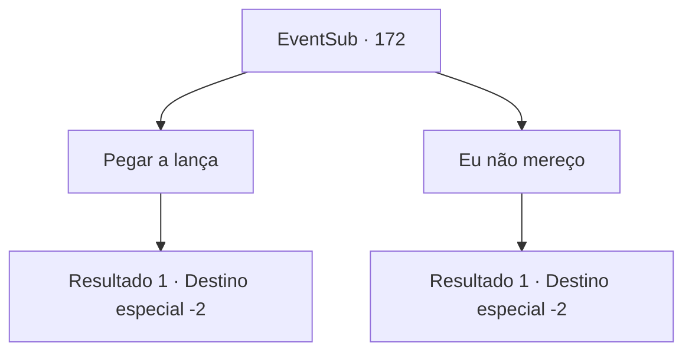

# Eventos secundários · 172

[Índice da tabela](index.md) · [Índice geral](../index.md)

ID: `pt:EventSub:172` · Fonte: `EventSub4` · Versão: 1.2.47.

Mapeamento estático dos arquivos; a disponibilidade e a execução dependem do estado da run.

## Texto do evento

Um dia, quando você está andando por uma igreja em uma cidade, um jovem com um manto de padre se aproxima de você e pergunta. 

 "Você poderia ser... {1}?"

 Quando você acena com a cabeça, o jovem se apresenta como Albert, guiando você para dentro da igreja. Você encontra Rohan na capela. Ele não esconde seus sentimentos de alegria por vê-lo novamente. 

 "Bem-vindo, {1}. É bom vê-lo novamente."

 Ele ordena que Albert traga algo embrulhado em seda. Ao abrir a seda, você encontra uma lança, brilhando com uma aura branca. 

 "É sua recompensa da igreja. Eu não teria sido capaz de derrotar o demônio sem sua ajuda, então, por favor, pegue."


## Dados de entrada

```json
{
  "id": 172,
  "grade": 1,
  "subEvent": "",
  "required": "12_5_9"
}
```

## Mapa das escolhas



## Escolhas e resultados

### Escolha 1

Pegar a lança

Requisitos e outros campos da escolha:

```json
{
  "required": ""
}
```

#### Resultado 1.1

Você pega a lança branca. Rohan te dá um tapinha no ombro e fala. 

 "Espero te ver mais vezes derrotando demônios. Foi um prazer te conhecer."

 Ele te acompanha até a saída e volta para a capela.

Continuação registrada: [Destino especial `-2`](../destinos-especiais.md).

```json
{
  "required": "",
  "chance": "1",
  "nextEvent": -2,
  "type": 2,
  "reward": "12_5_-1|14_5_3|3_60_1"
}
```

### Escolha 2

Eu não mereço

Requisitos e outros campos da escolha:

```json
{
  "required": ""
}
```

#### Resultado 2.1

Você acena com as mãos, dizendo que não merece tal item. Mas Rohan te obriga a pegar a lança. 

 "Se você não aceitar isso, não é um ato de humildade, mas de humor. Eu não estaria aqui vivo sem você. Vou saber disso quando você estiver pegando."

 Ele te acompanha até a saída e retorna para a capela.

Continuação registrada: [Destino especial `-2`](../destinos-especiais.md).

```json
{
  "required": "",
  "chance": "1",
  "nextEvent": -2,
  "type": 2,
  "reward": "12_5_-1|14_5_3|3_60_1"
}
```

## Referências que chegam a este evento

Nenhum `nextEvent` positivo da mesma tabela aponta para este nó. Isso não prova que seja inacessível: sorteio e estado de história podem selecioná-lo.

