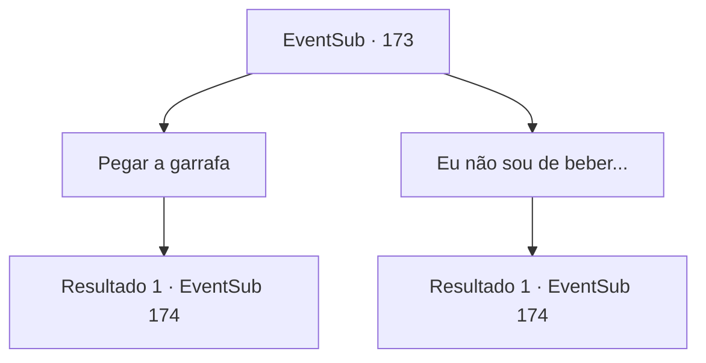

# Eventos secundários · 173

[Índice da tabela](index.md) · [Índice geral](../index.md)

ID: `pt:EventSub:173` · Fonte: `EventSub4` · Versão: 1.2.47.

Mapeamento estático dos arquivos; a disponibilidade e a execução dependem do estado da run.

## Texto do evento

Você sai de sua barraca, na névoa espessa. Então, você ouve alguém te chamando. 

 "Ei amigo. Sou eu."

 Ao sair de sua barraca, Cira está de pé ao lado da fogueira apagada. Ela está segurando uma garrafa de rum em cada mão. Quando ela vê você saindo, ela o cumprimenta calorosamente, abanando o rabo. 

 "Ah.. Achei que não seria divertido beber sozinho. Aqui."

 Ela lhe entrega um das garrafas de rum.

## Dados de entrada

```json
{
  "id": 173,
  "grade": 2,
  "subEvent": "",
  "required": "12_5_10"
}
```

## Mapa das escolhas



## Escolhas e resultados

### Escolha 1

Pegar a garrafa

Requisitos e outros campos da escolha:

```json
{
  "required": ""
}
```

#### Resultado 1.1

Você aceita o rum que ela oferece. Os dois brindam. Uma forte sensação de queimação preenche seu esôfago, mas logo você se sente ótimo. 

 "Não consigo mais me satisfazer com bebidas normais. Talvez seja forte demais para você. Haha. Estou aqui para falar sobre coisas da vida. A espessa névoa facilita a furtividade também..."

 Ela começa a contar histórias sobre sua vida recente, quando nem mesmo você pediu. Segundo ela, ela encontrou abrigo em uma montanha de neve alta e decorou como sua casa. Ela explica que pensou que as pessoas não seriam capazes de encontrá-la assim.

Continuação registrada: [Evento 174](0174.md) na mesma tabela.

```json
{
  "required": "",
  "chance": "1",
  "nextEvent": 174,
  "type": 2,
  "reward": "0_1_1"
}
```

### Escolha 2

Eu não sou de beber...

Requisitos e outros campos da escolha:

```json
{
  "required": ""
}
```

#### Resultado 2.1

Você recusa o rum. Ela engole a garrafa inteira de uma vez e limpa o rum ao redor de seus lábios com o braço. 

 "Eu não consigo mais me satisfazer com bebidas normais. Talvez seja forte demais para você. Haha. Estou aqui para falar sobre coisas da vida. A espessa névoa facilita a fuga também..."

 Ela começa a contar histórias sobre sua vida recente, quando nem mesmo pediu por isso. Segundo ela, ela encontrou abrigo em uma casa de yeti nas altas montanhas nevadas e a decorou como sua casa. Ela explica que pensou que as pessoas não seriam capazes de encontrá-la assim.

Continuação registrada: [Evento 174](0174.md) na mesma tabela.

```json
{
  "required": "",
  "chance": "1",
  "nextEvent": 174,
  "type": 2,
  "reward": ""
}
```

## Referências que chegam a este evento

Nenhum `nextEvent` positivo da mesma tabela aponta para este nó. Isso não prova que seja inacessível: sorteio e estado de história podem selecioná-lo.

