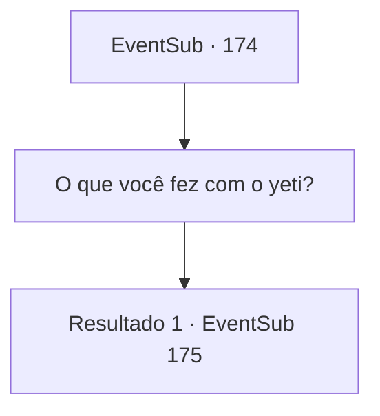

# Eventos secundários · 174

[Índice da tabela](index.md) · [Índice geral](../index.md)

ID: `pt:EventSub:174` · Fonte: `EventSub4` · Versão: 1.2.47.

Mapeamento estático dos arquivos; a disponibilidade e a execução dependem do estado da run.

## Texto do evento

*Sem texto no arquivo.*

## Dados de entrada

```json
{
  "id": 174,
  "grade": 1,
  "subEvent": "",
  "required": ""
}
```

## Mapa das escolhas



## Escolhas e resultados

### Escolha 1

O que você fez com o yeti?

Requisitos e outros campos da escolha:

```json
{
  "required": ""
}
```

#### Resultado 1.1

Respondendo à sua pergunta, Cira coloca um sorriso malévolo e responde. 

 "Eu cortei em pedaços e comi."

 Ela então explode em risadas. 

 "Brincadeira, brincadeira. Eu apenas assustei ele. Se você estiver interessado... quer vir visitar?"


Continuação registrada: [Evento 175](0175.md) na mesma tabela.

```json
{
  "required": "",
  "chance": "1",
  "nextEvent": 175,
  "type": 2,
  "reward": ""
}
```

## Referências que chegam a este evento

- [Evento 173 · escolha 1 · resultado 1](0173.md#escolha-1)
- [Evento 173 · escolha 2 · resultado 1](0173.md#escolha-2)
