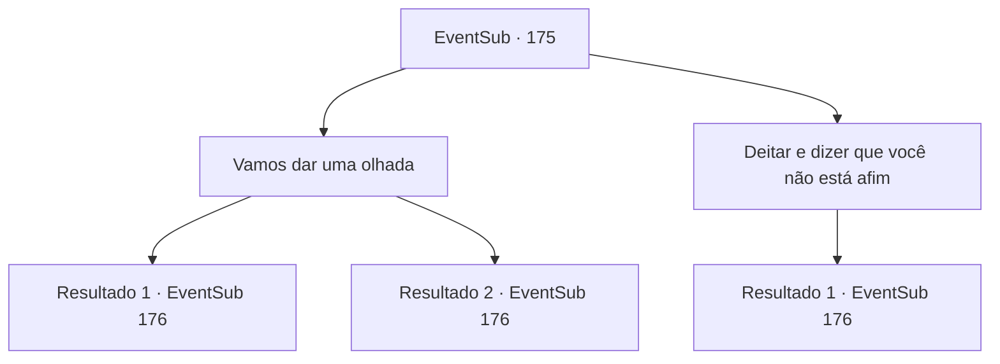

# Eventos secundários · 175

[Índice da tabela](index.md) · [Índice geral](../index.md)

ID: `pt:EventSub:175` · Fonte: `EventSub4` · Versão: 1.2.47.

Mapeamento estático dos arquivos; a disponibilidade e a execução dependem do estado da run.

## Texto do evento

*Sem texto no arquivo.*

## Dados de entrada

```json
{
  "id": 175,
  "grade": 1,
  "subEvent": "",
  "required": ""
}
```

## Mapa das escolhas



## Escolhas e resultados

### Escolha 1

Vamos dar uma olhada

Requisitos e outros campos da escolha:

```json
{
  "required": ""
}
```

#### Resultado 1.1

Assim como você está prestes a responder sim, você vê um pequeno flash na floresta. Você percebe instintivamente que é uma flecha e a desvia. Cira está surpreso, mas não leva muito tempo para entender a situação. 

 "Ah ... cruzados. Isso é irritante ... como é que vocês me encontram todas as vezes?"

 Os cruzados mostram hostilidade para com você e o CIRA, então você não tem escolha a não ser desenhar sua arma. |drawing_withCira|

Continuação registrada: [Evento 176](0176.md) na mesma tabela.

```json
{
  "required": "",
  "chance": "1|0_6_1",
  "nextEvent": 176,
  "type": 0,
  "reward": "6_0_50",
  "place": 1
}
```

#### Resultado 1.2

Assim como você está prestes a responder sim, uma flecha voa da floresta e pousa no braço de Cira. Ela grita de dor e olha para as costas dela. Cira está surpreso, mas não leva muito tempo para entender a situação. 

 "Ah ... cruzados. Isso é irritante ... como é que vocês me encontram todas as vezes?"

 Os cruzados mostram hostilidade para com você e o CIRA, então você não tem escolha a não ser desenhar sua arma. |drawing_withCira|

Continuação registrada: [Evento 176](0176.md) na mesma tabela.

```json
{
  "required": "",
  "chance": "12",
  "nextEvent": 176,
  "type": 1,
  "reward": "6_3_50",
  "place": 1
}
```

### Escolha 2

Deitar e dizer que você não está afim

Requisitos e outros campos da escolha:

```json
{
  "required": ""
}
```

#### Resultado 2.1

Você deitou maliciosamente, dizendo que é muito trabalho para andar até agora. Ela abaixa a cabeça para agarrá -lo. Nesse momento, uma flecha quehes por sua cabeça. Cira está surpreso, mas não leva muito tempo para entender a situação. 

 "Ah ... cruzados. Isso é irritante ... como é que vocês me encontram todas as vezes?"

 Os cruzados mostram hostilidade para com você e o CIRA, então você não tem escolha a não ser desenhar sua arma. |drawing_withCira|

Continuação registrada: [Evento 176](0176.md) na mesma tabela.

```json
{
  "required": "",
  "chance": "1",
  "nextEvent": 176,
  "type": 2,
  "reward": "6_0_50",
  "place": 1
}
```

## Referências que chegam a este evento

- [Evento 174 · escolha 1 · resultado 1](0174.md#escolha-1)
