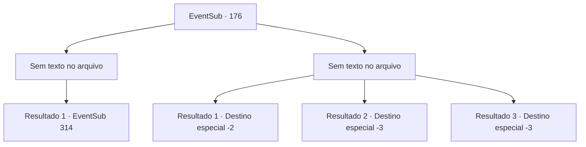

# Eventos secundários · 176

[Índice da tabela](index.md) · [Índice geral](../index.md)

ID: `pt:EventSub:176` · Fonte: `EventSub4` · Versão: 1.2.47.

Mapeamento estático dos arquivos; a disponibilidade e a execução dependem do estado da run.

## Texto do evento

*Sem texto no arquivo.*

## Dados de entrada

```json
{
  "id": 176,
  "grade": 1,
  "subEvent": "",
  "required": ""
}
```

## Mapa das escolhas



## Escolhas e resultados

### Escolha 1

*Sem texto no arquivo; o papel dessa opção depende da interface do jogo.*

Requisitos e outros campos da escolha:

```json
{
  "required": ""
}
```

#### Resultado 1.1

Você ajuda Cira a derrotar os cruzados. Eles não estão mortos, mas caem no chão sangrando. 

 "Vamos fiança. Antes que mais deles cheguem."

 Ela te abraça com força, abre suas asas e voa no céu. Você pode ver a visão de montanhas nevadas distantes, através da névoa. Cira diz para você segurar com força e depois aumenta sua velocidade. 

 Depois de alguns minutos, você chega à casa de Cira. Talvez Cira estivesse certa. Talvez um Yeti tenha visto para morar aqui. É assim que a caverna é larga. Você segue Cira nas partes mais profundas da caverna. No interior, há prateleiras de pedra cheias de diferentes tipos de bebidas alcoólicas, alguns livros e uma cama feita com couro de animal.

Continuação registrada: [Evento 314](0314.md) na mesma tabela.

```json
{
  "required": "",
  "chance": "1",
  "nextEvent": 314,
  "type": 2,
  "reward": ""
}
```

### Escolha 2

*Sem texto no arquivo; o papel dessa opção depende da interface do jogo.*

Requisitos e outros campos da escolha:

```json
{
  "required": ""
}
```

#### Resultado 2.1

Você luta contra os cruzados, mas acaba sendo derrotado. O cruzado que te venceu então corre para Cira, e logo cai no chão sangrando. 

 "Até mais. E certifique-se de escapar antes que os reforços cheguem."

 Ela te dá um tapinha na cabeça e voa para longe.

Continuação registrada: [Destino especial `-2`](../destinos-especiais.md).

```json
{
  "required": "1_0_2|1_1_2",
  "chance": "1",
  "nextEvent": -2,
  "type": 2,
  "reward": "14_5_0|0_0_-1|0_1_-1|12_5_-1"
}
```

#### Resultado 2.2

Você é morto por um dos cruzados. A voz de Cira, gritando 'Não!', desaparece.

Continuação registrada: [Destino especial `-3`](../destinos-especiais.md).

```json
{
  "required": "2_0_2",
  "chance": "1",
  "nextEvent": -3,
  "type": 2,
  "reward": "0_0_-1|0_1_-1"
}
```

#### Resultado 2.3

Você é morto por um dos cruzados. A voz de Cira, gritando 'Não!', desaparece.

Continuação registrada: [Destino especial `-3`](../destinos-especiais.md).

```json
{
  "required": "2_1_2",
  "chance": "1",
  "nextEvent": -3,
  "type": 2,
  "reward": "0_0_-1|0_1_-1"
}
```

## Referências que chegam a este evento

- [Evento 175 · escolha 1 · resultado 1](0175.md#escolha-1)
- [Evento 175 · escolha 1 · resultado 2](0175.md#escolha-1)
- [Evento 175 · escolha 2 · resultado 1](0175.md#escolha-2)
