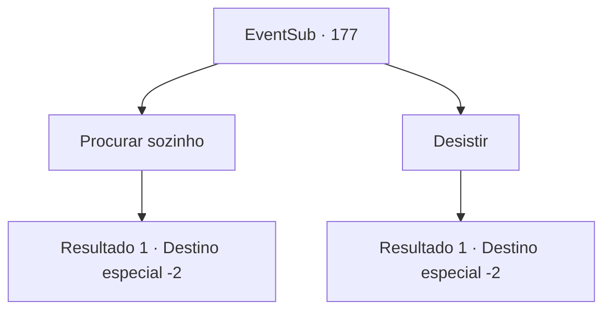

# Eventos secundários · 177

[Índice da tabela](index.md) · [Índice geral](../index.md)

ID: `pt:EventSub:177` · Fonte: `EventSub4` · Versão: 1.2.47.

Mapeamento estático dos arquivos; a disponibilidade e a execução dependem do estado da run.

## Texto do evento

*Sem texto no arquivo.*

## Dados de entrada

```json
{
  "id": 177,
  "grade": 1,
  "subEvent": "",
  "required": ""
}
```

## Mapa das escolhas



## Escolhas e resultados

### Escolha 1

Procurar sozinho

Requisitos e outros campos da escolha:

```json
{
  "required": ""
}
```

#### Resultado 1.1

Você decide procurar o Túmulo do Luto Ardente sozinho.

Continuação registrada: [Destino especial `-2`](../destinos-especiais.md).

```json
{
  "required": "",
  "chance": "1",
  "nextEvent": -2,
  "type": 2,
  "reward": "12_2_3"
}
```

### Escolha 2

Desistir

Requisitos e outros campos da escolha:

```json
{
  "required": ""
}
```

#### Resultado 2.1

Você desiste de encontrar a tumba e parte em busca de outras aventuras.

Continuação registrada: [Destino especial `-2`](../destinos-especiais.md).

```json
{
  "required": "",
  "chance": "1",
  "nextEvent": -2,
  "type": 2,
  "reward": "12_2_-1"
}
```

## Referências que chegam a este evento

- [Evento 41 · escolha 1 · resultado 1](0041.md#escolha-1)
- [Evento 41 · escolha 2 · resultado 1](0041.md#escolha-2)
- [Evento 41 · escolha 3 · resultado 1](0041.md#escolha-3)
