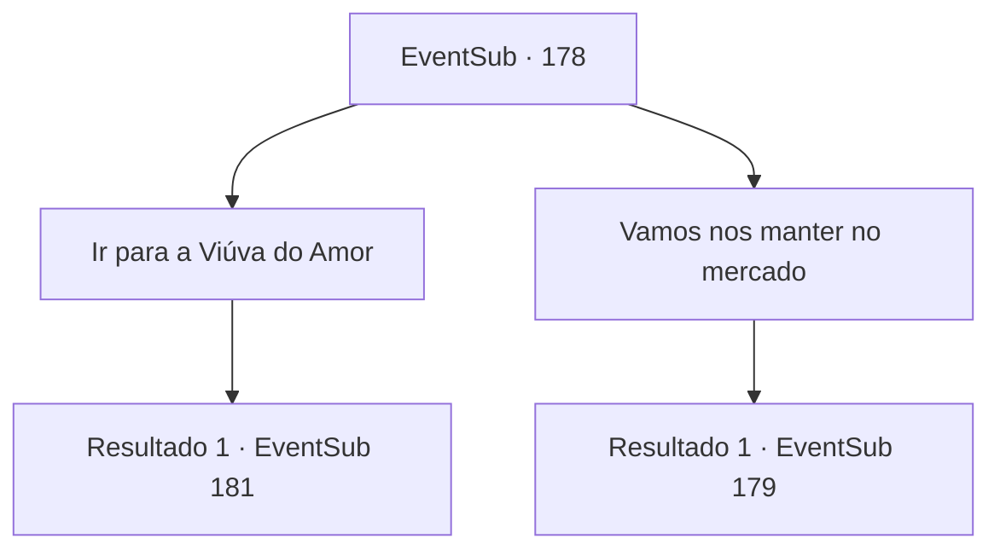

# Eventos secundários · 178

[Índice da tabela](index.md) · [Índice geral](../index.md)

ID: `pt:EventSub:178` · Fonte: `EventSub4` · Versão: 1.2.47.

Mapeamento estático dos arquivos; a disponibilidade e a execução dependem do estado da run.

## Texto do evento

|drawing_harbor| Um dia sob os raios escaldantes do sol, você chega à cidade costeira de 'Levantium', É uma cidade infestada de piratas, sempre cheia de marinheiros do pior tipo e crimes. Você olha ao redor da cidade e entra no mercado. A primeira coisa que chama a atenção são marinheiros de pele de cobre, tentando chamar a atenção de outras pessoas. 

 "AGORA OU NUNCA!! Verdadeiros 'homens viris' que desejam se juntar à busca por tritões, encontre-nos na Viúva do Amor até hoje à noite!"

 Aparentemente, a conversa sobre uma oportunidade de ganhar dinheiro e ver os tritões é suficiente para interessar as pessoas.

## Dados de entrada

```json
{
  "id": 178,
  "grade": 1,
  "subEvent": "",
  "required": "12_6_0|1_2_35"
}
```

## Mapa das escolhas



## Escolhas e resultados

### Escolha 1

Ir para a Viúva do Amor

Requisitos e outros campos da escolha:

```json
{
  "required": ""
}
```

#### Resultado 1.1

Você conversa com os marinheiros e encontra a Viúva do Amor. Em frente à galé com um nome estranho, está um homem com um chapéu de capitão, fazendo audições para pessoas. Ele se apresenta como Parrie. Quando Parrie assobia, um homem encapuzado atrás dele sai, ficando em frente à mesa preparada. Outro homem, com uma tatuagem de caveira no braço, fica em frente a ele. Ao sinal do Capitão Parrie, os dois começam a lutar braço de ferro. O vencedor é o homem encapuzado. Ele dobra o braço do oponente ao meio, e Parrie o parabeniza, gritando. 

 "Só quero os mais masculinos dos mais masculinos! Apenas aqueles que têm confiança podem se aproximar!"

 Ao testemunhar a força do homem encapuzado, a maioria das pessoas fica hesitante. Parrie, olhando ao redor, te encontra.

Continuação registrada: [Evento 181](0181.md) na mesma tabela.

```json
{
  "required": "",
  "chance": "1",
  "nextEvent": 181,
  "type": 2,
  "reward": ""
}
```

### Escolha 2

Vamos nos manter no mercado

Requisitos e outros campos da escolha:

```json
{
  "required": ""
}
```

#### Resultado 2.1

Você decide passear pelo mercado, em vez de caçar sereias. Felizmente, uma das lojas está vendendo um pargo vermelho a um bom preço. O dono da loja grita, segurando o pargo pela cauda. 

 "40 ouros se você levar agora. O que vai ser?"


Continuação registrada: [Evento 179](0179.md) na mesma tabela.

```json
{
  "required": "",
  "chance": "1",
  "nextEvent": 179,
  "type": 2,
  "reward": ""
}
```

## Referências que chegam a este evento

Nenhum `nextEvent` positivo da mesma tabela aponta para este nó. Isso não prova que seja inacessível: sorteio e estado de história podem selecioná-lo.

