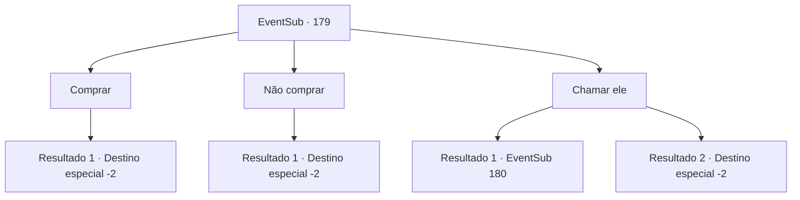

# Eventos secundários · 179

[Índice da tabela](index.md) · [Índice geral](../index.md)

ID: `pt:EventSub:179` · Fonte: `EventSub4` · Versão: 1.2.47.

Mapeamento estático dos arquivos; a disponibilidade e a execução dependem do estado da run.

## Texto do evento

*Sem texto no arquivo.*

## Dados de entrada

```json
{
  "id": 179,
  "grade": 1,
  "subEvent": "",
  "required": ""
}
```

## Mapa das escolhas



## Escolhas e resultados

### Escolha 1

Comprar

Requisitos e outros campos da escolha:

```json
{
  "required": "1_4_40"
}
```

#### Resultado 1.1

Você entrega a ele 40 ouro, antes que qualquer outra pessoa pudesse aproveitar a oferta. O dono sorri feliz, pega o dinheiro e lhe dá o snapper. Você coloca o snapper em sua bolsa e deixa o mercado.

Continuação registrada: [Destino especial `-2`](../destinos-especiais.md).

```json
{
  "required": "",
  "chance": "1",
  "nextEvent": -2,
  "type": 2,
  "reward": "12_6_-1|0_4_-40|3_125_1"
}
```

### Escolha 2

Não comprar

Requisitos e outros campos da escolha:

```json
{
  "required": ""
}
```

#### Resultado 2.1

Você não é enganado pelos truques do dono, balançando a cabeça. O dono então fica bravo com você sem motivo, te expulsando.

Continuação registrada: [Destino especial `-2`](../destinos-especiais.md).

```json
{
  "required": "",
  "chance": "1",
  "nextEvent": -2,
  "type": 2,
  "reward": "12_6_-1"
}
```

### Escolha 3

Chamar ele

Requisitos e outros campos da escolha:

```json
{
  "required": ""
}
```

#### Resultado 3.1

Você o chama, dizendo a ele que os olhos do snapper estão muito embaçados. 

 "Bem, como diabos os olhos de peixe morto deveriam parecer então?"

 O dono grita com raiva para você, iniciando uma discussão, mas quando você começa a falar sobre leis comerciais, ele deixa você vencer. Ele te arrasta para o canto da loja, sussurrando baixinho. 

 "Você tem um olho muito bom. Vou vendê-lo por 20 ouros, pegue e me deixe."


Continuação registrada: [Evento 180](0180.md) na mesma tabela.

```json
{
  "required": "",
  "chance": "1|0_7_1",
  "nextEvent": 180,
  "type": 0,
  "reward": "12_6_-1"
}
```

#### Resultado 3.2

Você o chama, dizendo a ele que os olhos do snapper estão muito embaçados. 

 "Bem, como diabos os olhos de peixes mortos deveriam parecer então?"

 O dono grita furiosamente com você, colocando seu rosto irritado na sua frente. Sobrecarregado com sua atitude, você murmura por alguns segundos e foge apressadamente do mercado.

Continuação registrada: [Destino especial `-2`](../destinos-especiais.md).

```json
{
  "required": "",
  "chance": "8",
  "nextEvent": -2,
  "type": 1,
  "reward": "12_6_-1"
}
```

## Referências que chegam a este evento

- [Evento 178 · escolha 2 · resultado 1](0178.md#escolha-2)
