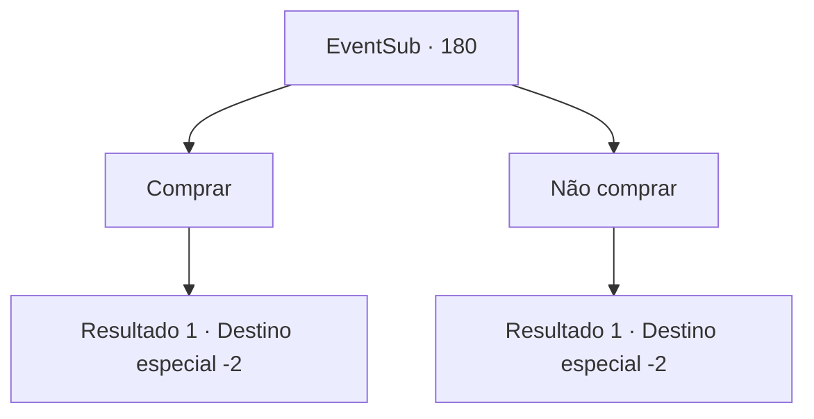

# Eventos secundários · 180

[Índice da tabela](index.md) · [Índice geral](../index.md)

ID: `pt:EventSub:180` · Fonte: `EventSub4` · Versão: 1.2.47.

Mapeamento estático dos arquivos; a disponibilidade e a execução dependem do estado da run.

## Texto do evento

*Sem texto no arquivo.*

## Dados de entrada

```json
{
  "id": 180,
  "grade": 1,
  "subEvent": "",
  "required": ""
}
```

## Mapa das escolhas



## Escolhas e resultados

### Escolha 1

Comprar

Requisitos e outros campos da escolha:

```json
{
  "required": "1_4_20"
}
```

#### Resultado 1.1

Você entrega a ele 20 ouro. O dono da loja pega o dinheiro com uma expressão perplexa no rosto e te entrega o snapper. Você coloca o snapper na sua bolsa e sai do mercado.

Continuação registrada: [Destino especial `-2`](../destinos-especiais.md).

```json
{
  "required": "",
  "chance": "1",
  "nextEvent": -2,
  "type": 2,
  "reward": "12_6_-1|0_4_-20|3_125_1"
}
```

### Escolha 2

Não comprar

Requisitos e outros campos da escolha:

```json
{
  "required": ""
}
```

#### Resultado 2.1

Você não é enganado pelos truques do dono, balançando a cabeça. O dono então fica bravo com você sem motivo, te expulsando.

Continuação registrada: [Destino especial `-2`](../destinos-especiais.md).

```json
{
  "required": "",
  "chance": "1",
  "nextEvent": -2,
  "type": 2,
  "reward": "12_6_-1"
}
```

## Referências que chegam a este evento

- [Evento 179 · escolha 3 · resultado 1](0179.md#escolha-3)
